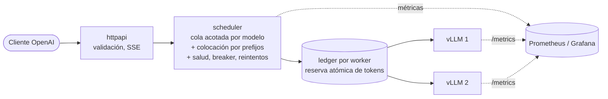

# Análisis final: razonamientos, evidencias y distancia a producción

Este documento resume **por qué el sistema es como es**, **qué se ha demostrado y con qué pruebas**, **cuáles son sus puntos fuertes y sus limitaciones**, y **qué faltaría para servir LLMs en producción con GPUs**. Sirve para defender el proyecto: cada afirmación enlaza con la decisión y la medición que la respaldan.

> **Fecha:** 2026-11-21, al cerrar la Fase 7 (Kubernetes en local). **Restricción del proyecto:** no se ha probado ni se probará en GPUs. Toda la evidencia viene del simulador, de un vLLM falso y de **vLLM 0.34 real en CPU** con un modelo de 0,5B parámetros.

## Índice

1. [El sistema en una página](#el-sistema-en-una-página)
2. [Los razonamientos que lo han traído hasta aquí](#los-razonamientos-que-lo-han-traído-hasta-aquí)
3. [La evidencia: qué se midió, dónde y con qué](#la-evidencia-qué-se-midió-dónde-y-con-qué)
4. [Lo que demostró vLLM real en CPU](#lo-que-demostró-vllm-real-en-cpu)
5. [Puntos fuertes](#puntos-fuertes)
6. [Limitaciones conocidas](#limitaciones-conocidas)
7. [Distancia a producción con GPUs](#distancia-a-producción-con-gpus)
8. [Qué haría a continuación](#qué-haría-a-continuación)
9. [Preguntas difíciles y cómo responderlas](#preguntas-difíciles-y-cómo-responderlas)
10. [Cómo reproducir las pruebas](#cómo-reproducir-las-pruebas)

---

## El sistema en una página

Un **control plane** en Go que recibe peticiones de chat con la API de OpenAI y las reparte entre **workers de inferencia**. Hoy los workers pueden ser el simulador, un vLLM falso o vLLM real. El control plane no ejecuta modelos: decide **cuándo** entra cada petición (admisión), **dónde** se ejecuta (colocación) y **qué hacer cuando algo falla** (resiliencia). vLLM hace todo lo que ocurre dentro de una GPU.



| Dato | Valor |
| :--- | :--- |
| Código | ~11 000 líneas de Go, una dependencia externa (`prometheus/client_golang`) |
| Tests | 119 funciones de test, `-race -count=5` en Go 1.23, estrés con caos, batería de contrato común a todos los workers, tests contra respuestas reales de vLLM |
| Fases | 1 Streaming y leases · 2 Colas y *load shedding* · 3 Routing por prefijos · 4 Resiliencia · 5 Observabilidad · 6a Adaptador vLLM · 6b-CPU vLLM real en CPU · 7 Kubernetes en local (Helm, autoscaling con KEDA) |
| Despliegue | Docker Compose (tres variantes) y un chart de Helm validado en minikube; CI en GitHub Actions (formato, vet, tests con `-race`, `helm lint`) |
| Documentación | Un documento de decisiones por fase (alternativas, opción elegida, por qué) y una limitación registrada (FI-n) por cada atajo consciente |

## Los razonamientos que lo han traído hasta aquí

Las decisiones que definen el sistema, cada una con su razón y su evidencia:

| Decisión | Razonamiento | Evidencia | Dónde |
| :--- | :--- | :--- | :--- |
| **Reservar capacidad antes de responder (lease atómico)** | En un LLM lo que se agota es la KV-Cache. "Mirar y luego enviar" sobrecompromete con concurrencia; reservar y comprobar en una sola operación no. Y reservar antes de escribir el `200` permite rechazar con un código HTTP correcto. | Ningún worker superó nunca su presupuesto en los tests de estrés (1 500 peticiones, con caos). | [08](servicio/08-fase-1-decisiones.md), [03](servicio/03-leases-y-capacidad.md), [09](servicio/09-fase-2-decisiones.md) |
| **Streaming-first y cancelación hasta el motor** | Casi todo el tráfico de un LLM es streaming, y cada petición abandonada que sigue generando ocupa memoria de la GPU para nada. Un único camino de ejecución (la respuesta sin streaming es el mismo stream acumulado) y el contexto de la petición hasta el worker. | La capacidad se libera al instante aunque el cliente esté atascado (tests). **Con vLLM real, cancelar detiene la generación en el motor** (6b-CPU). | [08](servicio/08-fase-1-decisiones.md), [02](servicio/02-recorrido-de-una-peticion.md#cancelación-el-cliente-se-va-a-mitad-de-respuesta) |
| **Capacidad en tokens, no en peticiones** | Un prompt de 8 000 tokens no ocupa lo mismo que uno de 100. | El presupuesto de cada worker vLLM se **descubre** de su KV-Cache real (87 296 tokens en CPU). | [03](servicio/03-leases-y-capacidad.md), [13](servicio/13-fase-6a-decisiones.md) |
| **Cola corta y acotada, y `503` en vez de cola infinita** | En inferencia la capacidad se libera continuamente: una cola corta absorbe picos, pero una infinita convierte la sobrecarga en latencias de minutos para todos. | Con una sobrecarga deliberada de 2×, la cola absorbió lo que pudo y rechazó pronto el resto (Fase 2). | [09](servicio/09-fase-2-decisiones.md) |
| **Admisión y colocación separadas** | "Cuándo" y "dónde" cambian por motivos distintos. | La Fase 3 (routing por prefijos) y la Fase 4 (salud) se añadieron sin tocar la cola. | [09 · Decisión 3](servicio/09-fase-2-decisiones.md#decisión-3-separar-admisión-y-colocación) |
| **Routing por afinidad de prefijo con umbral de carga** | vLLM reutiliza la KV-Cache de prefijos ya calculados, pero solo dentro de su GPU: el router debe enviar cada petición al worker que ya tiene su prefijo, sin saturar ese worker con un prefijo popular. | Simulador: TTFT p50 de 206 a 57 ms. **vLLM real en CPU: de 24 s a 4,7 s, y acierto de caché del 53 % al 75 %.** | [10](servicio/10-fase-3-decisiones.md), [resultados](operaciones/04-resultados-de-pruebas.md#fase-6b-cpu-benchmark-con-vllm-real-en-cpu) |
| **Un radix tree que imita la caché con una LRU propia** | El router no ve lo que vLLM expulsa. Con una sola réplica ve todo el tráfico de cada worker, así que su LRU recibe la misma secuencia de usos. | Acierto previsto frente a real: 73,8 % y 74,5 % en el simulador; **75,7 % y 75,0 % con vLLM real**. | [10 · Decisión 4](servicio/10-fase-3-decisiones.md#decisión-4-cómo-se-aproxima-la-caché-real-fi-6-primera-parte) |
| **Healthchecks, breaker y un reintento antes del primer token** | Con GPUs los fallos son normales. Antes del primer token el cliente no ha recibido nada, así que reintentar es invisible y seguro; después, no. | Un worker caído o colgado durante la prueba: **0 errores con reintentos** frente a 4–10 `503` sin ellos. | [resultados](operaciones/04-resultados-de-pruebas.md#fase-4-fallos-con-loadgen--chaos-simulador) |
| **La latencia alta solo desprioriza; no aísla** | La ITL sube con la carga de forma legítima. Aislar por latencia puede ir dejando sin servicio un worker tras otro. | Diseño. | [11 · Decisión 3](servicio/11-fase-4-decisiones.md#decisión-3-aislamiento-con-circuit-breaker-la-latencia-solo-desprioriza) |
| **Dos TTFT: el del cliente y el del worker** | Sin separarlos, un TTFT alto no dice si falta capacidad (cola) o si el motor es lento (prefill). | El dashboard diagnosticó un worker colgado como "problema de cola" en una captura real. | [observabilidad](operaciones/03-observabilidad.md#ejemplo-de-lectura-un-worker-colgado) |
| **Un contrato `Worker` y un ledger compartido** | Cambiar el motor no debe tocar el control plane, y la parte delicada en concurrencia debe existir una sola vez. | Simulador y adaptador pasan la **misma batería de contrato**. Pasar a vLLM real no cambió ni el scheduler ni la API. | [13](servicio/13-fase-6a-decisiones.md) |
| **Probar contra un falso, y después contra vLLM real** | Un falso permite probar fallos y cubrir todo el código sin coste, pero puede imitar lo que *creemos* que hace vLLM. | vLLM real confirmó los formatos y destapó seis diferencias que el falso no podía revelar. | [13](servicio/13-fase-6a-decisiones.md), [14](servicio/14-fase-6b-cpu-decisiones.md) |
| **Autoscaling por demanda en tokens, con KEDA en lugar de un operador propio (Fase 7)** | La CPU de un worker de inferencia no dice nada de su capacidad; lo que la plataforma sabe es cuántos tokens hay reservados y en cola. KEDA convierte esa consulta de Prometheus en réplicas sin escribir CRDs ni reconciliación. | En minikube: de 1 a 4 vLLM falsos en ~40 s y vuelta a 1 en ~50 s; con carga cubrible, 95 % `200` y **0 errores en stream**, también al borrar un pod con streams en curso. | [resultados](operaciones/04-resultados-de-pruebas.md#fase-7-kubernetes-en-minikube) |
| **Descubrimiento por DNS y una sola réplica con `Recreate` (Fase 7)** | Un Service *headless* da una IP por pod listo: cero dependencias y cero permisos, reutilizando el conector de la 6a. `Recreate` garantiza que nunca hay dos *ledgers* a la vez (FI-2), a cambio de un corte breve en cada despliegue. | Las bajas drenan los streams en curso; los 10 s en que el DNS va por detrás los cubre el reintento antes del primer token (8 reintentos, 0 errores). | [15](servicio/15-fase-7-decisiones.md) |
| **Sencillez frente a perfección (6b-CPU)** | El objetivo es un sistema funcional que se pueda defender, con sus inconvenientes documentados, no uno perfecto. | De once decisiones de la 6b-CPU se aplicaron ocho; las otras tres quedaron como limitaciones conocidas. | [14 · Qué sí y qué no](servicio/14-fase-6b-cpu-decisiones.md#qué-sí-y-qué-no) |

## La evidencia: qué se midió, dónde y con qué

**Importante para defenderlo:** cada cifra lleva su entorno. Las del simulador validan la lógica, no el rendimiento; las de CPU son reales pero **relativas**.

| Fase | Qué se midió | Entorno | Resultado |
| :--- | :--- | :--- | :--- |
| 2 | Comportamiento bajo una sobrecarga deliberada de 2× | Simulador | La cola absorbe picos y rechaza pronto (49 % `200`, 39 % `queue_full`) en lugar de alargar la latencia de todos. |
| 3 | Router por prefijos frente a round-robin | Simulador | TTFT p50 de 206 a 57 ms; acierto del 40 % al 75 %; un prompt muy popular se replicó solo en los 3 workers tras 2 desbordamientos. |
| 4 | Worker caído y worker colgado durante una prueba | Simulador | Con reintentos, 100 % `200`; sin ellos, hasta un 5,5 % de `503`. |
| 4 | Estrés con caos (1 500 peticiones, fallos aleatorios) | Simulador | Ningún presupuesto superado, sin fugas, un resultado por petición. |
| 5 | Cada consulta del dashboard tras pruebas con caos | Stack local | La validación encontró y corrigió 4 errores que los tests no veían (por ejemplo, la anotación de la primera apertura del breaker). |
| 6a | Batería de contrato, integración y estrés con caos por la red | vLLM falso | 400 peticiones contra 3 vLLM falsos que fallan, se cuelgan y se reinician, sin fugas ni sobrecargas. |
| 6b-CPU | Formatos, errores, métricas y cancelación | **vLLM 0.34 real** | Coinciden con lo supuesto; la prueba de humo (`TestRealVLLM`) pasa. |
| 6b-CPU | Router frente a round-robin | **vLLM real, 2 instancias** | TTFT p50 de 24 s a 4,7 s; acierto real del 53 % al 75 %. |
| 6b-CPU | Reserva del ledger frente a la KV-Cache real (FI-1) | **vLLM real** | El ledger reserva ~3 veces lo que se usa (29,5 % frente a 9,6 % de media). |
| 6b-CPU | Error de la estimación de tokens (FI-3) | **vLLM real** | Prompts largos: −5 %. Prompts cortos: −28 tokens fijos (la *chat template*). |
| 7 | Autoscaling con sobrecarga (más demanda que 4 réplicas) | minikube, vLLM falso | De 1 a 4 réplicas en ~40 s, vuelta a 1 en ~50 s; el exceso se rechaza con `503` (25 %), como diseñó la Fase 2. |
| 7 | Carga cubrible y un pod borrado en mitad de streams | minikube, vLLM falso | 95,2 % `200`, 0,4 % `503`, **0 errores en stream**; 8 peticiones reintentadas en otro worker, todas con éxito. |
| 7 | Puerto de administración (FI-10) | minikube | `/metrics` y `/debug/*`: `404` en el Service público, `200` en el de administración. |

## Lo que demostró vLLM real en CPU

Resumen; el detalle está en [14](servicio/14-fase-6b-cpu-decisiones.md).

**Viabilidad:** la imagen `vllm/vllm-openai-cpu:v0.34.0-x86_64` funciona en una CPU de portátil con AVX2 (sin AVX-512), con `Qwen2.5-0.5B-Instruct` en `float32`. Tarda ~6 minutos en arrancar y genera ~4 tokens/s.

**Qué confirmó:**

- El adaptador habla bien con vLLM: el stream SSE, `usage`, los errores, `/v1/models` y los nombres de las métricas coinciden con lo supuesto. Las respuestas reales están guardadas como *fixtures* de los tests (cierra FI-4).
- El adaptador descubre la capacidad real de la KV-Cache y registra cada servidor cuando termina de cargar.
- Cancelar una petición detiene la generación en vLLM.
- **El routing por prefijos funciona con un motor real** y el radix tree predice bien la caché real.

**Qué destapó** (y cómo quedó):

| Hallazgo | Estado |
| :--- | :--- |
| vLLM recorta `max_tokens` en vez de rechazar; nosotros rechazábamos | **Corregido:** la plataforma recorta igual. |
| El timeout de primer token convertía prefills lentos de CPU en "cuelgues" | **Mitigado:** flag `-ttft-timeout-per-token` y perfil de CPU. |
| El log contaba chunks en lugar de tokens reales | **Corregido.** |
| En CPU el bloque de KV-Cache es de 128 tokens y el router piensa en 16 | **Aceptado** como limitación: medido, no afecta a la predicción. |
| La estimación ignora la *chat template* | **Aceptado** como limitación: el recorte y el `400` de vLLM cubren los casos límite. |
| vLLM no cuenta las desconexiones como `abort` | **Documentado:** la cancelación se comprueba de otra forma. |

**El inconveniente principal del benchmark:** entre un 23 % y un 29 % de `503` en los dos modos. El ledger limita la concurrencia por **memoria** y en CPU el cuello de botella es el **cálculo**. Varios prefills simultáneos se ralentizaron, superaron el timeout, se trataron como cuelgues y abrieron el breaker. Está documentado y no se ha corregido (ver [limitaciones](#limitaciones-conocidas)).

## Puntos fuertes

1. **La forma del sistema es la correcta.** Admisión antes de responder, capacidad en tokens, routing según la KV-Cache, cancelación hasta el motor y separación entre control plane y motor. Son las mismas ideas que usan los proyectos de producción de este espacio (el router del *production-stack* de vLLM, llm-d, AIBrix), aunque con mucha menos superficie.
2. **Cada decisión está razonada y es rastreable.** Un documento por fase con alternativas, conflictos entre decisiones y la opción elegida, y una limitación registrada por cada atajo consciente.
3. **Cada afirmación tiene su medición**, con el entorno indicado.
4. **Los mecanismos difíciles están probados con carreras y caos:** el ledger, la cola, el breaker y los reintentos, con `-race`, estrés con fallos aleatorios e invariantes comprobadas al final.
5. **El contrato del worker aguantó el cambio de motor.** Pasar del simulador a vLLM real no cambió el scheduler ni la API, solo añadió un adaptador.
6. **Se ve lo que pasa.** Métricas con dos TTFT, logs por petición con un único `outcome` y un dashboard que diagnostica problemas reales.
7. **Las pruebas con vLLM real son repetibles:** `task vllm-cpu:up`, `task vllm-cpu:smoke` y respuestas reales como *fixtures*.
8. **Se despliega y escala en Kubernetes con un comando** (`task k8s:up`): el chart, el descubrimiento por DNS y el autoscaling por demanda en tokens están validados en minikube, y la CI comprueba tests, carreras y chart en cada cambio.

## Limitaciones conocidas

| Limitación | Gravedad para producción | Estado |
| :--- | :--- | :--- |
| **FI-1: reserva pesimista.** El ledger reserva el peor caso y cobra el prompt entero aunque esté en caché. | **Alta:** en GPU significa pagar ~3 veces más hardware del necesario (medido en CPU). | Medida; sin corregir. |
| **FI-2: una sola réplica del control plane.** El estado vive en memoria. | **Alta:** punto único de fallo; sin alta disponibilidad, y un corte breve en cada despliegue (`Recreate`). | Abierta; hecha explícita en el despliegue (Fase 7). |
| **Sin autenticación de clientes ni cuotas; el puerto de administración solo lo protege la red del clúster.** | **Alta** si se expone. | FI-10 resuelta en la Fase 7 (`-admin-addr`); autenticación y cuotas, abiertas. |
| **Las bajas de pods abren el breaker durante la ventana del DNS** (hasta 10 s). | Baja: el reintento antes del primer token lo hace invisible (medido). | Aceptada (Fase 7). |
| **Concurrencia limitada por memoria, no por cálculo.** | Media: grave en CPU; en GPU la memoria suele ser el límite real, pero las ráfagas de prefill también compiten. | Documentada. |
| **El timeout de primer token no distingue un worker lento de uno colgado.** | Media: con picos de carga puede aislar workers sanos. | Documentada; hay que calibrarlo por hardware. |
| FI-3: estimación de tokens sin tokenizer real | Baja: −5 % en prompts largos. | Medida; aceptada. |
| El router no conoce el bloque de 128 tokens del motor | Baja: medido sin efecto en la predicción. | Aceptada. |
| Funciones del API rechazadas: multimodal, *tool calls*, logprobs, `n` > 1; solo `/v1/chat/completions` | Media: depende de los clientes. | Fuera de alcance, con `400` explícito. |
| Escala del control plane sin medir (dispatcher único, lock global del scheduler) | **Desconocida.** | Nunca se ha probado por encima de decenas de peticiones por segundo. |

Resueltas por el camino: FI-4 (métricas de vLLM), FI-5 (roadmap), FI-6 (diseño del árbol, validado), FI-7 (petición completa), FI-8 (tokens reales), FI-9 (cabeceras con el primer token) y FI-10 (puerto de administración separado).

## Distancia a producción con GPUs

**No son retoques:** quedan cuatro bloques de trabajo de fondo y una validación imprescindible. La Fase 7 redujo el bloque de despliegue, pero no los otros.

| Bloque | Qué hay | Qué falta |
| :--- | :--- | :--- |
| **Modelo de capacidad (FI-1)** | Ledger pesimista y el dato de cuánto sobra (~3×) | Reservar con salidas esperadas o con *overbooking* usando la ocupación real y la *preemption* de vLLM como red de seguridad; descontar los prefijos en caché. Es el bloque que más coste cambia en GPU. |
| **Alta disponibilidad (FI-2)** | Una réplica; el registro de workers con bajas que drenan | Repartir los workers entre réplicas (hash consistente) o un *sidecar* de admisión por GPU; leases que se recuperan si cae la réplica. |
| **Seguridad y multi-cliente** | Validación de peticiones, `X-Request-Id` y puerto de administración separado (FI-10) | Autenticación, cuotas y límites por cliente, prioridades, TLS e Ingress. |
| **Despliegue y operación** | Chart de Helm, descubrimiento por DNS, autoscaling por demanda con KEDA, bajas que drenan, CI (Fase 7, en minikube y con vLLM falso) | Actualizaciones sin corte (depende de FI-2), escalar nodos de GPU y no solo pods, pesos de decenas de GB y arranques de minutos (el autoscaling reactivo llega tarde: hace falta capacidad de reserva o predicción), imágenes en un registro, Alertmanager, trazas, persistencia de Prometheus. |
| **Validación en GPU y a escala** | Todo medido en simulador y en CPU | Calibrar timeouts, capacidad y umbrales con números reales; medir el control plane con miles de peticiones por segundo; repetir el benchmark del router. |

**Qué se trasladaría a GPU y qué no:**

| Se trasladaría | No se trasladaría |
| :--- | :--- |
| La arquitectura, el contrato, el adaptador (habla la API real de vLLM) y el descubrimiento de capacidad | Las cifras absolutas: latencias, tokens/s |
| La dirección del efecto del router: acertar en caché ahorra prefill | El tamaño del efecto: en GPU el prefill es mucho más barato, así que la ganancia será menor que el ×5 de CPU |
| El sobrecoste del ledger pesimista, que es estructural | El problema de "memoria frente a cálculo", que debería ser menor: en GPU la KV-Cache suele ser el recurso que se agota, justo lo que modela el ledger (por confirmar) |
| La resiliencia y la observabilidad | Los valores de los timeouts (perfil de CPU) |

**Modelos más grandes:** lo que hay que hacer para servirlos (repartirlos entre varias GPUs, gestionar la memoria, el *batching*) lo hace vLLM, no la plataforma. Para el control plane, un worker sigue siendo un servidor vLLM, tenga una GPU u ocho. Lo que cambia es la operación: arranques de muchos minutos, pocas réplicas caras y fallos más costosos. Ahí pesan los bloques de capacidad, alta disponibilidad y despliegue.

**Sobre el autoscaling con GPUs:** el mecanismo (demanda en tokens → réplicas) se traslada; los tiempos no. Con vLLM falso un pod está listo en segundos; con GPUs, un vLLM real tarda minutos en descargar y cargar el modelo, y un nodo de GPU nuevo aún más. Escalar cuando la cola ya crece llega tarde: en producción se combina con un mínimo de réplicas de reserva, umbrales más bajos o escalado programado. Y cuando FI-1 se resuelva, la señal debería pasar a la ocupación real de la KV-Cache.

**Veredicto:** un prototipo sólido con la arquitectura correcta y cada decisión defendible con datos, que ya se despliega y escala en Kubernetes. Como sistema de producción le sigue faltando mucho: el modelo de capacidad, la alta disponibilidad, la seguridad y la validación en GPU.

## Qué haría a continuación

1. **Modelo de capacidad (FI-1)**, porque es lo que más coste cambia en GPU y ya hay datos para diseñarlo.
2. **Alta disponibilidad (FI-2)**: repartir los workers entre réplicas o un *sidecar* de admisión por GPU. Es lo que permitiría quitar `Recreate` y desplegar sin corte.
3. **Validación en GPU**, si algún día es posible. Sin ella, cualquier afirmación de "listo para producción" sería una suposición.

## Preguntas difíciles y cómo responderlas

| Pregunta | Respuesta |
| :--- | :--- |
| *"Si nunca lo habéis probado en GPU, ¿cómo sabéis que funciona?"* | La **lógica** está probada con carreras y caos, y la **integración con vLLM real** está verificada (formatos, errores, métricas, cancelación) contra la versión fijada. Lo que no sabemos son las **cifras** de rendimiento en GPU, y no las afirmamos. |
| *"¿Por qué no usar directamente el router de vLLM o llm-d?"* | En producción sería la opción razonable. Este proyecto construye esas piezas para entender y defender cada decisión (admisión, capacidad, routing, resiliencia) con alternativas y mediciones; el diseño acaba muy cerca del de esos proyectos. |
| *"El benchmark en CPU tuvo un 23–29 % de errores. ¿No invalida el resultado?"* | No invalida la comparación: los dos modos tuvieron la misma configuración, y round-robin falló más (50 fallos frente a 24) porque fallaba más la caché y hacía más prefills lentos. Sí revela una limitación real, la concurrencia limitada por memoria y no por cálculo, que está documentada con su mitigación. |
| *"¿Por qué reservar el peor caso si desperdicia ~3×?"* | Porque es **atómico y seguro** sin ayuda del motor, y nunca provoca *preemption*. Fue un atajo consciente (FI-1), y ahora está medido. El siguiente paso es el *overbooking* con la ocupación real como red de seguridad. |
| *"¿Por qué una sola réplica?"* | La atomicidad de la reserva depende de que un solo proceso sea la puerta de entrada a cada worker; vLLM no tiene API de reserva. Es FI-2, con opciones analizadas (particionar los workers, estado compartido, *sidecar*). Es el bloque de alta disponibilidad pendiente. |
| *"El router en CPU da ×5. ¿En GPU será igual?"* | No: será menor, porque en GPU el prefill es mucho más barato. Lo que se traslada es la dirección del efecto y que el árbol predice la caché real (a menos de un punto). |
| *"¿Por qué estimar tokens en vez de tokenizar?"* | Tokenizar exige el tokenizer de cada modelo o una llamada al motor antes de elegir worker. La estimación erró un 5 % en prompts largos y la respuesta usa los tokens reales del motor. El caso débil (prompts cortos) está medido y aceptado. |
| *"¿Qué pasa si se cae un worker en mitad de un stream?"* | Antes del primer token se reintenta en otro sin que el cliente lo note; después, el error va dentro del stream. El breaker aísla el worker y lo vuelve a probar después de una espera. Medido: 0 errores visibles con un worker caído antes del primer token. |
| *"¿Cómo sabéis que el falso no os engañó?"* | Por eso existe la 6b-CPU: las respuestas reales de vLLM están en los tests y la prueba de humo corre contra vLLM real. Encontró seis diferencias, y todas están corregidas o documentadas. |
| *"¿Qué es lo primero que cambiaríais para producción?"* | El modelo de capacidad (FI-1), y en paralelo la alta disponibilidad (FI-2) y la seguridad (autenticación y cuotas). |
| *"¿Por qué KEDA y no un operador propio, como decía el roadmap?"* | Un operador (CRD, reconciliación, RBAC, `client-go`) es mucho código para lo mismo: convertir una métrica en réplicas. KEDA lo hace con un `ScaledObject` sobre nuestras propias métricas. Lo que sí es nuestro es la **señal**: la demanda en tokens que ve la plataforma, no la CPU. |
| *"¿Por qué escaláis por tokens reservados y no por `kv_cache_usage_perc` de vLLM?"* | Porque la cola de la plataforma solo crece cuando el ledger está lleno, y el ledger reserva el peor caso (FI-1). Escalar por demanda (reservado + en cola) es coherente con lo que la plataforma admite y funciona igual con el simulador, el falso o vLLM real. Si la reserva dejara de ser pesimista, la ocupación real sería la señal correcta. |
| *"¿Qué pasa con los streams cuando el autoscaler quita un pod?"* | El pod deja de anunciarse sano y termina sus streams antes de salir; la plataforma lo drena al verlo desaparecer del DNS. Medido: workers dados de baja con un stream en curso lo terminaron sin cortes, y las conexiones que llegaron durante la ventana del DNS se reintentaron en otro worker (0 errores). |
| *"¿Por qué una réplica con `Recreate` en Kubernetes, si se puede tener alta disponibilidad?"* | Porque con `RollingUpdate` habría dos *ledgers* a la vez durante cada despliegue, cada uno creyéndose la única puerta de entrada (FI-2). Preferimos un corte de segundos, explícito y documentado, a sobrecomprometer la KV-Cache en silencio. |

## Cómo reproducir las pruebas

```bash
task check            # formato, vet y tests
task test:race        # -race -count=5 en Go 1.23 (Docker)

task run -- -placement prefix -prefill-per-token 100us        # Fase 3 con el simulador
task loadgen -- -rate 4 -duration 60s -prefixes 24 -rag-fraction 0 -cancel-fraction 0

task stack:up         # observabilidad con el simulador: Grafana en :3000
task stack:up:fake-vllm
task stack:up:vllm-cpu                                        # vLLM real en CPU (~6 min)
task vllm-cpu:up && task vllm-cpu:smoke                       # prueba de humo del adaptador

VLLM_KV_BYTES=201326592 task stack:up:vllm-cpu:2              # benchmark de la 6b-CPU (ver operaciones/04)
task stack:down

task k8s:up                                                   # Fase 7: minikube + KEDA + chart (ver operaciones/01)
task k8s:port-forward                                         # API :8080, Grafana :3000, admin :18081
cd platform && go run ./cmd/loadgen -admin-url http://localhost:18081 -rate 1.5 -duration 180s -prefixes 8
task k8s:status && task k8s:down
```
