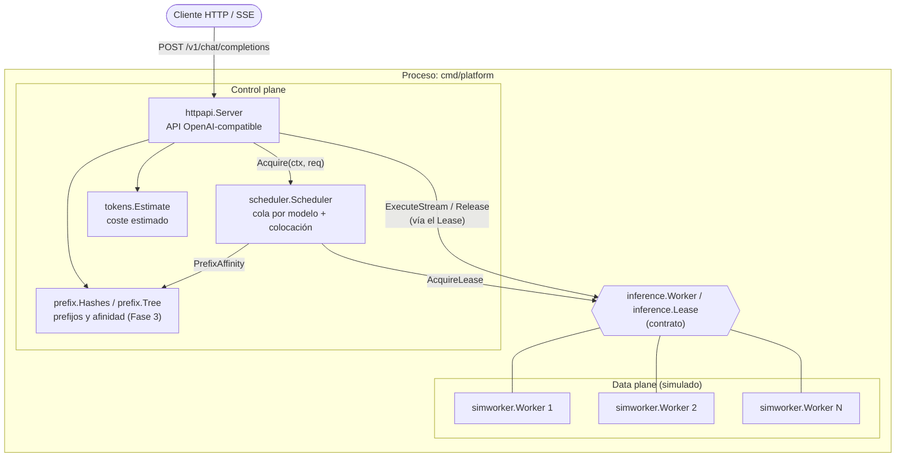
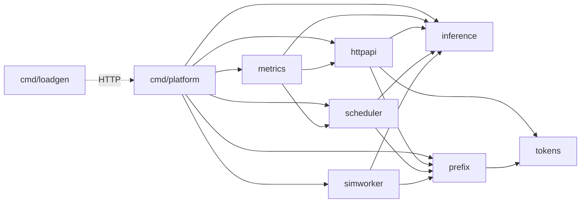

# 1. Arquitectura y componentes

## Un binario, dos planos

Hoy todo corre en **un único proceso Go** (`cmd/platform`). Aun así, el código ya está separado según los dos planos de la arquitectura final, de forma que cada pieza pueda salir a su propio proceso (o ser sustituida por vLLM) sin tocar las demás:



La frontera importante es el **contrato `inference`**: el control plane solo habla con interfaces (`Worker`, `Lease`), nunca con `simworker` directamente. En la Fase 6, un `VLLMAdapter` implementará esas mismas interfaces haciendo llamadas HTTP a un servidor vLLM, y el resto del código no cambiará.

## Paquetes

Todo el código vive en `platform/`, el módulo Go `llm-inference-platform`:

```text
platform/
├── go.mod
├── cmd/platform/          wiring: flags, creación de workers, servidor HTTP, apagado ordenado, /debug de administración
├── cmd/loadgen/           generador de carga contra un servidor en marcha (solo HTTP)
└── internal/
    ├── inference/         contrato core (sin dependencias internas)
    ├── tokens/            estimación de tokens
    ├── prefix/            hashes de prefijo por bloque y radix tree de prefijos (Fase 3)
    ├── simworker/         implementación simulada de Worker/Lease, con fallos inyectables
    ├── scheduler/         admisión, colocación, registro de workers, salud, breaker y reintentos
    ├── httpapi/           API HTTP OpenAI-compatible, SSE
    └── metrics/           métricas Prometheus: implementa los observadores y lee el estado (Fase 5)
```

El resto del repositorio (README, `docs/`, `Taskfile.yml`) queda fuera del módulo. Así, los componentes futuros (Helm charts, Dockerfiles, el operador de Kubernetes) pueden tener su propia carpeta junto a `platform/`.

Grafo de dependencias (las flechas son *imports*). No hay ciclos y `inference` no depende de nadie:



Nótese que **`httpapi` no importa `scheduler`**: depende de una interfaz pequeña definida en el propio paquete (`httpapi.Scheduler` con `Acquire`, `Models`, `Snapshots`). Es el patrón Go de "la interfaz la define quien la consume", y permitió sustituir el `Pool` de la Fase 1 por el scheduler de la Fase 2, y añadir el router por prefijos de la Fase 3, sin tocar la API.

### `internal/inference` — el contrato

Define los tipos que cruzan la frontera control/data plane:

| Tipo | Papel |
| :--- | :--- |
| `InferenceRequest` | Unidad de trabajo: `ID`, `Model`, `Prompt`, `PromptTokens` (estimados), `MaxNewTokens` y, desde la Fase 3, `PrefixHashes` (hashes encadenados de los bloques del prompt; opcional). `TokenCost()` = `PromptTokens + MaxNewTokens`. |
| `TokenChunk` | Un trozo de salida: `Index`, `Text`, `FinishReason` (solo en el último). |
| `Worker` | `ID`, `Models`, `AcquireLease`, `Snapshot`, `CapacityChanged` (Fase 2, señal agrupada de capacidad liberada) y `Health` (Fase 4, devuelve un `HealthStatus` con el `InstanceID` del proceso). |
| `Lease` | `WorkerID`, `ExecuteStream`, `Release`. |
| `WorkerSnapshot` | Vista informativa del estado de un worker (presupuesto, reservado, leases y, si tiene caché de prefijos, su tamaño y sus aciertos). |
| Errores | `ErrAtCapacity`, `ErrRequestTooLarge`, `ErrModelNotServed`, `ErrModelNotFound`, `ErrInvalidRequest`, `ErrLeaseUsed`, `ErrLeaseReleased`, `ErrLeaseExpired`, `ErrQueueFull`, `ErrQueueTimeout` y, desde la Fase 4, `ErrWorkerFailure` (fallo del propio worker, no de la petición) y `ErrNoHealthyWorkers`. |
| `RetryAfterError` | Envuelve un error de cola con el `Retry-After` que calcula el scheduler; se lee con `errors.As`. |
| `StartStream` | Helper que ejecuta `ExecuteStream` en una goroutine y devuelve un canal que se cierra al terminar más una función `wait()` con el error. |

Los errores son *sentinels* que se envuelven con `fmt.Errorf("%w", ...)`; todo el código los compara con `errors.Is`. Esto permite añadir contexto (`"w1: at capacity"`) sin romper la clasificación que hace la API para elegir el código HTTP.

El detalle del contrato está en [03 · Leases y capacidad](03-leases-y-capacidad.md).

### `internal/tokens` — estimación

`Estimate(text)` devuelve `ceil(runas / 4)`. No hay tokenizer real en el control plane; la estimación solo sirve para la admisión. Su margen de error está registrado en **FI-3**.

### `internal/prefix` — prefijos compartidos (Fase 3)

- `Hashes(model, prompt)` corta el prompt en bloques de `BlockTokens` = 16 tokens estimados (64 caracteres) y devuelve un hash encadenado por bloque completo: el hash del bloque *i* identifica todo el prefijo hasta él.
- `Tree` es un radix tree sobre esas secuencias que recuerda qué workers tienen qué prefijos, con una capacidad LRU por worker. Es la aproximación del router a las cachés reales de los workers.

No depende del scheduler ni de los workers (solo de `tokens`), así que se prueba aislado. Ver [09 · Fase 3](09-fase-3-routing-por-prefijos.md).

### `internal/simworker` — el data plane simulado

Implementa `Worker` y `Lease` con un presupuesto de tokens protegido por un mutex y un generador de tokens con latencias artificiales. Desde la Fase 3 tiene además una caché de prefijos simulada que acorta el TTFT. Ver [04 · Worker simulado](04-worker-simulado.md).

### `internal/scheduler` — admisión, colocación y ciclo de vida (Fases 2 a 4)

Desde la Fase 2 el scheduler tiene dos mitades detrás de la misma `Acquire` ([08 · Decisión 3](08-fase-2-decisiones.md#decisión-3-separar-admisión-y-colocación)):

| Pieza | Responde a | Implementación |
| :--- | :--- | :--- |
| **Admisión** (`scheduler.go`) | *Cuándo* puede intentar una petición | Una cola FIFO por modelo, límites, timeout y un dispatcher único. |
| **Colocación** (`placement.go`, `affinity.go`) | *Dónde* se ejecuta | Interfaz `Placement`. `RoundRobin` (Fase 2): first-fit desde un desplazamiento rotatorio. `PrefixAffinity` (Fase 3, la que usa el binario): primero los workers que tienen el prefijo más largo y no están cargados, luego el resto del menos al más cargado. Ver [09](09-fase-3-routing-por-prefijos.md). |

`Acquire(ctx, req)`:

1. **Comprobaciones estáticas, sin esperar:** petición inválida → `ErrInvalidRequest` (400); ningún worker sirve el modelo → `ErrModelNotFound` (404); el coste supera el presupuesto del mayor worker del modelo → `ErrRequestTooLarge` (400).
2. **Camino rápido:** si la cola del modelo está vacía, la colocación intenta un lease y, si lo obtiene, la petición entra sin esperar. Si la cola no está vacía no lo intenta: nadie se cuela delante de quien ya espera.
3. **Límites:** si la cola del modelo superaría `QueueTokenFactor` (2) × el presupuesto total de sus workers, o ya esperan `MaxQueuedRequests` (1024) peticiones en total → `ErrQueueFull` (503).
4. **Espera:** la petición entra en la cola hasta que el dispatcher le entregue un lease, como mucho `min(QueueTimeout, deadline del cliente)`. Si vence → `ErrQueueTimeout` (503). Si el cliente se va, sale de la cola sin reservar nada; si el lease llegó justo a la vez, lo libera.

El **dispatcher** es una única goroutine que escucha con `reflect.Select` las señales `CapacityChanged()` de todos los workers, las llegadas nuevas y un sondeo de seguridad (1 s). Cada despertar es **una pasada** por las colas, sin importar cuántas señales llegaron:

- Recorre la cola de cada modelo desde la cabeza (hasta `MaxScan` = 64 peticiones) e intenta colocar cada una.
- Si la cabeza no cabe pero es joven, las de detrás que sí caben la adelantan.
- Si la cabeza no cabe y supera `HeadMaxAge` (por defecto, la mitad del timeout), se activa la **barrera FIFO**: nadie más de ese modelo pasa hasta que ella entre.

Los rechazos por cola van envueltos en `inference.RetryAfterError`, con un `Retry-After` que sigue la espera reciente en cola (media exponencial), acotado entre 1 s y 30 s, más hasta 1 s de *jitter* para que los clientes no reintenten sincronizados.

| Situación | Error | HTTP |
| :--- | :--- | :--- |
| Ningún worker sirve el modelo (o no hay workers) | `ErrModelNotFound` | 404 |
| No cabe en ningún worker del modelo ni vacío | `ErrRequestTooLarge` | 400 |
| Petición inválida | `ErrInvalidRequest` | 400 |
| Cola del modelo llena o tope global alcanzado | `ErrQueueFull` | 503 `queue_full` |
| Sin capacidad dentro del timeout de cola | `ErrQueueTimeout` | 503 `queue_timeout` |
| El cliente se fue mientras esperaba | error del contexto | — |

**Por qué "intentar reservar" en vez de "mirar y luego elegir":** leer `Snapshot()` de todos, elegir el más libre y luego reservar abre una condición de carrera (dos peticiones ven el mismo hueco). Con `AcquireLease` la comprobación y la reserva son una sola operación atómica dentro del worker. La colocación solo *intenta*; nunca decide con datos que puedan estar obsoletos.

`Stats()` expone el estado de las colas en `GET /debug/scheduler` (y, con `PrefixAffinity`, sus contadores bajo `placement`); `Models()` y `Snapshots()` agregan la información de los workers para `/v1/models` y `/debug/workers`. `Close()` para el dispatcher.

#### Ciclo de vida de los workers (Fase 4)

Desde la Fase 4 el scheduler es también el **registro de workers** ([10](10-fase-4-decisiones.md)):

| Pieza | Fichero | Qué hace |
| :--- | :--- | :--- |
| Registro | `registry.go` | `AddWorker` / `RemoveWorker` en caliente. La baja **drena**: el worker deja de recibir peticiones y desaparece (también del radix tree) cuando termina su último stream. Los límites por modelo y la escucha del dispatcher se recalculan en cada cambio. |
| Salud | `registry.go` | Una goroutine por worker llama a `Health` cada 2 s (3 fallos seguidos → no sano; 2 éxitos → sano). Un `InstanceID` distinto significa que el worker se reinició: se olvidan sus prefijos. |
| *Circuit breaker* | `registry.go` | Por worker. Lo abren 5 fallos del worker seguidos o un healthcheck no sano. Tras 10 s (doble en cada reapertura, máximo 2 min) deja pasar **una** petición de prueba; si sale bien, se cierra. |
| Degradado | `registry.go` | Un worker con una ITL más de 2× la mediana de los demás solo se ofrece a la colocación si los otros no tienen sitio. |
| Lease gestionado | `lease.go` | El `Lease` que devuelve `Acquire` envuelve el del worker: mide la ITL, informa al breaker de cómo acabó cada stream, corta los cuelgues (sin primer token en 10 s + 1 ms por token de prompt, o sin token nuevo en 10 s) y, si el worker falla **antes del primer token**, reintenta una vez en otro worker. |

La colocación solo ve workers usables: activos, sanos y con el breaker cerrado (o semiabierto sin prueba en curso). Si un modelo tiene workers pero ninguno usable, `Acquire` devuelve `ErrNoHealthyWorkers` (`503`) sin encolar: la cola es para esperar capacidad, no recuperación.

| Situación (Fase 4) | Error | HTTP |
| :--- | :--- | :--- |
| Ningún worker usable del modelo | `ErrNoHealthyWorkers` | 503 `no_healthy_workers` |
| El worker falla antes del primer token, también tras el reintento | `ErrWorkerFailure` | 503 `worker_unavailable` |
| El worker falla a mitad de stream | `ErrWorkerFailure` | error en banda (el `200` ya se envió) |

El scheduler asume **una sola réplica del control plane** (decisión registrada en **FI-2**).

### `internal/httpapi` — la API

Traduce HTTP ⇄ contrato `inference`: valida el JSON, construye el `InferenceRequest`, pide un lease al scheduler, ejecuta el stream y lo escribe como SSE (o lo agrega en una respuesta JSON). Ver [02 · Recorrido de una petición](02-recorrido-de-una-peticion.md) y [05 · API HTTP](05-api-http.md).

### `cmd/platform` — el wiring

1. Lee los flags (ver tabla abajo).
2. Crea `-workers` instancias de `simworker.Worker` (`sim-worker-1..N`), todas sirviendo los mismos modelos y con el mismo presupuesto y caché de prefijos.
3. Crea la colocación elegida con `-placement`, un `scheduler.Scheduler` (que arranca su dispatcher) y el `httpapi.Server`; al salir, `Close()` para el dispatcher.
4. Arranca `http.Server` con `ReadHeaderTimeout: 10s` y **sin `WriteTimeout`** (un `WriteTimeout` cortaría cualquier stream SSE largo).
5. Al recibir `SIGINT`/`SIGTERM` llama a `Shutdown` con `-shutdown-grace`: deja de aceptar conexiones y espera a que terminen los streams en curso. Si se agota la gracia, `Close()` corta las conexiones restantes; eso cancela sus contextos y, por tanto, libera sus leases.

Además de las rutas de `httpapi`, `cmd/platform` sirve los endpoints de administración de los workers simulados (`admin.go`): `POST /debug/workers` (alta), `DELETE /debug/workers/{id}` (baja con drenaje), `POST /debug/workers/{id}/faults` (inyectar fallos) y `POST /debug/workers/{id}/restart`. Ver [05](05-api-http.md#administración-de-workers-simulados-fase-4).

Logs: JSON estructurado (`log/slog`) a stdout. El scheduler escribe con `component=scheduler`.

### `internal/metrics` — métricas Prometheus (Fase 5)

Es el único paquete, junto con `cmd/platform`, que importa `prometheus/client_golang`, la primera dependencia externa del módulo ([11 · Decisión 1](11-fase-5-decisiones.md#decisión-1-librería-de-métricas)). Combina dos mecanismos:

| Mecanismo | Para qué | Cómo |
| :--- | :--- | :--- |
| **Eventos** | Contadores e histogramas: cada petición, cada token, cada fallo, cada transición del breaker | `Metrics` implementa `httpapi.Observer` y `scheduler.Observer`, dos interfaces pequeñas definidas por quien las consume. Por defecto son vacías: el núcleo no sabe nada de Prometheus. |
| **Estado** | Gauges de lo que hay ahora: cola, reservado, salud, árbol de prefijos | Un *collector* lee `Scheduler.Stats()` y `Snapshots()` en cada *scrape*: los mismos datos que `/debug`, así que no pueden contradecirse. |

`cmd/platform` crea un `metrics.Metrics`, lo pasa como `Observer` a la API y al scheduler, llama a `Watch(sched)` y sirve `GET /metrics` en el mismo puerto (FI-10). El catálogo completo está en [12 · Observabilidad](12-observabilidad.md#catálogo-de-métricas).

| Flag | Por defecto | Qué controla |
| :--- | :--- | :--- |
| `-addr` | `:8080` | Dirección de escucha. |
| `-workers` | `3` | Número de workers simulados. |
| `-models` | `sim-llama-3-8b` | Modelos (separados por comas) que sirve cada worker. |
| `-token-budget` | `16384` | Capacidad de KV-Cache simulada por worker, en tokens. |
| `-ttft` | `50ms` | Latencia base hasta el primer token. |
| `-prefill-per-token` | `20µs` | Coste de prefill por token de prompt (se suma al TTFT). |
| `-itl` | `20ms` | Latencia entre tokens. |
| `-lease-ttl` | `5s` | Tiempo máximo entre `AcquireLease` y `ExecuteStream`. |
| `-mean-output-tokens` | `200` | Media de la longitud de salida simulada (exponencial, acotada por `max_tokens`); `0` = siempre `max_tokens`. |
| `-itl-load-factor` | `0.05` | Cuánto crece la ITL por cada lease activo adicional; `0` = ITL constante. |
| `-queue-timeout` | `5s` | Espera máxima en la cola (tráfico interactivo). |
| `-head-max-age` | `0` (= `queue-timeout/2`) | Edad a partir de la cual la cabeza de la cola no puede ser adelantada (barrera FIFO). |
| `-queue-token-factor` | `2` | Límite de la cola de cada modelo, en múltiplos del presupuesto total de sus workers. |
| `-max-queued` | `1024` | Tope global de peticiones esperando. |
| `-max-tokens-limit` | `4096` | `max_tokens` máximo aceptado. |
| `-placement` | `prefix` | Colocación: `prefix` (afinidad de prefijo, Fase 3) o `round-robin` (Fase 2). |
| `-affinity-max-load` | `0.8` | Carga del ledger a partir de la cual un worker deja de recibir peticiones solo por afinidad. |
| `-affinity-min-blocks` | `4` | Prefijo cacheado mínimo que cuenta como afinidad, en bloques de 16 tokens. |
| `-prefix-cache-blocks` | `-1` (= `token-budget/16`) | Caché de prefijos simulada por worker, en bloques; `0` la desactiva. |
| `-health-interval` | `2s` | Frecuencia de los healthchecks; negativo los desactiva. |
| `-breaker-failures` | `5` | Fallos del worker seguidos que abren su breaker. |
| `-breaker-cooldown` | `10s` | Espera en abierto antes de la petición de prueba (doble en cada reapertura, máximo 2 min). |
| `-ttft-timeout` | `10s` | Sin primer token en este tiempo (+1 ms por token de prompt): worker colgado. |
| `-stall-timeout` | `10s` | Sin token nuevo en este tiempo a mitad de stream: worker colgado. |
| `-max-retries` | `1` | Reintentos en otro worker si uno falla antes del primer token; `-1` los desactiva. |
| `-shutdown-grace` | `15s` | Gracia para los streams en curso al apagar. |

## Cómo se separará en procesos más adelante

| Hoy (en memoria) | Futuro |
| :--- | :--- |
| `simworker.Worker` en el mismo proceso | Pod de vLLM con GPU; `VLLMAdapter` en el control plane habla con él por HTTP (Fase 6). |
| Registro en el scheduler, alimentado por `main` y por `/debug/workers` (Fase 4) | Alimentado por el *watch* de los Endpoints de Kubernetes (Fase 7). |
| Healthchecks contra `simworker.Health` | `GET /health` de vLLM desde el `VLLMAdapter` (Fase 6). |
| `/metrics` y `/debug` en el puerto de la API | Puerto de administración solo accesible dentro del clúster (FI-10, Fase 7). |
| Stack local con `docker-compose` (`deploy/observability`) | Prometheus y Grafana del clúster; el dashboard JSON se reutiliza. |
| `PrefixAffinity` aproxima las cachés con su propio árbol LRU (Fase 3) | Corregirlo con eventos de KV-Cache de vLLM, si la versión fijada los publica (Fase 6). |
| Caché de prefijos simulada en `simworker` | *Automatic prefix caching* de vLLM; `PrefixHashes` deja de usarse en el worker. |
| Una réplica | Varias réplicas: ver **FI-2**. |
