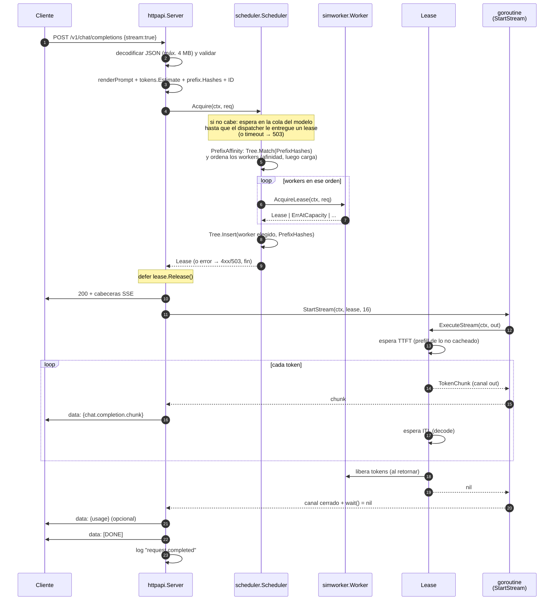

# 2. Recorrido de una petición

Este documento sigue una petición de chat desde que llega hasta que se libera su capacidad. Todo el código está en `internal/httpapi/server.go` (`handleChatCompletions`, `stream`, `collect`) salvo donde se indica.

## Vista general



## Fase A — Antes de escribir nada al cliente

### 1. Decodificación y validación

- El cuerpo se limita a `MaxBodyBytes` (4 MB) con `http.MaxBytesReader`.
- JSON inválido → `400`.
- `toInferenceRequest` valida:
  - `model` no vacío y `messages` con al menos un mensaje.
  - `max_tokens`: se toma `max_completion_tokens` si viene, si no `max_tokens`, si no `DefaultMaxTokens` (256). Debe estar entre 1 y `MaxTokensLimit` (4096). Fuera de rango → `400`.
  - Desde la Fase 6a: cada mensaje con `role` y con `content` de texto (un `content` en partes o nulo → `400` con mensaje claro), y los parámetros que la plataforma no sabría atender (`n` > 1, `best_of`, `logprobs`, `top_logprobs`, `tools`, `tool_choice`, `functions`…) → `400` con la lista. El resto de campos se reenvía al motor tal cual (`internal/httpapi/params.go`).

### 2. Construcción del `InferenceRequest`

| Campo | Origen |
| :--- | :--- |
| `ID` | `chatcmpl-` + 24 caracteres hex aleatorios (`crypto/rand`). Se usa en logs, en la cabecera `X-Request-Id` y en cada chunk. |
| `Model` | `model` del cuerpo. |
| `Prompt` | `renderPrompt`: cada mensaje como `role: content\n`. |
| `PromptTokens` | `tokens.Estimate(Prompt)` (~4 caracteres/token, FI-3). |
| `MaxNewTokens` | El `max_tokens` resuelto en el paso 1. |
| `Messages` | Los mensajes del cliente tal cual (Fase 6a): el adaptador de vLLM se los envía al motor, que aplica la *chat template* del modelo. |
| `Params` | Los campos que la plataforma no controla (`temperature`, `top_p`, `stop`, `seed`, `response_format`, extras de vLLM…), sin interpretar. |
| `PrefixHashes` | `prefix.Hashes(model, Prompt)`: un hash encadenado por cada bloque completo de 64 caracteres (16 tokens estimados). `nil` si el prompt es más corto. Se calcula aquí, una vez, porque la colocación puede intentarse muchas veces mientras la petición espera en la cola ([09 · Decisión 2](09-fase-3-routing-por-prefijos.md#decisión-2-dónde-se-calculan-los-hashes)). |

`renderPrompt` **no** es una *chat template* real: solo sirve para estimar el coste. Ver [06 · Relación con vLLM](06-relacion-con-vllm.md) para lo que implica.

### 3. Admisión: obtener un lease

`s.sched.Acquire(r.Context(), req)` intenta un lease y, si no hay capacidad, espera en la cola del modelo hasta que el dispatcher se lo entregue o venza el timeout (ver [01 · Arquitectura](01-arquitectura.md#internalscheduler--admisión-y-colocación-fase-2)). Durante la espera el cliente no recibe ningún byte.

Con la colocación por defecto del binario (`PrefixAffinity`, Fase 3), cada intento de colocación consulta el radix tree y prueba primero los workers que tienen el prefijo más largo de la petición y no están cargados, y después el resto del menos al más cargado. Al conceder el lease, el prefijo queda registrado para ese worker. Ver [09 · Cómo funciona](09-fase-3-routing-por-prefijos.md#cómo-funciona). Si falla, `writeAdmissionError` elige la respuesta:

| Error | Respuesta |
| :--- | :--- |
| El cliente ya se fue (`r.Context()` cancelado) | Nada (no hay a quién escribir). |
| `ErrModelNotFound` | `404`, `code: model_not_found` |
| `ErrRequestTooLarge` | `400`, `code: context_length_exceeded` |
| `ErrInvalidRequest` | `400` |
| `ErrQueueFull` | `503`, `code: queue_full`, `Retry-After` calculado por el scheduler |
| `ErrQueueTimeout` | `503`, `code: queue_timeout`, `Retry-After` calculado por el scheduler |
| `ErrAtCapacity` | `503`, `code: at_capacity` (el scheduler de la Fase 2 ya no lo devuelve; se mantiene en el mapa) |
| Otro | `500` |

**Por qué la admisión va antes de las cabeceras:** una vez enviado `200 OK` ya no se puede cambiar el código de estado. Reservar primero permite rechazar con un `503` limpio que clientes, balanceadores y herramientas de benchmark entienden y reintentan. Es la decisión "Leases atómicos" de la tabla §2 del README raíz.

Con el lease concedido:

```go
defer lease.Release()                         // red de seguridad: siempre se libera
ctx, cancel := context.WithCancel(r.Context()) // se cancela si el cliente se va o si falla una escritura
defer cancel()
```

## Fase B — Streaming (`stream: true`)

### 4. Cabeceras

**Desde la Fase 4, las cabeceras esperan al primer chunk.** Hasta que llega el primer token, el lease del scheduler puede reintentar la petición en otro worker, y si todo falla el handler todavía puede responder con un código real: `503 worker_unavailable`, o `400` si el motor rechaza la petición al empezar. Así se resuelve **FI-9** ([10 · Decisión 4](10-fase-4-decisiones.md#decisión-4-reintentos-y-cabeceras-retrasadas-resuelve-fi-9)). Para el cliente apenas cambia nada: de todas formas no recibía nada útil antes del primer token.

Con el primer chunk se envían `200` y:

| Cabecera | Motivo |
| :--- | :--- |
| `Content-Type: text/event-stream` | Formato SSE. |
| `Cache-Control: no-cache` | Que ningún intermediario cachee el stream. |
| `Connection: keep-alive` | Conexión larga. |
| `X-Accel-Buffering: no` | Desactiva el buffering de proxies tipo nginx, que si no retendrían los tokens. |
| `X-Request-Id`, `X-Worker-Id` | Trazabilidad: qué petición y qué worker la sirvió. |

### 5. Bucle de tokens

`inference.StartStream(ctx, lease, 16)` lanza `lease.ExecuteStream(ctx, out)` en una goroutine y devuelve el canal `out` (buffer de 16 chunks). El handler hace `for c := range chunks`:

- Marca el instante del primer token (para el log `ttft_ms`) y cuenta tokens.
- Construye un `chat.completion.chunk`. El primero lleva `delta.role: "assistant"`; el último lleva `finish_reason: "length"` (o `"stop"` si el simulador termina antes de `max_tokens`).
- Lo escribe como `data: <json>\n\n` y hace **flush** inmediatamente (`http.ResponseController.Flush`), para que el token llegue al cliente en cuanto se genera.

El buffer de 16 desacopla un poco al generador del cliente: si el cliente lee algo más lento, el worker puede adelantarse hasta 16 tokens antes de bloquearse. Más allá de eso hay *backpressure* natural: el worker se bloquea en el `send` hasta que el cliente consuma (o se cancele `ctx`).

### 6. Final

Cuando el canal se cierra, `wait()` devuelve el error de `ExecuteStream`:

| Resultado | Qué se envía después de los tokens |
| :--- | :--- |
| Éxito y `stream_options.include_usage: true` | Un chunk con `choices: []` y `usage` (`prompt_tokens` estimados, `completion_tokens` contados). |
| Éxito | — |
| Error antes del primer token (reintento incluido) | No hay stream: respuesta de error con su código (`503 worker_unavailable`, `400`, …) y sin `[DONE]`. |
| Error con `ctx` vivo después del primer token | `data: {"error": {...}}` *en banda*, porque el `200` ya se envió. No se reintenta. |
| Cancelación | Nada más (el cliente ya no está). |

Si `ctx` sigue vivo, se termina con `data: [DONE]`, la señal estándar de fin de stream para clientes OpenAI.

### 7. Liberación

La capacidad se libera **cuando `ExecuteStream` retorna** (lo hace el propio lease con un `defer` interno), no al salir del handler. El `defer lease.Release()` del handler no hace nada en el camino feliz (`Release` es idempotente); existe para los caminos en los que `ExecuteStream` nunca llega a ejecutarse (por ejemplo, un *panic* entre la admisión y el stream).

### 8. Log y métricas

Al terminar, la petición deja **un log y un registro de métricas**, sea cual sea el resultado (Fase 5, ver [12 · Observabilidad](12-observabilidad.md)). Ambos llevan el mismo `outcome`: cada petición acaba en exactamente uno (`completed`, `cancelled`, `rejected_invalid`, `rejected_queue_full`, `rejected_queue_timeout`, `rejected_no_healthy_workers`, `worker_unavailable`, `failed_midstream` o `error`).

Campos del log: `request_id`, `model`, `outcome`, `http_status`, `prompt_tokens`, `max_new_tokens`, `stream`, `completion_tokens`, `duration_ms`, `ttft_ms` y, si hubo lease, `worker_id`, `queue_wait_ms`, `retries` y `worker_ttft_ms`.

| Mensaje | Nivel | Cuándo |
| :--- | :--- | :--- |
| `request completed` | `INFO` | Stream completo. |
| `request cancelled by client` | `INFO` | El cliente se desconectó. |
| `request rejected` | `INFO` | `400`/`404`: petición inválida, demasiado grande o modelo desconocido. |
| `request shed` | `WARN` | `503` por cola llena o timeout de cola. |
| `request failed` | `ERROR` | Fallo del servidor: `no_healthy_workers`, `worker_unavailable`, error a mitad de stream, `500`. |

- `request_id` es el `X-Request-Id` del cliente si lo envió y es válido (1–64 caracteres `[A-Za-z0-9._-]`); si no, uno generado. Se devuelve en la cabecera `X-Request-Id` de **todas** las respuestas, también las de error, y es el `id` de los chunks.
- `worker_id` es el del worker que terminó sirviendo la petición: si hubo un reintento, el segundo.
- `ttft_ms − worker_ttft_ms` ≈ `queue_wait_ms` + el tiempo perdido en el intento fallido: la descomposición del TTFT de esa petición.

## Fase B' — Sin streaming (`stream: false`)

`collect` usa exactamente el mismo mecanismo (`StartStream`), pero en lugar de escribir cada chunk lo acumula en un `strings.Builder`. Al terminar responde un único JSON `chat.completion` con el texto completo, `finish_reason` y `usage`. Como no se ha escrito nada antes, un error del worker sí puede devolverse como `500`.

**Por qué reutilizar el stream:** es la decisión *streaming-first*. Hay un único camino de ejecución en el data plane; la respuesta no-streaming es solo una forma distinta de presentar el mismo stream.

## Cancelación: el cliente se va a mitad de respuesta

Es el caso que más importa en LLMs: cada petición abandonada que siguiera generando ocuparía VRAM para nada.

```mermaid
sequenceDiagram
    participant C as Cliente
    participant API as httpapi
    participant L as Lease
    participant W as Worker

    C--xAPI: cierra la conexión
    Note over API: net/http cancela r.Context()<br/>→ ctx (derivado) se cancela
    L->>L: select { case <-ctx.Done() } despierta<br/>(en la espera ITL o en el send)
    L->>W: defer Release() → reserved -= coste
    L-->>API: ExecuteStream devuelve context.Canceled
    API->>API: el range termina, wait() = Canceled
    API->>API: no escribe [DONE]; log "cancelled by client"
```

Hay dos formas de detectar la desconexión, y ambas acaban en `cancel()`:

1. **`net/http` detecta el cierre** de la conexión y cancela `r.Context()`; `ctx` deriva de él.
2. **Falla una escritura** (`writeSSE` devuelve error): el handler marca `writeFailed`, llama a `cancel()` y **sigue vaciando el canal** sin escribir. Vaciar es importante: si dejara de leer, el worker podría quedarse bloqueado en el `send` (no lo hará porque también escucha `ctx.Done()`, pero vaciar garantiza que la goroutine de `StartStream` termine y no se filtre).

El worker escucha `ctx.Done()` **en los dos puntos donde puede esperar**: la pausa entre tokens y el envío al canal. Por eso la liberación es inmediata aunque la latencia entre tokens sea larga o el cliente esté atascado (lo comprueban `TestCancellationFreesCapacityImmediately`, `TestCancellationWhileConsumerIsStuck` y `TestClientDisconnectReleasesCapacity`).

## Apagado del servidor con peticiones en curso

`SIGTERM` → `http.Server.Shutdown`: no se aceptan conexiones nuevas y se espera a que los streams en curso terminen solos durante `-shutdown-grace` (15 s). Si alguno sigue vivo, `Close()` corta las conexiones; sus contextos se cancelan y se aplica exactamente el camino de cancelación anterior, de modo que no queda capacidad reservada.
