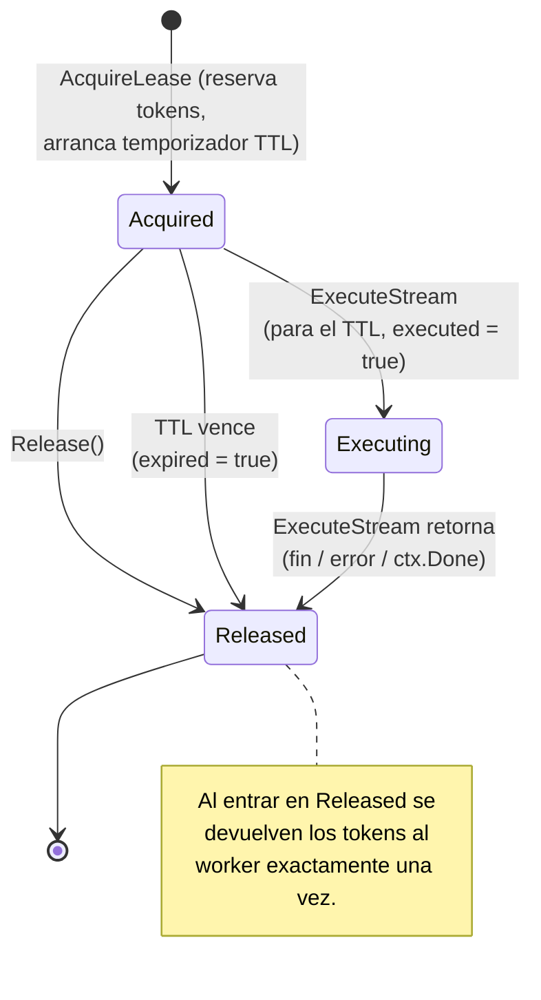

# 3. Leases y capacidad

El *lease* es la pieza central del diseño: **ninguna petición empieza a generar sin tener antes su capacidad reservada en un worker concreto**. Este documento explica el contrato (`internal/inference`) y cómo lo implementa el worker simulado (`internal/simworker`).

## Por qué un lease y no "mirar el estado y elegir"

El diseño clásico sería: leer la ocupación de todos los workers, elegir el más libre y enviarle la petición. Con concurrencia, eso falla:

```text
t0  petición A lee: w1 tiene 1000 tokens libres
t0  petición B lee: w1 tiene 1000 tokens libres
t1  A envía 800 tokens a w1
t1  B envía 800 tokens a w1   → w1 sobrecomprometido (1600 > 1000)
```

Con un lease, **comprobar y reservar es una sola operación atómica** dentro del worker. Si dos peticiones compiten por el mismo hueco, una recibe el lease y la otra `ErrAtCapacity`, y el scheduler prueba otro worker. No hace falta un lock global en el control plane.

## La unidad de capacidad: tokens

```go
func (r InferenceRequest) TokenCost() int { return r.PromptTokens + r.MaxNewTokens }
```

En un motor de LLM lo que se agota es la **memoria de KV-Cache**, y crece con el número de tokens de cada secuencia (prompt + generados), no con el número de peticiones. Contar "peticiones en vuelo" trataría igual un prompt de 8K tokens que uno de 100.

La reserva es **pesimista**: se reserva el peor caso (`max_new_tokens` completo) durante todo el stream. Es una decisión consciente: es simple, nunca sobrecompromete al worker y es atómica sin ayuda del motor. El precio es infrautilizar la GPU cuando los clientes piden `max_tokens` mucho mayores que lo que realmente generan. Alternativas registradas en **FI-1**.

## El contrato

```go
type Worker interface {
    ID() string
    Models() []string
    AcquireLease(ctx context.Context, req InferenceRequest) (Lease, error)
    Snapshot() WorkerSnapshot
    CapacityChanged() <-chan struct{} // Fase 2
    Health(ctx context.Context) (HealthStatus, error) // Fase 4
}

type Lease interface {
    WorkerID() string
    ExecuteStream(ctx context.Context, out chan<- TokenChunk) error
    Release()
}
```

Reglas que toda implementación (simulada o vLLM) debe cumplir:

| Regla | Motivo |
| :--- | :--- |
| `AcquireLease` reserva o falla **sin efectos secundarios**. | Si falla, el scheduler prueba otro worker; un fallo no puede dejar capacidad "a medias". |
| `ExecuteStream` se llama **como mucho una vez** (`ErrLeaseUsed`). | Un lease representa una única ejecución; reutilizarlo duplicaría el trabajo con una sola reserva. |
| `ExecuteStream` **nunca cierra `out`**; el canal es del llamador. | Quien crea el canal decide cuándo se cierra. Evita *panics* por doble cierre si alguien reutiliza el canal. `StartStream` aplica el patrón correcto. |
| La capacidad se libera **en cuanto `ExecuteStream` retorna**, sea cual sea el motivo. | Un cliente que se desconecta debe liberar VRAM *ya*, no cuando el handler llegue a su `defer`. |
| `Release` es **idempotente** y segura en concurrencia. | Se llama desde varios sitios (el `defer` del handler, el final de `ExecuteStream`, el TTL); solo la primera tiene efecto. |
| `CapacityChanged()` se emite **una vez por lease liberado**, agrupada (canal con buffer 1 y envío no bloqueante) y sin datos. | El dispatcher reintenta en cuanto hay capacidad, sin sondeo ni tormentas de eventos. Perderla o duplicarla no rompe nada: la verdad está en `AcquireLease` ([08 · Decisión 2](08-fase-2-decisiones.md#decisión-2-cómo-se-entera-el-scheduler-de-que-hay-capacidad-libre)). |
| Un lease no ejecutado **expira** tras el TTL (`ErrLeaseExpired`). | Un lease que nadie ejecuta (bug, *panic*, cliente perdido entre admisión y stream) retendría capacidad para siempre. |
| Los errores se comparan con `errors.Is`. | Las implementaciones pueden añadir contexto (`"w1: at capacity"`) sin romper la clasificación. |

Reglas añadidas en la Fase 4 ([10](10-fase-4-decisiones.md)):

| Regla | Motivo |
| :--- | :--- |
| Los fallos **del propio worker** (conexión rechazada, `5xx`, stream cortado) se envuelven con `ErrWorkerFailure`; los de la petición, no. | Solo los primeros cuentan para el *circuit breaker* y permiten reintentar en otro worker. Un `400` del motor por una petición demasiado larga no debe aislar a un worker sano. |
| `Health` respeta el deadline de `ctx` y devuelve un `InstanceID` que cambia si el proceso se reinicia. | El scheduler lo consulta periódicamente. Un `InstanceID` nuevo significa caché de prefijos vacía. |

**El lease que devuelve el scheduler envuelve al del worker** (`scheduler/lease.go`). Cumple el mismo contrato, y además: corta los streams colgados, informa al breaker de cómo acabó cada uno y, si el worker falla antes del primer token, ejecuta la petición en otro worker dentro de la misma llamada a `ExecuteStream`. Por eso `WorkerID()` puede cambiar durante la ejecución: hay que leerlo tras el primer chunk o al final.

### Patrón de uso

```go
lease, err := pool.Acquire(ctx, req)
if err != nil { /* 404 / 400 / 503 */ }
defer lease.Release()                       // cubre los caminos sin ExecuteStream

chunks, wait := inference.StartStream(ctx, lease, 16)
for c := range chunks {                      // el canal se cierra al terminar
    // enviar c al cliente; si falla: cancel() y seguir vaciando
}
err = wait()                                 // error de ExecuteStream
```

## Máquina de estados del lease (simworker)



`ExecuteStream` llamada en cada estado:

| Estado / flags | Resultado |
| :--- | :--- |
| `Acquired` | Pasa a `Executing` y genera. |
| `executed == true` (en curso o ya terminado) | `ErrLeaseUsed` |
| `Released` con `expired == true` | `ErrLeaseExpired` |
| `Released` (por `Release()`) | `ErrLeaseReleased` |

### Cómo se garantiza "liberar exactamente una vez"

Tres caminos pueden liberar: `Release()`, `expire()` (TTL) y el `defer l.Release()` dentro de `ExecuteStream`. Los tres pasan por el mutex del lease y solo actúan si el estado no es `Released`; el que llega primero cambia el estado y es el único que llama a `w.free(cost)`.

La carrera delicada es **TTL contra `ExecuteStream`**: el temporizador puede dispararse justo cuando empieza la ejecución. `begin()` para el temporizador, pero si la función del TTL ya estaba en marcha, se quedará esperando el mutex. Cuando lo obtenga verá estado `Executing` (o `Released`, si el stream ya terminó) y no hará nada, porque `expire()` solo actúa en estado `Acquired`. Lo comprueban `TestLeaseExpiresWhenNotExecuted` y `TestLeaseDoesNotExpireOnceExecuting`.

## Contabilidad del worker

```go
type Worker struct {
    mu       sync.Mutex
    reserved int    // tokens reservados ahora
    active   int    // leases vivos
    granted  uint64 // leases concedidos (histórico)
    rejected uint64 // rechazos por ErrAtCapacity (histórico)
}
```

`AcquireLease`, en orden:

1. Contexto ya cancelado → error del contexto.
2. Modelo no servido → `ErrModelNotServed`.
3. `PromptTokens < 0` o `MaxNewTokens <= 0` → `ErrInvalidRequest`.
4. `coste > TokenBudget` → `ErrRequestTooLarge` (no cabría nunca, ni con el worker vacío; no cuenta como rechazo).
5. **Con el mutex:** si `reserved + coste > TokenBudget` → `rejected++`, `ErrAtCapacity`; si no, `reserved += coste`, `active++`, `granted++`.
6. Fuera del mutex: crear el lease y, si hay TTL, el temporizador.

El mutex solo protege aritmética de enteros: nunca se mantiene durante esperas ni E/S, así que no es un cuello de botella aunque haya miles de peticiones.

`Snapshot()` copia estos valores bajo el mismo mutex. Es **solo informativa** (para `/debug/workers` y, en el futuro, métricas): ninguna decisión de admisión debe basarse en ella, por la carrera descrita al principio.

**Ojo con `rejected`:** cuenta rechazos *por worker*. Cada intento de colocación que encuentra un worker lleno suma 1 en ese worker, así que con varios workers (y con la cola, que reintenta) la suma de `leases_rejected` no corresponde a los `503` reales. Desde la Fase 2, los rechazos reales al cliente se cuentan en el scheduler (`rejected_queue_full` y `rejected_queue_timeout` en `/debug/scheduler`); `leases_rejected` solo cuenta intentos de colocación fallidos, que con la cola son normales.

## El ledger de capacidad

El **ledger** es el libro de cuentas de tokens reservados que lleva cada worker en el control plane: la contabilidad de cuánta capacidad está comprometida, **no la memoria real de la GPU**. En `simworker` son los campos de arriba (`TokenBudget`, `reserved`, `active`, `granted`, `rejected`), protegidos por `Worker.mu`, y se ven en `GET /debug/workers`.

- **Cargo** (`AcquireLease`): si `reserved + coste ≤ TokenBudget`, entonces `reserved += coste`.
- **Abono** (`free()`): al terminar el stream, en `Release()` o al vencer el TTL, `reserved -= coste`, exactamente una vez.
- **Saldo disponible:** `TokenBudget − reserved`.

| | Ledger (control plane) | KV-Cache de vLLM (GPU) |
| :--- | :--- | :--- |
| Qué cuenta | Reservas de peor caso: `prompt + max_tokens` por petición | Bloques realmente ocupados por los tokens generados hasta ahora |
| Cuándo cambia | Solo al conceder o liberar un lease: una vez por petición | En cada paso de decode, asignación y expulsión LRU |
| Dónde vive | En la memoria de un proceso del control plane | Dentro de vLLM |
| Para qué sirve | Decidir de forma atómica si se admite una petición | Ejecutar la inferencia |

Consecuencias:

- Con reserva pesimista, el ledger siempre marca **más** ocupación que la real: es seguro pero desperdicia capacidad (**FI-1**).
- Vive en un solo proceso: dos réplicas del control plane tendrían dos ledgers del mismo vLLM y reservarían de más (**FI-2**).
- Con vLLM real, el ledger lo seguirá llevando el `VLLMAdapter` dentro del control plane, porque vLLM no ofrece una API de reserva (ver [06](06-relacion-con-vllm.md)).
- La señal `CapacityChanged()` de la Fase 2 observa cambios del ledger, no de los bloques de vLLM; por eso se emite una vez por petición (ver [08](08-fase-2-decisiones.md#decisión-2-cómo-se-entera-el-scheduler-de-que-hay-capacidad-libre)).

## El TTL del lease

`-lease-ttl` (5 s por defecto) es el tiempo máximo entre `AcquireLease` y `ExecuteStream`. En la Fase 1 ambos ocurren en el mismo handler con microsegundos de diferencia, así que nunca vence en condiciones normales: es una red de seguridad. Con la cola de la Fase 2, el dispatcher obtiene el lease y lo entrega por un canal a la goroutine del handler, que lo ejecuta de inmediato. Si el cliente se va justo en ese instante, el scheduler ve la entrega bajo su lock y libera el lease explícitamente; el TTL queda como última red. Cobra importancia cuando el worker sea remoto (Fases 4–6): si el control plane obtiene un lease y muere antes de usarlo, el worker debe poder recuperar esa capacidad por su cuenta. El caso de una réplica que muere *a mitad* de stream necesita además renovación de leases (registrado en **FI-2**).
