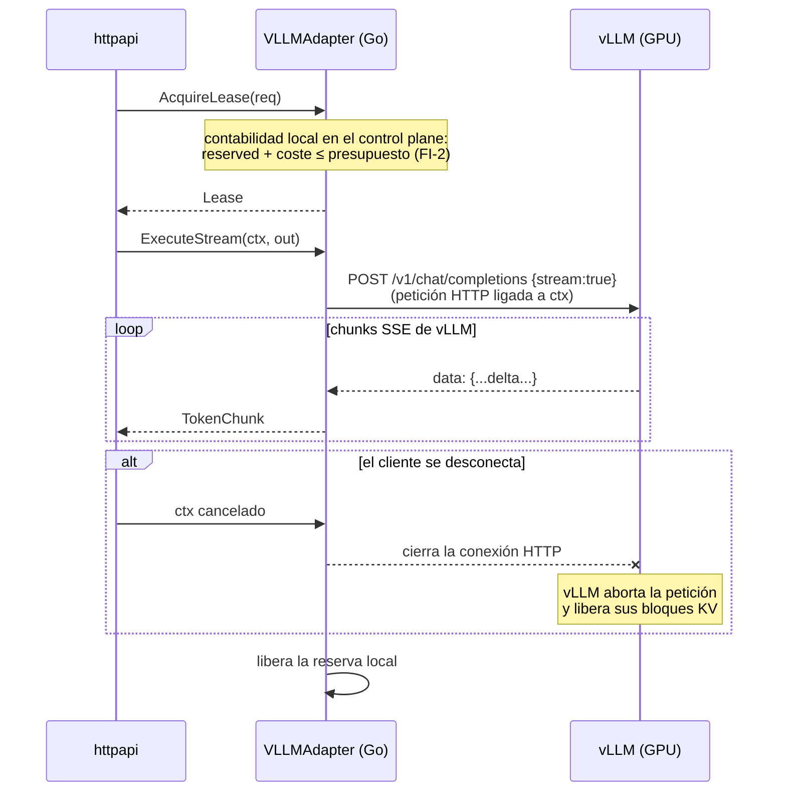

# 6. Relación con los workers vLLM

El objetivo final es que cada worker sea un servidor **vLLM** con una GPU. Este documento explica qué representa cada pieza simulada, qué hace vLLM por su cuenta, cómo encajará el `VLLMAdapter` de la Fase 6 y qué huecos del contrato actual habrá que cerrar.

> Los nombres de flags y métricas de vLLM cambian entre versiones (motor V0 frente a V1). Se citan como referencia y hay que comprobarlos contra la versión que se fije (ver **FI-4**).

## Reparto de responsabilidades

| Responsabilidad | Plataforma (control plane, Go) | vLLM (data plane, por GPU) |
| :--- | :--- | :--- |
| Elegir a qué GPU va cada petición | ✅ `scheduler` (afinidad de prefijo desde la Fase 3; round-robin opcional) | ❌ solo conoce su propia GPU |
| Rechazar pronto cuando el clúster está lleno (`503`) | ✅ leases + admisión | ⚠️ encola internamente sin límite útil para el cliente |
| Agrupar peticiones en batches (*continuous batching*) | ❌ | ✅ |
| Gestionar la memoria KV-Cache por bloques (*PagedAttention*) | ❌ solo la contabiliza (aproximadamente) | ✅ |
| Reutilizar prefijos ya calculados (*prefix caching*) | ✅ Fase 3: enviar la petición al worker que ya los tiene (radix tree aproximado) | ✅ dentro de su GPU |
| Tokenizar y aplicar la *chat template* del modelo | ❌ hoy solo estima (FI-3) | ✅ |
| Abortar y liberar memoria al cancelar | ✅ propaga la cancelación | ✅ libera los bloques |
| Detectar GPUs caídas o colgadas y desviar el tráfico | ✅ Fase 4: healthchecks, *circuit breaker*, timeouts de cuelgue, reintento antes del primer token | ⚠️ solo informa (`/health`) de su propio proceso |
| Kernels CUDA, ejecución del modelo | ❌ (no objetivo) | ✅ |

En una frase: **vLLM optimiza una GPU; la plataforma optimiza el clúster de GPUs.** vLLM no sabe que existen otras réplicas, así que no puede decidir que una petición iría mejor a otra GPU que ya tiene su prefijo cacheado, ni rechazar pronto porque todo el clúster está saturado.

## Correspondencia entre conceptos

| Simulación (hoy) | Equivalente en vLLM |
| :--- | :--- |
| `simworker.Worker` | Un proceso `vllm serve <modelo>` en una GPU (en K8s, un pod). |
| `Config.Models` | El modelo cargado por ese servidor (normalmente uno por proceso). |
| `TokenBudget` | Capacidad total de KV-Cache: nº de bloques × tamaño de bloque (`--block-size`, 16 tokens por defecto). Depende de la VRAM libre tras cargar los pesos (`--gpu-memory-utilization`); vLLM la informa en sus logs al arrancar. |
| `TokensReserved / TokenBudget` | Métrica de ocupación de KV-Cache (`vllm:kv_cache_usage_perc` en V1, `vllm:gpu_cache_usage_perc` en V0). |
| `ActiveLeases` | `vllm:num_requests_running` (+ `vllm:num_requests_waiting`). |
| TTFT simulado (`BaseTTFT + prompt × PrefillPerToken`) | Fase de *prefill*: el modelo procesa todo el prompt en paralelo y llena la KV-Cache. |
| ITL simulada | Fase de *decode*: un paso del modelo por token, compartido con todo el batch. |
| `PrefixHashes` + caché de `simworker` (Fase 3) | *Automatic prefix caching* (`--enable-prefix-caching`, activo por defecto en V1): bloques de `--block-size` tokens identificados por un hash del bloque y de su prefijo. vLLM hashea IDs de token tras la *chat template*; nosotros, texto aplanado. |
| `prefix.Tree` en el router | No existe en vLLM: es la vista del clúster que ninguna GPU tiene. |
| `ctx.Done()` → liberación | Al cerrar la conexión HTTP, el servidor de vLLM aborta la petición y libera sus bloques. |
| `AcquireLease` atómico | **No existe en vLLM.** Ver abajo. |
| `Worker.Health` / `HealthStatus.InstanceID` (Fase 4) | `GET /health` (200 si el motor está vivo). vLLM no expone un identificador de instancia en `/health`: candidatos a comprobar con la versión fijada son `process_start_time_seconds` de `/metrics` o el *uptime* del pod. |
| `ErrWorkerFailure` (Fase 4) | Lo que el adaptador debe envolver: conexión rechazada, `5xx`, stream SSE cortado. **No** un `400` (p. ej. `--max-model-len`), que es un error de la petición. |
| `ErrAtCapacity` | No hay equivalente directo: vLLM acepta y encola, o expulsa (*preempt*) peticiones si se queda sin bloques. |

## Lo que la simulación no captura (y por qué importa)

1. **vLLM no reserva el peor caso.** Asigna bloques a medida que la secuencia crece. Si se queda sin memoria, expulsa peticiones en curso (las recalcula más tarde), lo que dispara la latencia. Nuestra reserva pesimista evita llegar a ese punto, a costa de admitir menos de lo que cabría (**FI-1**).
2. **El prefix caching hace que el coste real sea menor que el contabilizado.** Si 50 peticiones comparten un *system prompt* de 2000 tokens, vLLM guarda esos bloques una sola vez; nosotros los contamos 50 veces (**FI-1**). Con el routing por afinidad de la Fase 3 esas peticiones se concentran en el mismo worker, así que la sobrestimación es mayor ([09 · Interacción con FI-1](09-fase-3-routing-por-prefijos.md#interacción-con-fi-1-la-reserva-pesimista)).
3. **La ITL depende del batch.** Con más peticiones simultáneas, cada paso de decode sirve a más secuencias: sube el throughput total pero cada petición va más lenta. El simulador usa una ITL fija (ver [04](04-worker-simulado.md)).
4. **Los tokens reales salen del tokenizer del modelo**, no de "4 caracteres por token" (**FI-3**).

## El `VLLMAdapter` (Fase 6a)

**Implementado en la Fase 6a** (`internal/vllm`, decisiones en [13](13-fase-6a-decisiones.md)) y probado contra un vLLM falso; falta contrastarlo con un vLLM real (6b). Implementa `inference.Worker` sobre el ledger compartido:

| Método | Implementación |
| :--- | :--- |
| Descubrimiento (`Connector`) | Antes de registrarse: `GET /v1/models` (modelos y `max_model_len`) y `GET /metrics` (`vllm:cache_config_info` → presupuesto = `num_gpu_blocks × block_size`). Reintenta con *backoff* mientras vLLM carga el modelo y redescubre cada 30 s. |
| `AcquireLease` | El ledger compartido (`internal/ledger`): vLLM no ofrece una API para reservar. La atomicidad depende de que esta réplica sea la única puerta de entrada a ese vLLM (**FI-2**). Límite por petición = `max_model_len`. |
| `ExecuteStream` | `POST /v1/chat/completions` con los `messages`, los parámetros reenviados y los campos controlados (`max_tokens`, `stream`, `stream_options.include_usage`), ligado a `ctx`: cancelar cierra la conexión y vLLM aborta. El SSE se traduce a `TokenChunk`; el último lleva `finish_reason` y el `usage` del motor. |
| Errores | Red y `5xx`/`404`/`401` → `ErrWorkerFailure`; `400` de longitud → `ErrRequestTooLarge`; otro `400` → `ErrInvalidRequest` ([13 · Decisión 6](13-fase-6a-decisiones.md#decisión-6-traducción-de-errores)). |
| `Health` | `GET /health` y, en la misma consulta, `GET /metrics`: reinicios (`process_start_time_seconds`, o un contador que baja), acierto real de la caché de prefijos y ocupación real de la KV-Cache (`WorkerSnapshot.Engine`). |
| `Release`, `CapacityChanged` | Los del ledger, idénticos a los del simulador. |

`httpapi` y `scheduler` no cambiaron para hablar con vLLM: `main` crea un `Connector` por cada URL de `-vllm`. Simulados y vLLM pueden convivir en el mismo pool.

### Dónde corre el adaptador y qué cruza la red

El `VLLMAdapter` es un **objeto Go dentro del proceso del control plane**, no un proceso en el nodo de la GPU. El [ledger](03-leases-y-capacidad.md#el-ledger-de-capacidad) de cada vLLM vive en él.

| Pieza | Dónde corre | Qué cruza la red |
| :--- | :--- | :--- |
| Scheduler | Proceso del control plane | Nada |
| `VLLMAdapter` (ledger, señal de capacidad) | Mismo proceso | Nada: las señales son canales Go |
| vLLM | Nodo GPU | La petición HTTP, su stream SSE y, cuando se lean, `/metrics` y `/health` |

El adaptador sabe que una petición terminó **porque se cierra el stream SSE que está reenviando**; no necesita ningún mensaje adicional de vLLM para liberar su reserva. Lo que vLLM haga con sus bloques de KV-Cache (asignar, liberar, expulsar del LRU de *prefix caching*) no llega al adaptador ni afecta a la admisión. En vLLM, la expulsión LRU ocurre *al asignar* memoria a otra petición, así que no indica capacidad nueva.

Si en el futuro hiciera falta información que vive en vLLM (la ocupación real para relajar FI-1, o qué prefijos tiene cada GPU para la Fase 3), la regla es **leer estado agregado periódicamente** (`/metrics` cada 100 ms – 1 s) o consumir eventos agrupados fuera del camino crítico, nunca un evento por bloque. Las versiones recientes de vLLM pueden publicar eventos de KV-Cache agrupados; hay que comprobarlo contra la versión que se fije (como en **FI-4**). Ver [08 · Decisión 2](08-fase-2-decisiones.md#decisión-2-cómo-se-entera-el-scheduler-de-que-hay-capacidad-libre).

## Huecos del contrato que el adaptador tenía que cerrar

Eran consecuencias del contrato de la Fase 1. **Los cuatro primeros están cerrados** (FI-7 y FI-8 en la Fase 6a, FI-9 en la Fase 4 y 6a); el texto original se conserva como registro.

1. ~~**`InferenceRequest` solo lleva el prompt aplanado.**~~ **Resuelto en la 6a:** `Messages` y `Params` (con campos controlados y rechazados). `renderPrompt` convierte los mensajes en `role: content\n` únicamente para estimar el coste. vLLM necesita los `messages` originales para aplicar la *chat template* del modelo, y también los parámetros de muestreo que hoy se ignoran (`temperature`, `top_p`, `stop`, …). El contrato tendrá que transportar los mensajes y esos parámetros, o el cuerpo original de la petición (**FI-7**).
2. ~~**Un `TokenChunk` no siempre es exactamente un token.**~~ **Resuelto en la 6a:** `TokenChunk.Usage` con los tokens del motor; `Index` es índice de chunk. vLLM normalmente emite un token por evento, pero puede agrupar varios (por ejemplo, al retener bytes de un carácter UTF-8 incompleto, o con *speculative decoding*). Hoy `completion_tokens` se calcula contando chunks; con vLLM debería tomarse del `usage` que devuelve el propio motor (**FI-8**).
3. ~~**Las cabeceras `200` se envían antes de que el worker responda.**~~ **Resuelto en la Fase 4:** el handler espera al primer chunk para enviar el `200`, así que un rechazo de vLLM al empezar llega al cliente con su código (**FI-9**). Para que sea un `400` y no un `503`, el adaptador debe traducir el `400` de vLLM a `ErrRequestTooLarge` o `ErrInvalidRequest`, nunca a `ErrWorkerFailure`.
4. **`PrefixHashes` no le sirve a vLLM.** El adaptador no lo envía: vLLM calcula sus propios hashes sobre los tokens reales. El router seguirá usándolos para su árbol. Hay que comprobar que la *chat template* del modelo no inserta texto variable al principio del prompt (fechas, IDs), porque rompería en vLLM prefijos que el router cree compartidos ([09 · Limitaciones](09-fase-3-routing-por-prefijos.md#limitaciones-y-trabajo-futuro)).
5. **El `finish_reason` real** puede ser `stop` (fin natural, *stop sequence*) además de `length`; el tipo `FinishReason` ya lo contempla.

## Por qué el diseño actual sigue siendo válido con vLLM

- **Streaming-first:** vLLM ya responde en SSE con el mismo formato OpenAI; el adaptador traduce evento a evento sin cambiar de modelo mental.
- **Cancelación propagada:** el camino `ctx.Done()` que hoy libera tokens simulados es el mismo que mañana cerrará la conexión con vLLM y liberará VRAM real.
- **Admisión antes de responder:** aunque vLLM no reserve, el control plane sigue evitando enviar trabajo a GPUs saturadas, que es lo que provoca las expulsiones (*preemption*) y el *thrashing* de la KV-Cache descritos en §4.2 del README raíz.
- **Interfaces:** el simulador y el adaptador son intercambiables, así que los tests del control plane siguen siendo válidos y se pueden comparar ambos con el mismo benchmark.
