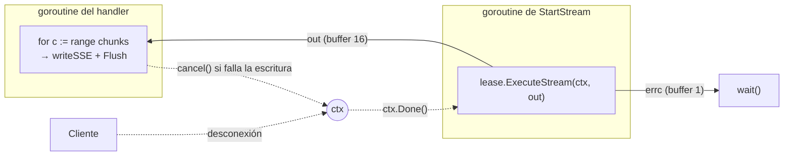

# 7. Concurrencia y tests

## Modelo de concurrencia

### Goroutines por petición

| Goroutine | Quién la crea | Qué hace | Cuándo termina |
| :--- | :--- | :--- | :--- |
| Handler | `net/http` (una por petición) | Admisión, escritura SSE, log | Cuando acaba el stream o el cliente se va |
| Productor | `inference.StartStream` | Ejecuta `lease.ExecuteStream` y cierra el canal | Cuando `ExecuteStream` retorna |
| TTL | `time.AfterFunc` (solo si vence) | Llama a `lease.expire()` | Inmediatamente |
| Dispatcher | `scheduler.New` (una por proceso) | Escucha `CapacityChanged()` de todos los workers, las llegadas y el sondeo; entrega leases a las peticiones en cola | `Scheduler.Close()` |

Reglas que evitan bloqueos y fugas de goroutines:

- **Solo el productor escribe en `out` y solo él lo cierra** (con `defer close(out)` en `StartStream`). `ExecuteStream` nunca lo cierra.
- **`errc` tiene buffer 1**: el productor puede dejar su error y terminar aunque nadie llame a `wait()`.
- **El productor nunca se bloquea para siempre**: toda espera y todo envío están en un `select` con `ctx.Done()`.
- **El handler siempre vacía el canal** hasta que se cierra, incluso después de fallar una escritura, para que el productor termine.
- **El dispatcher entrega cada lease por un canal con buffer 1** y marca la petición como servida bajo `Scheduler.mu`. Si la petición se rinde a la vez (cliente que se va o timeout), lo ve bajo el mismo lock y libera (o usa) ese lease: nunca se pierde capacidad.

### Estado compartido y locks

| Estado | Protección | Notas |
| :--- | :--- | :--- |
| `Worker.reserved`, `active`, `granted`, `rejected` | `Worker.mu` | Solo aritmética bajo el lock; nunca E/S ni esperas. |
| Estado del lease (`state`, `executed`, `expired`) | `lease.mu` | Serializa `begin`, `Release` y `expire`. |
| Colas, contadores y estadísticas del scheduler | `Scheduler.mu` | Se mantiene mientras se intentan leases (`Worker.mu` se toma dentro, nunca al revés). |
| Desplazamiento de `RoundRobin` | `atomic.Uint64` | Sin lock. |
| Lista de workers, colas por modelo y configuración | Inmutables tras la creación | Se leen sin lock. |

**Orden de locks:** `lease.mu` y `Worker.mu` nunca se mantienen a la vez (`Release()` y `expire()` sueltan `lease.mu` antes de llamar a `w.free()`). El único anidamiento es `Scheduler.mu` → `Worker.mu` (la cola se recorre bloqueada mientras se intentan leases); el worker nunca toma `Scheduler.mu`, solo avisa por un canal con envío no bloqueante. Con un único orden posible no hay riesgo de *deadlock*.

### Lo que comprueba el detector de carreras

`go test -race` instrumenta todos los accesos a memoria y falla si dos goroutines acceden al mismo dato sin sincronización y al menos una escribe. La suite se ejecuta con `-race -count=5` en Linux (`task test:race`) y pasa sin incidencias.

## La suite de tests

Todo está en `Taskfile.yml`, en la raíz del repositorio; cada tarea se ejecuta dentro de `platform/` (ver §8 del README raíz):

| Tarea | Uso |
| :--- | :--- |
| `task check` | En cada cambio: `gofmt` + `go vet` + tests. |
| `task check:all` | Antes de cerrar una fase: `check` + tests con `-race` en Docker. |
| `task test:cover` | Cobertura por función (77 % al cerrar la Fase 1; 82 % al cerrar la Fase 2; al cerrar la Fase 3: `prefix` 93 %, `scheduler` 93 %, `simworker` 97 %, `httpapi` 87 %; al cerrar la Fase 4: `scheduler` 95 %, `simworker` 94,5 %, `prefix` 93 %, `httpapi` 90 %; al cerrar la Fase 5: `metrics` 97 %, `scheduler` 94 %, `simworker` 94,5 %, `prefix` 93 %, `httpapi` 92 %; al cerrar la Fase 6a: `httpapi` 93 %, `metrics` 94 %, `scheduler` 94 %, `simworker` 94 %, `vllm` 88 %, y `ledger` 98 % / `fakevllm` 83 % medidos con `-coverpkg`, porque los ejercitan los tests de otros paquetes). |
| `task loadgen` | Generador de carga contra un servidor en marcha (no es un test: sirve para comparar configuraciones). |

### Batería de contrato común (`internal/workertest`, Fase 6a)

`workertest.Run` se ejecuta contra **cada implementación de `Worker`**: el simulador (`simworker/contract_test.go`) y el adaptador de vLLM contra un vLLM falso por HTTP (`vllm/integration_test.go`). Subtests: admisión (reserva, encaje exacto, `ErrAtCapacity`, `ErrRequestTooLarge`, `ErrModelNotServed`, `ErrInvalidRequest`, contexto cancelado, `Release` idempotente), stream completo que libera capacidad, lease de un solo uso, cancelación que libera al instante, TTL sin doble liberación, señal `CapacityChanged` y 60 adquisiciones concurrentes sin superar el presupuesto. `workertest.Stub` da un worker mínimo sobre el ledger para tests que necesitan `usage` o `max_model_len`.

`internal/ledger`: validación de la configuración y `MaxRequestTokens` (una petición que cabe en el presupuesto pero no en `max_model_len`).

### `internal/simworker` — contrato del lease

| Test | Qué garantiza |
| :--- | :--- |
| `TestNewValidatesConfig` | Configuraciones inválidas se rechazan. |
| `TestAcquireLeaseAdmission` | Reserva, encaje exacto, `ErrAtCapacity`, `ErrRequestTooLarge`, `ErrModelNotServed`, `ErrInvalidRequest`, `Release` idempotente y contadores. |
| `TestAcquireLeaseCancelledContext` | No se reserva con un contexto ya cancelado. |
| `TestExecuteStreamEmitsAllTokens` | Número, orden y `finish_reason` de los chunks; capacidad liberada al terminar. |
| `TestExecuteStreamOnlyOnce` | Segunda ejecución → `ErrLeaseUsed`. |
| `TestExecuteStreamAfterRelease` | Ejecutar tras `Release` → `ErrLeaseReleased`. |
| `TestCancellationFreesCapacityImmediately` | Cancelar durante una ITL de 1 hora libera la capacidad al instante. |
| `TestCancellationWhileConsumerIsStuck` | El worker no se bloquea si el consumidor deja de leer. |
| `TestLeaseExpiresWhenNotExecuted` | El TTL recupera la capacidad, sin doble liberación. |
| `TestLeaseDoesNotExpireOnceExecuting` | El TTL no interrumpe un stream ya iniciado. |
| `TestConcurrentAcquireNeverExceedsBudget` | 200 goroutines contra un worker: nunca se supera el presupuesto y no se pierde capacidad. |
| `TestVariableOutputLength` | Salida entre 1 y `max_tokens`, `stop` si para antes y `length` si llega al tope, reproducible por ID. |
| `TestITLGrowsWithLoad` | La ITL crece según `ITLLoadFactor` con los leases activos. |
| `TestCapacityChangedSignal` | La señal se emite al liberar, al terminar un stream y al vencer el TTL, y se agrupa. |
| `TestPrefixCacheMatchesLeadingBlocksOnly` | Solo cuentan los bloques iniciales consecutivos; contadores de consulta y acierto. |
| `TestPrefixCacheEvictsTailsBeforeSharedHeads` | La LRU expulsa las colas de las peticiones antes que el prefijo compartido. |
| `TestPrefixCacheShortensTTFT` | Un prompt de 800 tokens ya cacheado se salta el prefill; `Snapshot` refleja tamaño y aciertos. |
| `TestNoPrefixCacheByDefault` | Sin `PrefixCacheBlocks`, los hashes se ignoran (comportamiento de las fases 1 y 2). |
| `TestFaultsValidate` | Fallos con valores inválidos se rechazan en `New` y en `SetFaults`. |
| `TestDownFailsStreamsAndHealth` | `Down`: streams y `Health` fallan con `ErrWorkerFailure`, sin perder capacidad; al quitarlo, vuelve a funcionar. |
| `TestErrorRateIsSeededByRequestID` | `ErrorRate` falla la proporción pedida y el mismo ID da siempre el mismo resultado. |
| `TestHangEmitsNothingUntilCancelled` | `Hang`: ningún token hasta cancelar; `Health` sigue bien. |
| `TestFailAndStallAfterTokens` | Corte y parada a mitad de stream tras N tokens. |
| `TestSlowdownMultipliesLatency` | `Slowdown` multiplica el TTFT. |
| `TestRestartCutsStreamsAndChangesInstance` | `Restart` corta los streams, libera su capacidad, vacía la caché y cambia el `InstanceID`. |
| `TestHealthHonoursContext` | `Health` respeta un contexto cancelado. |

### `internal/scheduler` — admisión, cola y colocación

Los tests usan un sondeo de seguridad de 1 hora, así que demuestran que es la señal `CapacityChanged()` (y no el sondeo) la que despierta al dispatcher.

| Test | Qué garantiza |
| :--- | :--- |
| `TestImmediateErrors` | `404`, `400` (no cabe ni vacío, o petición inválida) sin esperar en la cola. |
| `TestImmediateAdmissionSpreadsLoad` | Camino rápido sin cola y reparto round-robin. |
| `TestQueuedRequestAdmittedOnCapacitySignal` | Una petición en cola entra cuando se libera capacidad. |
| `TestFIFOOrder` | Orden de llegada dentro de un modelo. |
| `TestSkipAheadWhileHeadIsYoung` | Una petición pequeña adelanta a una cabeza grande y joven. |
| `TestFIFOBarrierWhenHeadIsOld` | La barrera impide adelantar a una cabeza vieja (C1). |
| `TestQueueFullByTokens` | Límite de tokens por modelo (C2) y `Retry-After` dentro de rango. |
| `TestQueueFullByRequestCount` | Tope global de peticiones en espera entre modelos. |
| `TestQueueTimeout` | `ErrQueueTimeout` con `Retry-After` y cola vacía después. |
| `TestClientDeadlineCapsTheWait` | El deadline del cliente acota la espera. |
| `TestCancelWhileQueued` | Cancelar en la cola no reserva nada ni deja restos. |
| `TestModels` | Lista de modelos ordenada y sin duplicados. |
| `TestStressInvariants` | 1.500 peticiones contra 3 workers realistas, con cancelaciones: nunca se supera el presupuesto, cada petición tiene un único resultado, la cola y los ledgers acaban vacíos y no quedan goroutines. Se ejecuta con las dos colocaciones (`round-robin` y `prefix-affinity`, esta con 5 prefijos compartidos). |

`affinity_test.go` (Fase 3):

| Test | Qué garantiza |
| :--- | :--- |
| `TestAffinityKeepsAPrefixOnOneWorker` | Las peticiones con el mismo prefijo van al mismo worker; contadores de acierto y bloques previstos. |
| `TestAffinitySpreadsDifferentPrefixesByLoad` | Prefijos nuevos se reparten por carga entre workers ociosos. |
| `TestAffinityPrefersTheLongestMatch` | Gana el worker con el prefijo más largo, aunque esté más cargado (por debajo de `MaxLoad`). |
| `TestAffinityIgnoresShortMatches` | Un acierto menor que `MinMatchBlocks` no se impone a la carga. |
| `TestAffinityOverflowsWhenTheWorkerIsLoaded` | Por encima de `MaxLoad` la petición desborda al menos cargado, que pasa a tener el prefijo y recibe los siguientes. |
| `TestAffinityFallsBackWhenTheAffineWorkerIsFull` | Si la petición no cabe en el worker afín, va al siguiente y cuenta como desbordamiento. |
| `TestAffinityWithoutPrefixUsesLoad` | Sin hashes: el menos cargado, y el árbol no se toca. |
| `TestAffinityErrors` | Sin workers o con el pool lleno → `ErrAtCapacity`; un contexto cancelado se propaga; los fallos no se registran. |
| `TestSchedulerWithAffinity` | Integración con la cola: una petición en espera entra por desbordamiento al liberarse capacidad, y los contadores llegan a `Stats().Placement`. |

`lifecycle_test.go` (Fase 4). Usan un reloj falso para las esperas del breaker y workers con fallos inyectados:

| Test | Qué garantiza |
| :--- | :--- |
| `TestBreakerOpensProbesAndCloses` | 2 fallos abren el breaker (`503 no_healthy_workers` con `Retry-After`); tras la espera, una sola prueba; una prueba fallida reabre con el doble de espera; una buena lo cierra. |
| `TestRequestErrorsDoNotCountAgainstTheWorker` | Un error de la petición (`ErrRequestTooLarge` del motor) no cuenta como fallo del worker ni se reintenta. |
| `TestRetryBeforeFirstTokenOnAnotherWorker` | Con un worker caído, todas las peticiones terminan en el otro; reintentos = éxitos de reintento = fallos; sin fugas de capacidad. |
| `TestNoRetryAfterTheFirstToken` | Un corte tras 2 tokens llega al cliente y no se reintenta. |
| `TestRetriesAreBounded` | Con todos los workers caídos, un solo reintento por petición. |
| `TestHangDetectedBeforeFirstTokenIsRetried` | Un worker colgado se detecta por el timeout de TTFT, se libera su capacidad y la petición termina en otro. |
| `TestStallMidStreamIsAWorkerFailure` | Una parada a mitad de stream se detecta por `StallTimeout`. |
| `TestHealthChecksExcludeAndReadmit` | Un worker que falla los healthchecks queda excluido (breaker abierto) y vuelve tras recuperarse, la espera y una prueba. |
| `TestRestartForgetsCachedPrefixes` | Un cambio de `InstanceID` borra los prefijos del worker en el radix tree. |
| `TestAddWorkerAdmitsQueuedRequests` | Un worker nuevo admite una petición que esperaba en la cola; IDs duplicados se rechazan; `Models()` se actualiza. |
| `TestRemoveWorkerDrains` | Un worker en baja no recibe peticiones nuevas, su stream en curso termina, luego desaparece (también del árbol); sin workers, `404`. |
| `TestDegradedWorkerOnlyUsedWhenOthersAreFull` | Un worker 10× más lento queda degradado y solo se usa cuando el otro está lleno. |

`observe_test.go` (Fase 5), con un observador que registra cada evento y un `slog` que escribe en un buffer:

| Test | Qué garantiza |
| :--- | :--- |
| `TestObserverAdmissionAndQueueEvents` | Admisión inmediata y desde la cola; salida de la cola como admitida y como cancelada. |
| `TestObserverStreamFailureRetryAndBreaker` | Un cuelgue da `failure ttft_timeout`, un reintento con éxito y la apertura del breaker; primer token y huecos entre tokens del worker que sirve; la recuperación da `half_open` y `closed`. Los logs `worker hung`, `request retried`, `breaker opened` (con `reason`), `breaker half-open`/`closed`, `worker draining`/`removed` aparecen. |
| `TestObserverHealthAndRestart` | Healthchecks correctos y fallidos, reinicio detectado y apertura del breaker por salud, con sus logs. |

`TestStressInvariants` tiene además un subtest `chaos`: las mismas 1.500 peticiones mientras una goroutine cambia los fallos de los workers al azar cada 3 ms (errores, caída, cuelgue, corte, parada, lentitud y reinicios), con healthchecks, breaker y reintentos activos. Comprueba las mismas invariantes (presupuesto nunca superado, un resultado por petición, cola y ledgers vacíos, sin goroutines vivas) y además que no queda ningún grant sin terminar.

### `internal/prefix` — hashes y radix tree

| Test | Qué garantiza |
| :--- | :--- |
| `TestHashesCutsFullBlocksOnly` | Un hash por bloque completo de 64 caracteres; el bloque parcial no cuenta. |
| `TestHashesCountRunesNotBytes` | Los bloques se cortan por caracteres, como `tokens.Estimate`. |
| `TestHashesAreChained` | Prompts que comparten *k* bloques comparten *k* hashes y después difieren; los hashes dependen de la posición y del modelo y son deterministas. |
| `TestTreeMatchAndSplit` | Coincidencia por worker, incluida la parcial dentro de una arista, y partición de aristas. |
| `TestTreeInsertIsIdempotent` | Reinsertar no duplica bloques. |
| `TestTreeEvictsLeastRecentlyUsedDeepestFirst` | La expulsión quita las hojas menos usadas de ese worker (nodos enteros) y respeta el prefijo compartido refrescado. |
| `TestTreeRemoveWorker` | Olvidar un worker borra sus nodos exclusivos y deja los compartidos. |
| `TestTreeRandomized` | 3.000 inserciones aleatorias con prefijos compartidos: invariantes del árbol, cota de capacidad por worker y coincidencia completa tras insertar. |
| `TestTreeConcurrentUse` | 8 goroutines insertando y consultando a la vez (con `-race`). |

### `internal/httpapi` — de extremo a extremo con `httptest`

Usan workers simulados reales detrás de un servidor HTTP real:

| Test | Qué garantiza |
| :--- | :--- |
| `TestStreamingChatCompletion` | Formato SSE, rol en el primer chunk, `finish_reason`, chunk de `usage`, `[DONE]`, capacidad liberada. |
| `TestNonStreamingChatCompletion` | Respuesta agregada y `usage`. |
| `TestAdmissionErrors` | `400`, `404`, `context_length_exceeded` y `503 queue_timeout` con `Retry-After` al saturar el worker. |
| `TestQueuedRequestCompletesAfterCapacityIsFreed` | Una petición espera en la cola, entra al liberarse capacidad (con TTL activo) y su stream termina; `/debug/scheduler` lo refleja. |
| `TestClientDisconnectReleasesCapacity` | Una desconexión del cliente a mitad de stream libera la capacidad. |
| `TestModelsAndDebugEndpoints` | `/v1/models` y `/debug/workers`. |
| `TestRequestsCarryPrefixHashes` | Dos chats con el mismo `system` comparten los hashes de sus bloques; los mensajes distintos acaban en bloques distintos; un prompt corto no lleva hashes. |
| `TestFailureBeforeFirstTokenGetsAStatusCode` | Con el único worker caído, streaming y no streaming responden `503 worker_unavailable` con `Retry-After`, sin cabeceras SSE (FI-9). |
| `TestRetryIsInvisibleToTheClient` | Con un worker caído y otro sano, todas las respuestas son `200` completas y `X-Worker-Id` es el sano. |
| `TestNoHealthyWorkers` | Cuando los healthchecks marcan el único worker, la respuesta es `503 no_healthy_workers` con `Retry-After`. |
| `TestRequestOutcomes` | Cada camino acaba en su `outcome` (completada, modelo desconocido como `unknown`, JSON inválido, demasiado grande, worker caído, corte a mitad de stream con y sin streaming), con sus tokens y su TTFT. |
| `TestClientRequestID` | Un `X-Request-Id` válido se usa como ID (cabecera y chunks); uno con espacios, demasiado largo o ausente se sustituye por uno generado. |

### `internal/metrics` — catálogo y valores (Fase 5)

Montan las piezas reales como `cmd/platform` (workers simulados, scheduler y API, todos informando a un `Metrics`):

| Test | Qué garantiza |
| :--- | :--- |
| `TestCatalogue` | Con tráfico que toca todas las áreas, **cada métrica de la guía 12 existe**, pasa el *linter* de Prometheus (`GatherAndLint`) y tiene valores coherentes (las peticiones reintentadas cuentan como `completed`, el modelo desconocido como `unknown`, la concurrencia vuelve a 0); `/metrics` sirve el formato de texto. |
| `TestHistogramsObserveBothTTFTs` | Una petición da un TTFT del cliente, uno del worker, un hueco entre tokens por token y una latencia total. |
| `TestQueueMetrics` | Una petición que espera da una admisión `queued` y una observación de espera en cola. |
| `TestEventCountersStartAtZero` | Los contadores de eventos existen a 0 desde el primer *scrape*, para que `increase()` vea el primer evento. |

### `internal/vllm` — el adaptador (Fase 6a)

| Test | Qué garantiza |
| :--- | :--- |
| `TestContract` | La batería común, contra el adaptador y un vLLM falso por HTTP. |
| `TestParseMetrics` | El parser del formato de texto de Prometheus: etiquetas con comillas escapadas, sumas por etiqueta, marcas de tiempo, líneas inválidas. |
| `TestErrorTranslation` | La tabla de errores: `400` de longitud (formato nuevo y antiguo de vLLM) → `ErrRequestTooLarge`; otro `400`/`422` → `ErrInvalidRequest`; `5xx`, `404`, `401` → `ErrWorkerFailure`; un error de la petición nunca es fallo del worker. |
| `TestRequestBodyControlledFieldsWin` | Un parámetro reenviado no puede pisar `max_tokens`, `stream` ni `stream_options`. |
| `TestRelay` | El SSE de vLLM: *keep-alive*, delta inicial sin contenido, `usage` en un chunk sin `choices`, `[DONE]`; stream sin `[DONE]`, evento de error (nuevo y antiguo) y evento ilegible → `ErrWorkerFailure`; salida vacía. |
| `TestDiscover` | Presupuesto = bloques × tamaño de bloque, `max_model_len`, ID; servidor cargando o inalcanzable → error. |
| `TestForwardedRequestAndUsage` | vLLM recibe los parámetros, `max_tokens`, `stream_options.include_usage` y la API key; el último chunk trae el `usage`. |
| `TestErrorsReachTheContract` | Contra el falso: longitud excesiva según su tokenizer, `500`, stream cortado, evento de error. |
| `TestCancellationAbortsTheEngineRequest` | Cancelar cierra la conexión y **el motor ve el aborto** (sin esto seguiría generando y ocupando VRAM). |
| `TestHealthEngineStatsAndRestarts` | Ocupación, caché de prefijos y reinicios, con y sin `process_start_time_seconds`; `/health` fallando → no sano. |
| `TestConnectorWaitsForTheModelThenRegisters` | El conector no registra mientras el modelo carga, registra después, y no vuelve a registrar un servidor que no cambió. |
| `TestEndToEnd` | API + scheduler + adaptador + dos vLLM falsos, uno roto: todas las respuestas `200`, `usage` del motor (no la estimación), reintentos con éxito. |
| `TestStressWithChaos` | 400 peticiones concurrentes contra 3 vLLM falsos que fallan, se cuelgan, cortan, emiten errores, se reinician y dejan de estar sanos: ningún ledger sobre su presupuesto, un resultado por petición, nada reservado ni en curso al final. |

En `internal/httpapi` (Fase 6a): `TestParamsAreForwarded`, `TestUnsupportedParamsAreRejected`, `TestMessageContentMustBeAString`, `TestEngineUsageIsReported` (el `usage` del motor en la respuesta con y sin streaming, y en el registro de métricas) y `TestContextLength` (Fase 6b-CPU: un `max_tokens` que no cabe en `max_model_len` se recorta y se reserva lo recortado; un prompt que no cabe da `400` inmediato, sin cola).

**Contra vLLM real (Fase 6b-CPU):**

- `TestCapturedStream`, `TestCapturedErrors`, `TestCapturedDiscovery`: el parser SSE, la tabla de errores, el descubrimiento y la lectura de `/metrics` contra **respuestas reales de vLLM 0.34** guardadas en `internal/vllm/testdata/vllm-0.34.0/` (bloques de 128, 682 bloques, 87 296 tokens).
- `TestRealVLLM`: la prueba de humo contra un vLLM en marcha; solo se ejecuta si `VLLM_URL` está definida (`task vllm-cpu:up` y `task vllm-cpu:smoke`). Comprueba descubrimiento, `usage` real, `400` de prompt demasiado largo, el recorte de `max_tokens`, que cancelar detiene la generación (vía `num_requests_running`) y los nombres de las métricas (FI-4). Pasa contra `v0.34.0-x86_64` en CPU.

### Huecos conocidos

- **El vLLM falso no se ha reajustado** a las capturas reales (por ejemplo, usa bloques de 16 por defecto y no recorta `max_tokens`). Los formatos coinciden y los tests del parser corren contra las capturas, que es lo que importa; el falso sirve para probar fallos, no para imitar magnitudes.
- `TestRealVLLM` no entra en `task check`: tarda minutos en arrancar vLLM y necesita una imagen de 1,8 GB.

- El stack de observabilidad (Dockerfile, compose, dashboard) no tiene tests automáticos. Se validó al cerrar la Fase 5: `promtool check config`/`check rules`, cada consulta del dashboard contra Prometheus tras una prueba con `loadgen`, y revisión visual de una captura.

- `internal/tokens` no tiene tests (0 % de cobertura).
- La comparación de colocaciones (TTFT, acierto de caché) se mide con `loadgen` contra el binario, no con un test: depende de tiempos reales.
- Los endpoints de administración de `cmd/platform` no tienen tests automáticos: se probaron a mano contra el binario (alta, fallos, campo desconocido, baja con drenaje, reinicio).
- La comprobación del pico de reserva sigue siendo por muestreo (después de cada concesión), tanto en `simworker` como en el test de estrés del scheduler.
- La prueba del binario completo (arrancarlo y lanzar peticiones con `curl`) se hizo a mano; un test *end-to-end* en Go que arranque el servidor sería la forma portable de automatizarla.
- No hay un test que fuerce el vencimiento del TTL *después* de salir de la cola; el camino normal (cola → handler con TTL activo) sí está cubierto.
- `task test:race` necesita Docker Desktop arrancado. Al cerrar la Fase 2 (2026-11-09) pasó con `-race -count=5`, tras corregir una carrera que encontró en el mensaje de `ErrQueueFull`. Al cerrar la Fase 3 (2026-11-17) pasó a la primera con `-race -count=5` en Go 1.23. Al cerrar la Fase 4 (2026-11-18) también, incluido el estrés con caos, y al cerrar la Fase 5 (2026-11-18) también, con `client_golang` incluido. Desde Git Bash, lanzar `docker` a mano requiere `MSYS_NO_PATHCONV=1` (Task no lo necesita).

La estrategia de tests de la Fase 2 (contrato, estrés con invariantes y generador de carga) está en [08 · Decisión 7](08-fase-2-decisiones.md#decisión-7-tests-carga-y-métricas-mínimas).
