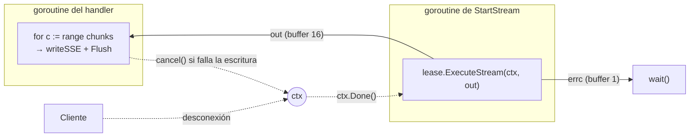

# 7. Concurrencia y tests

## Modelo de concurrencia

### Goroutines por petición

| Goroutine | Quién la crea | Qué hace | Cuándo termina |
| :--- | :--- | :--- | :--- |
| Handler | `net/http` (una por petición) | Admisión, escritura SSE, log | Cuando acaba el stream o el cliente se va |
| Productor | `inference.StartStream` | Ejecuta `lease.ExecuteStream` y cierra el canal | Cuando `ExecuteStream` retorna |
| TTL | `time.AfterFunc` (solo si vence) | Llama a `lease.expire()` | Inmediatamente |
| Dispatcher | `scheduler.New` (una por proceso) | Escucha `CapacityChanged()` de todos los workers, las llegadas y el sondeo; entrega leases a las peticiones en cola | `Scheduler.Close()` |

Reglas que evitan bloqueos y fugas de goroutines:

- **Solo el productor escribe en `out` y solo él lo cierra** (con `defer close(out)` en `StartStream`). `ExecuteStream` nunca lo cierra.
- **`errc` tiene buffer 1**: el productor puede dejar su error y terminar aunque nadie llame a `wait()`.
- **El productor nunca se bloquea para siempre**: toda espera y todo envío están en un `select` con `ctx.Done()`.
- **El handler siempre vacía el canal** hasta que se cierra, incluso después de fallar una escritura, para que el productor termine.
- **El dispatcher entrega cada lease por un canal con buffer 1** y marca la petición como servida bajo `Scheduler.mu`. Si la petición se rinde a la vez (cliente que se va o timeout), lo ve bajo el mismo lock y libera (o usa) ese lease: nunca se pierde capacidad.

### Estado compartido y locks

| Estado | Protección | Notas |
| :--- | :--- | :--- |
| `Worker.reserved`, `active`, `granted`, `rejected` | `Worker.mu` | Solo aritmética bajo el lock; nunca E/S ni esperas. |
| Estado del lease (`state`, `executed`, `expired`) | `lease.mu` | Serializa `begin`, `Release` y `expire`. |
| Colas, contadores y estadísticas del scheduler | `Scheduler.mu` | Se mantiene mientras se intentan leases (`Worker.mu` se toma dentro, nunca al revés). |
| Desplazamiento de `RoundRobin` | `atomic.Uint64` | Sin lock. |
| Lista de workers, colas por modelo y configuración | Inmutables tras la creación | Se leen sin lock. |

**Orden de locks:** `lease.mu` y `Worker.mu` nunca se mantienen a la vez (`Release()` y `expire()` sueltan `lease.mu` antes de llamar a `w.free()`). El único anidamiento es `Scheduler.mu` → `Worker.mu` (la cola se recorre bloqueada mientras se intentan leases); el worker nunca toma `Scheduler.mu`, solo avisa por un canal con envío no bloqueante. Con un único orden posible no hay riesgo de *deadlock*.

### Lo que comprueba el detector de carreras

`go test -race` instrumenta todos los accesos a memoria y falla si dos goroutines acceden al mismo dato sin sincronización y al menos una escribe. La suite se ejecuta con `-race -count=5` en Linux (`task test:race`) y pasa sin incidencias.

## La suite de tests

Todo está en `Taskfile.yml`, en la raíz del repositorio; cada tarea se ejecuta dentro de `platform/` (ver §8 del README raíz):

| Tarea | Uso |
| :--- | :--- |
| `task check` | En cada cambio: `gofmt` + `go vet` + tests. |
| `task check:all` | Antes de cerrar una fase: `check` + tests con `-race` en Docker. |
| `task test:cover` | Cobertura por función (77 % al cerrar la Fase 1; 82 % al cerrar la Fase 2: `scheduler` 90 %, `simworker` 96 %, `httpapi` 86 %). |
| `task loadgen` | Generador de carga contra un servidor en marcha (no es un test: sirve para comparar configuraciones). |

### `internal/simworker` — contrato del lease

| Test | Qué garantiza |
| :--- | :--- |
| `TestNewValidatesConfig` | Configuraciones inválidas se rechazan. |
| `TestAcquireLeaseAdmission` | Reserva, encaje exacto, `ErrAtCapacity`, `ErrRequestTooLarge`, `ErrModelNotServed`, `ErrInvalidRequest`, `Release` idempotente y contadores. |
| `TestAcquireLeaseCancelledContext` | No se reserva con un contexto ya cancelado. |
| `TestExecuteStreamEmitsAllTokens` | Número, orden y `finish_reason` de los chunks; capacidad liberada al terminar. |
| `TestExecuteStreamOnlyOnce` | Segunda ejecución → `ErrLeaseUsed`. |
| `TestExecuteStreamAfterRelease` | Ejecutar tras `Release` → `ErrLeaseReleased`. |
| `TestCancellationFreesCapacityImmediately` | Cancelar durante una ITL de 1 hora libera la capacidad al instante. |
| `TestCancellationWhileConsumerIsStuck` | El worker no se bloquea si el consumidor deja de leer. |
| `TestLeaseExpiresWhenNotExecuted` | El TTL recupera la capacidad, sin doble liberación. |
| `TestLeaseDoesNotExpireOnceExecuting` | El TTL no interrumpe un stream ya iniciado. |
| `TestConcurrentAcquireNeverExceedsBudget` | 200 goroutines contra un worker: nunca se supera el presupuesto y no se pierde capacidad. |
| `TestVariableOutputLength` | Salida entre 1 y `max_tokens`, `stop` si para antes y `length` si llega al tope, reproducible por ID. |
| `TestITLGrowsWithLoad` | La ITL crece según `ITLLoadFactor` con los leases activos. |
| `TestCapacityChangedSignal` | La señal se emite al liberar, al terminar un stream y al vencer el TTL, y se agrupa. |

### `internal/scheduler` — admisión, cola y colocación

Los tests usan un sondeo de seguridad de 1 hora, así que demuestran que es la señal `CapacityChanged()` (y no el sondeo) la que despierta al dispatcher.

| Test | Qué garantiza |
| :--- | :--- |
| `TestImmediateErrors` | `404`, `400` (no cabe ni vacío, o petición inválida) sin esperar en la cola. |
| `TestImmediateAdmissionSpreadsLoad` | Camino rápido sin cola y reparto round-robin. |
| `TestQueuedRequestAdmittedOnCapacitySignal` | Una petición en cola entra cuando se libera capacidad. |
| `TestFIFOOrder` | Orden de llegada dentro de un modelo. |
| `TestSkipAheadWhileHeadIsYoung` | Una petición pequeña adelanta a una cabeza grande y joven. |
| `TestFIFOBarrierWhenHeadIsOld` | La barrera impide adelantar a una cabeza vieja (C1). |
| `TestQueueFullByTokens` | Límite de tokens por modelo (C2) y `Retry-After` dentro de rango. |
| `TestQueueFullByRequestCount` | Tope global de peticiones en espera entre modelos. |
| `TestQueueTimeout` | `ErrQueueTimeout` con `Retry-After` y cola vacía después. |
| `TestClientDeadlineCapsTheWait` | El deadline del cliente acota la espera. |
| `TestCancelWhileQueued` | Cancelar en la cola no reserva nada ni deja restos. |
| `TestModels` | Lista de modelos ordenada y sin duplicados. |
| `TestStressInvariants` | 1.500 peticiones contra 3 workers realistas, con cancelaciones: nunca se supera el presupuesto, cada petición tiene un único resultado, la cola y los ledgers acaban vacíos y no quedan goroutines. |

### `internal/httpapi` — de extremo a extremo con `httptest`

Usan workers simulados reales detrás de un servidor HTTP real:

| Test | Qué garantiza |
| :--- | :--- |
| `TestStreamingChatCompletion` | Formato SSE, rol en el primer chunk, `finish_reason`, chunk de `usage`, `[DONE]`, capacidad liberada. |
| `TestNonStreamingChatCompletion` | Respuesta agregada y `usage`. |
| `TestAdmissionErrors` | `400`, `404`, `context_length_exceeded` y `503 queue_timeout` con `Retry-After` al saturar el worker. |
| `TestQueuedRequestCompletesAfterCapacityIsFreed` | Una petición espera en la cola, entra al liberarse capacidad (con TTL activo) y su stream termina; `/debug/scheduler` lo refleja. |
| `TestClientDisconnectReleasesCapacity` | Una desconexión del cliente a mitad de stream libera la capacidad. |
| `TestModelsAndDebugEndpoints` | `/v1/models` y `/debug/workers`. |

### Huecos conocidos

- `internal/tokens` no tiene tests (0 % de cobertura).
- La comprobación del pico de reserva sigue siendo por muestreo (después de cada concesión), tanto en `simworker` como en el test de estrés del scheduler.
- La prueba del binario completo (arrancarlo y lanzar peticiones con `curl`) se hizo a mano; un test *end-to-end* en Go que arranque el servidor sería la forma portable de automatizarla.
- No hay un test que fuerce el vencimiento del TTL *después* de salir de la cola; el camino normal (cola → handler con TTL activo) sí está cubierto.
- `task test:race` necesita Docker Desktop arrancado. Al cerrar la Fase 2 (2026-11-09) pasó con `-race -count=5`, tras corregir una carrera que encontró en el mensaje de `ErrQueueFull`. Desde Git Bash, lanzar `docker` a mano requiere `MSYS_NO_PATHCONV=1` (Task no lo necesita).

La estrategia de tests de la Fase 2 (contrato, estrés con invariantes y generador de carga) está en [08 · Decisión 7](08-fase-2-decisiones.md#decisión-7-tests-carga-y-métricas-mínimas).
