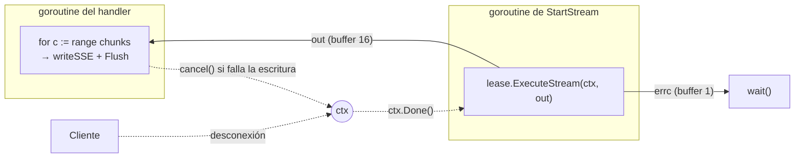

# 7. Concurrencia

## Modelo de concurrencia

### Goroutines por petición

| Goroutine | Quién la crea | Qué hace | Cuándo termina |
| :--- | :--- | :--- | :--- |
| Handler | `net/http` (una por petición) | Admisión, escritura SSE, log | Cuando acaba el stream o el cliente se va |
| Productor | `inference.StartStream` | Ejecuta `lease.ExecuteStream` y cierra el canal | Cuando `ExecuteStream` retorna |
| TTL | `time.AfterFunc` (solo si vence) | Llama a `lease.expire()` | Inmediatamente |
| Dispatcher | `scheduler.New` (una por proceso) | Escucha `CapacityChanged()` de todos los workers, las llegadas y el sondeo; entrega leases a las peticiones en cola | `Scheduler.Close()` |
| Healthcheck | `Scheduler.AddWorker` (una por worker, Fase 4) | Llama a `Health` cada `HealthInterval`; actualiza salud, breaker y reinicios | Al dar de baja el worker o en `Close()` |
| Lease gestionado | `scheduler/lease.go` (una por stream, Fase 4) | Un `StartStream` intermedio entre el worker y el handler: mide la ITL, corta cuelgues y reintenta antes del primer token | Cuando termina el stream del worker |
| Conector vLLM | `cmd/platform` o el `DNSWatcher` (una por servidor, Fases 6a y 7) | Descubre el servidor, lo registra cuando está listo y lo redescubre cada 30 s | Al cancelar su contexto (apagado, o el servidor sale del DNS: entonces da de baja su worker) |
| Observador de DNS | `cmd/platform` (una por nombre de `-vllm-dns`, Fase 7) | Resuelve el nombre cada 10 s y arranca o para conectores | Al apagar |

Reglas que evitan bloqueos y fugas de goroutines:

- **Solo el productor escribe en `out` y solo él lo cierra** (con `defer close(out)` en `StartStream`). `ExecuteStream` nunca lo cierra.
- **`errc` tiene buffer 1**: el productor puede dejar su error y terminar aunque nadie llame a `wait()`.
- **El productor nunca se bloquea para siempre**: toda espera y todo envío están en un `select` con `ctx.Done()`.
- **El handler siempre vacía el canal** hasta que se cierra, incluso después de fallar una escritura, para que el productor termine.
- **El dispatcher entrega cada lease por un canal con buffer 1** y marca la petición como servida bajo `Scheduler.mu`. Si la petición se rinde a la vez (cliente que se va o timeout), lo ve bajo el mismo lock y libera (o usa) ese lease: nunca se pierde capacidad.

### Estado compartido y locks

| Estado | Protección | Notas |
| :--- | :--- | :--- |
| `Ledger.reserved`, `active`, `granted`, `rejected` (`internal/ledger`, compartido por el simulador y el adaptador) | `Ledger.mu` | Solo aritmética bajo el lock; nunca E/S ni esperas. |
| Estado propio de cada worker (fallos e instancia del simulador; métricas del motor e instancia del adaptador) | `Worker.mu` de cada paquete | Independiente del ledger. |
| Estado del lease (`state`, `executed`, `expired`) | `lease.mu` | Serializa `begin`, `Release` y `expire`. |
| Colas, registro de workers (salud, breaker, drenaje), contadores y estadísticas del scheduler | `Scheduler.mu` | Se mantiene mientras se intentan leases (`Ledger.mu` se toma dentro, nunca al revés). |
| Estado del lease gestionado (intento actual, reintentos) | `managedLease.mu` | Fase 4. |
| Árbol de prefijos y caché de prefijos simulada | `prefix.Tree.mu`, `prefixCache.mu` | Cada uno el suyo; consultar la caché no bloquea `AcquireLease`. |
| Desplazamiento de `RoundRobin` | `atomic.Uint64` | Sin lock. |
| Configuración | Inmutable tras la creación | Se lee sin lock. Desde la Fase 4, la lista de workers **no** es inmutable: cambia con el registro y se protege con `Scheduler.mu`. |

**Orden de locks:** `lease.mu` y `Ledger.mu` nunca se mantienen a la vez (`Release()` y `expire()` sueltan `lease.mu` antes de llamar a `free()`). El único anidamiento es `Scheduler.mu` → `Ledger.mu` (la cola se recorre bloqueada mientras se intentan leases); el ledger nunca toma `Scheduler.mu`, solo avisa por un canal con envío no bloqueante. Con un único orden posible no hay riesgo de *deadlock*.

### Lo que comprueba el detector de carreras

`go test -race` instrumenta todos los accesos a memoria y falla si dos goroutines acceden al mismo dato sin sincronización y al menos una escribe. La suite se ejecuta con `-race -count=5` en Linux (`task test:race`) y pasa sin incidencias.

## Tests

La suite de tests (qué cubre cada paquete, la batería de contrato, el estrés con caos y los huecos conocidos) está en [operaciones · tests](../operaciones/02-tests.md).
