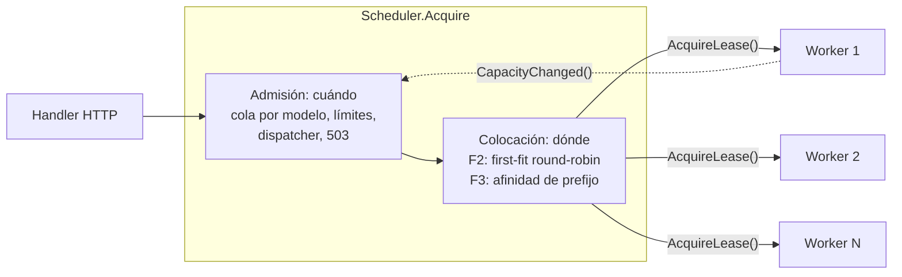

# 9. Fase 2: decisiones de diseño

Este documento recoge las decisiones de diseño de la Fase 2 (scheduler con colas acotadas, *load shedding* y tests de concurrencia intensa), con sus trade-offs y la opción elegida. Es el registro del *por qué*; cómo quedó implementado está en los documentos 1–7.

> **Estado (2026-11-09):** las siete decisiones están **aprobadas** con la opción recomendada, y los tres conflictos que surgieron al combinarlas están resueltos (ver [Conflictos resueltos](#conflictos-resueltos)). La decisión 2 se revisó antes de aprobarse, tras discutir el coste de red de la señal de capacidad.

## Conflictos resueltos

Al aplicar juntas las recomendaciones aparecieron tres conflictos. Se resolvieron antes de implementar:

| # | Conflicto | Decisión tomada | Alternativa descartada |
| :--- | :--- | :--- | :--- |
| C1 | La decisión 4 quería «reservar el hueco» a la cabeza envejecida, pero la decisión 3 separa la cola de la colocación, que no sabe de reservas. | **Barrera FIFO.** Si la cabeza de la cola de un modelo supera la edad máxima, ninguna otra petición de ese modelo la adelanta hasta que entre. La colocación no cambia. | Reservar capacidad en un worker concreto: aprovecha mejor la GPU pero rompe la separación admisión/colocación. |
| C2 | La decisión 5 limita la cola por tokens y la decisión 4 crea una cola por modelo: ¿límite por modelo o global? | **Por modelo:** cada modelo admite en cola hasta `QueueTokenFactor` (2) × el presupuesto total de sus workers, más un **tope global** de peticiones en espera (1024) que protege al proceso. | Un límite global: un modelo saturado podría hacer rechazar a otro con capacidad libre. |
| C3 | El timeout de la decisión 5 depende del tipo de tráfico. | **Solo tráfico interactivo** (chat, streaming). Timeout de cola corto (5 s, configurable), acotado por el deadline del cliente. | Interactivo + batch: requeriría clases de tráfico y *keep-alive* durante la espera. |

## Por qué la Fase 2 necesita estas decisiones

La Fase 1 resuelve *si* una petición cabe en un worker (ver [03 · Leases y capacidad](03-leases-y-capacidad.md)). La Fase 2 decide *qué hacer cuando no cabe*. Hoy la respuesta es un `503` inmediato. En un sistema LLM eso significa rechazar tráfico en picos de pocos segundos que una cola corta habría absorbido.

Cuatro propiedades de un motor real (vLLM) condicionan todas las decisiones:

| Propiedad | Qué pasa en vLLM | Consecuencia para el scheduler |
| :--- | :--- | :--- |
| *Continuous batching* | Las peticiones entran y salen del batch en cada paso de decode. | La capacidad se libera de forma continua, no en bloque: una cola corta suele encontrar hueco pronto. |
| La ITL depende del tamaño del batch | Más peticiones concurrentes hacen más lento cada paso de decode. | Admitir más no es gratis: degrada a quien ya está en curso. |
| Prefill caro, decode barato | Un prompt largo retrasa los pasos de decode de los demás. | El tamaño de la petición importa al decidir el orden. |
| Salida real ≪ `max_tokens` | vLLM asigna KV-Cache a medida que genera; si se queda sin memoria, expulsa (*preemption*). | La reserva pesimista infrautiliza la GPU (FI-1). |

En inferencia LLM **la cola es el funcionamiento normal**. La pregunta no es si encolar, sino dónde y cuánto antes de rechazar. Encolar en el control plane tiene una ventaja: todavía no se ha elegido worker, así que se puede elegir el mejor cuando se libera capacidad (y en la Fase 3, el que tenga el prefijo en caché).

## Resumen

| # | Decisión | Opción aprobada | Depende de |
| :--- | :--- | :--- | :--- |
| 1 | Realismo del simulador | Longitud de salida variable + ITL dependiente de la carga, con semilla | — |
| 2 | Señal de capacidad | `CapacityChanged()` en el contrato `Worker`: canal en memoria, una por petición terminada, agrupada; dispatcher único; sondeo lento de seguridad | — |
| 3 | Estructura del scheduler | Separar admisión (cola) y colocación (elección de worker) tras la misma `Acquire` | 2 |
| 4 | Disciplina de la cola | FIFO por modelo con adelantamiento acotado por edad | 3 |
| 5 | Límites y respuestas | Límite por tokens + tope por número; timeout corto acotado por el cliente; siempre `503` + `Retry-After` derivado de la carga | 4 |
| 6 | Load shedding | Rechazo por estado de la cola; umbral de ocupación aplazado a la Fase 6 | 5 |
| 7 | Tests y métricas | Contrato + estrés con invariantes + `cmd/loadgen`; cuatro métricas en `/debug/scheduler` | 1, 4 |

Fuera de alcance, salvo que se decida lo contrario: prioridades por cliente, liberación progresiva de la reserva (FI-1) y varias réplicas del control plane (FI-2).

---

## Decisión 1: realismo del worker simulado

**Decisión:** añadir longitud de salida variable y una ITL que crezca con la carga antes de diseñar la cola. Sin ellas, cualquier política de cola parece correcta en los tests y no se pueden comparar.

Hoy `simworker` siempre genera exactamente `max_tokens` (la reserva coincide al 100 % con el uso, así que FI-1 no se ve) y su ITL es constante (admitir más no penaliza a nadie). Ver [04 · Worker simulado](04-worker-simulado.md).

| Opción | Aporta | Coste | Riesgo |
| :--- | :--- | :--- | :--- |
| A. Dejarlo como está | Tests deterministas | Cero | La Fase 2 valida corrección, no calidad. |
| B. Solo salida variable | Se ve la capacidad infrautilizada (`finish_reason: stop`) | Bajo | La latencia sigue sin depender de la carga. |
| **C. Salida variable + ITL dependiente de la carga** | Aparece el trade-off throughput/latencia | Medio: `ITL = base × (1 + k × leases_activos)` | Ajustar a una ficción; se calibra en la Fase 6. |
| D. Simulador de batching completo | Lo más fiel | Alto | Contradice el no-objetivo de no reimplementar el motor. |

Con C: mantener el determinismo (la distribución usa la semilla de `seedFor(req.ID)` y se puede desactivar). La liberación progresiva de la reserva no entra todavía.

## Decisión 2: cómo se entera el scheduler de que hay capacidad libre

**Decisión:** añadir al contrato `Worker` una señal `CapacityChanged()`. Es un canal en memoria, sin datos, que se emite **una vez por cada petición terminada** y se agrupa sola. Al recibirla, un dispatcher único vuelve a intentar `AcquireLease`. No genera tráfico de red y no tiene nada que ver con los bloques de KV-Cache de vLLM.

### El problema

Una petición en cola tiene que despertar cuando un worker libera presupuesto. Pero el [ledger](03-leases-y-capacidad.md#el-ledger-de-capacidad) se libera **dentro del worker** por tres caminos que el pool no ve: el final de `ExecuteStream`, `Release()` y el vencimiento del TTL.

### Dónde vive cada pieza

En la Fase 6, quien implementa `inference.Worker` es el `VLLMAdapter`: un **objeto Go dentro del proceso del control plane**, no un proceso en el nodo de la GPU.

| Pieza | Dónde corre | Qué cruza la red |
| :--- | :--- | :--- |
| Scheduler y dispatcher | Proceso del control plane | Nada |
| `VLLMAdapter` (ledger, `CapacityChanged()`) | Mismo proceso | Nada: la señal es un canal Go |
| vLLM | Nodo GPU | Solo lo que ya existe: la petición HTTP y su stream SSE |

### Opciones

| Opción | Cómo funciona | A favor | En contra |
| :--- | :--- | :--- | :--- |
| A. Sondeo con backoff | La cola reintenta `AcquireLease` cada X ms. | No toca el contrato. | Hasta X ms de latencia extra; ráfagas de intentos contra el mutex del worker. |
| B. El pool envuelve cada lease | El `Lease` del pool despierta a la cola en `Release()`. | No toca `Worker`. | Pierde la liberación al terminar `ExecuteStream` y la del TTL. |
| **C. `CapacityChanged()` en el contrato** | Canal con buffer 1 y envío no bloqueante en `free()`; el dispatcher espera en un `select`. | Cubre los tres caminos; latencia de despertar ≈ 0; coste de nanosegundos. | Cambia la interfaz core. |
| D. Callback de registro | `onFree()` pasado al crear el worker. | Igual de completa que C. | Acopla el worker a quien lo usa; un canal se compone mejor con `select`. |

### Qué significa exactamente la señal

- **Una por petición.** Se emite cuando cambia el ledger: al terminar `ExecuteStream` (fin, error o cancelación), en un `Release()` sin ejecutar o al vencer el TTL. Nunca por token ni por bloque. Con vLLM, el adaptador sabe que la petición terminó porque **se cierra el stream SSE que está reenviando**: no hace falta ningún mensaje extra.
- **Sin datos: «algo cambió, vuelve a intentarlo».** La reserva sigue pasando por `AcquireLease`, única fuente de verdad atómica. Una señal perdida o duplicada no rompe la corrección; como mucho retrasa un intento.
- **Se agrupa sola.** Con buffer 1 y envío no bloqueante, mil liberaciones antes de que el dispatcher despierte producen un único despertar. El coste lo marca la frecuencia de despertares, no el número de liberaciones. Si hiciera falta, un intervalo mínimo entre recorridos (1–5 ms) lo acota del todo.
- **Un único consumidor.** La escucha el dispatcher del pool, no cada petición en cola; si no, una liberación despertaría a una petición al azar y se perdería el orden de la cola (decisión 4).
- **Red de seguridad.** Un sondeo lento (p. ej. cada 1 s) cubre a un worker que no emitiera la señal.

### Por qué no se usan los eventos de bloque de vLLM

- **El ledger es nuestro, no la KV-Cache.** Lo que vLLM haga con sus bloques (asignar, liberar, expulsar del LRU de *prefix caching*) no llega al adaptador ni cambia el ledger.
- **Una expulsión no es capacidad nueva.** En vLLM un bloque cacheado sin uso ya cuenta como asignable; la expulsión LRU ocurre *al asignar* memoria a otra petición. Es consecuencia de ocupar, no de liberar.
- **Coste.** Bajo alta concurrencia se expulsan miles de bloques por segundo. Propagarlos al scheduler sería una tormenta de mensajes para una información que la admisión no necesita.

### Cuando el ledger o la ocupación salgan del proceso

Regla: **enviar estado agregado periódicamente, nunca un evento por cambio**. El estado («libres: N tokens») es idempotente y tolera pérdidas.

| Escenario | Qué cruzaría la red | Cómo hacerlo |
| :--- | :--- | :--- |
| FI-2: admisión en un sidecar junto a cada vLLM | Cambios del presupuesto | El sidecar publica su estado como mucho cada X ms, o el scheduler lo consulta. |
| FI-1: usar la ocupación real de KV-Cache | La ocupación cambia en cada paso de decode | Leer `/metrics` de vLLM cada 100 ms – 1 s como pista con margen e histéresis, nunca como verdad atómica. |
| Fase 3: qué prefijos tiene cada vLLM (FI-6) | Bloques almacenados y expulsados | Las versiones recientes de vLLM pueden publicar eventos de KV-Cache agrupados (comprobar con la versión que se fije). Alimentan el **índice de routing**, no la admisión, y fuera del camino crítico. |

## Decisión 3: separar admisión y colocación

**Decisión:** partir el scheduler en dos piezas detrás de la misma `Acquire`. La **admisión** decide *cuándo* intentar (cola, timeouts, rechazo); la **colocación** decide *dónde* (qué worker). La interfaz que usa `httpapi` no cambia; solo se añaden los nuevos códigos de error.

| Opción | A favor | En contra |
| :--- | :--- | :--- |
| Un único `Pool` que lo hace todo | Menos tipos | La Fase 3 tendría que reescribir la cola; tests de cola y de routing mezclados. |
| **Dos piezas, colocación como interfaz** | Cada fase toca solo su pieza; cada una se prueba por separado; FI-6 es otra implementación. | Una interfaz más; hay que definir qué sabe la colocación. |

Con cola, la colocación se ejecuta muchas veces por petición (una por despertar hasta que entra): debe ser barata y sin efectos secundarios salvo el `AcquireLease` final.

## Decisión 4: disciplina de la cola

**Decisión:** una cola FIFO por modelo con **adelantamiento acotado**. Si la primera petición no cabe, pasan las siguientes que sí caben, pero solo mientras la primera no supere una edad máxima (p. ej. la mitad de su timeout); después se activa una **barrera FIFO** y nadie más de ese modelo la adelanta hasta que entre (C1).

Con reserva pesimista, una petición de `8K + 4K` cuesta 12K tokens y una de `200 + 256` unos 460: 26 veces menos. Eso produce dos fallos opuestos:

- **Bloqueo en cabeza (FIFO estricto):** la grande en cabeza bloquea a 50 pequeñas que cabrían ya; la GPU queda ociosa con trabajo en cola.
- **Inanición (adelantamiento libre):** mientras lleguen pequeñas, la grande nunca encuentra 12K libres de golpe.

| Opción | Utilización | Equidad | Complejidad |
| :--- | :--- | :--- | :--- |
| FIFO estricto | Mala con tamaños mezclados | Predecible | Mínima |
| Primera que cabe | La mejor | Las grandes pueden no salir nunca | Baja |
| **Adelantamiento con edad máxima** | Buena | Espera acotada | Media |
| Colas por tamaño | Buena | Umbrales arbitrarios | Media-alta |
| Prioridades por cliente | — | Multi-tenancy | Fuera de alcance |

Una cola **por modelo**: peticiones de modelos distintos no compiten por los mismos workers, y mezclarlas solo añade bloqueos falsos.

## Decisión 5: límites de cola, timeouts y códigos de respuesta

**Decisión:** limitar la cola **por tokens** (con un tope alto por número como seguridad), timeout de cola corto acotado por el deadline del cliente, y responder siempre `503` + `Retry-After` **antes de enviar cabeceras**.

- **Límite por tokens:** coherente con la unidad de capacidad; 100 peticiones de 12K no son 100 de 460.
- **Timeout:** `min(timeout_de_cola, deadline del cliente)`, corto (2–10 s) si el tráfico es interactivo. Si el cliente se va mientras espera, la petición sale de la cola sin pedir lease.
- **TTL del lease:** si el dispatcher obtiene el lease y lo entrega al handler, el TTL corre entre ambos pasos. Hoy nunca vence desde HTTP; con la cola sí puede, y necesita un test.
- **Rechazo anticipado por tiempo estimado** (README §4.2): se deja preparado pero desactivado hasta tener métricas.

| Situación | Recomendado | Por qué no la alternativa |
| :--- | :--- | :--- |
| Cola llena | `503` + `Retry-After` | `429` significa límite por cliente; confundiría cuando exista rate limiting. |
| Timeout en cola | `503` + `Retry-After` | `504` sugiere un upstream caído. |
| `Retry-After` | Derivado de la carga, mínimo 1 s, con *jitter* | Fijo a 1 s (actual) sincroniza los reintentos. |

Decidido (C3): solo tráfico interactivo. Si en el futuro hubiera clientes batch que toleran minutos de espera, habría que revisar el diseño de la cola.

## Decisión 6: señal de load shedding

**Decisión:** en la Fase 2 se rechaza por el **estado de la cola** (llena o timeout), no por un umbral de ocupación de los workers.

El 85 % de §4.2 del README está pensado para la ocupación **real** de KV-Cache. Con reserva pesimista, un 100 % reservado puede ser un 30 % de uso real; rechazar al 85 % reservado desperdiciaría aún más GPU.

| Señal | ¿Sirve para rechazar en la Fase 2? |
| :--- | :--- |
| % de presupuesto reservado (ledger) | No como umbral; el límite duro (100 %) ya lo aplica `AcquireLease`. |
| Profundidad de la cola (tokens) | Sí: es lo que controla el límite de la decisión 5. |
| Tiempo en cola / estimado | Sí, la mejor señal, pero necesita métricas. |
| Ocupación real (`vllm:kv_cache_usage_perc`) | En la Fase 6; permite relajar FI-1. |

**Admisión** (¿cabe ahora?) la resuelve el lease; **shedding** (¿merece la pena esperar?) la resuelve la cola. §4.2 del README debe actualizarse para separarlas y corregir el nombre de la métrica (FI-4).

## Decisión 7: tests, carga y métricas mínimas

**Decisión:** tres niveles de prueba y cuatro métricas adelantadas de la Fase 5.

| Nivel | Valida | Cómo |
| :--- | :--- | :--- |
| Contrato | Orden de la cola, adelantamiento, timeout, cancelación en cola, TTL tras la cola | Workers falsos controlables; reloj inyectable o canales, sin `time.Sleep`. |
| Estrés | Presupuesto nunca superado, sin capacidad perdida ni goroutines vivas | Miles de goroutines contra varios workers con `-race -count=N`; invariantes al final. |
| Carga | Si la política mejora algo frente al `503` inmediato | `cmd/loadgen`: llegadas Poisson, mezcla chat/RAG, cancelaciones. Requiere la decisión 1C. |

Métricas en `/debug/scheduler`: profundidad de cola por modelo (peticiones y tokens), tiempo en cola p50/p99, rechazos por motivo (cola llena, timeout, cancelación) y ocupación por worker (ya en `/debug/workers`).

El contador `LeasesRejected` de cada worker se infla con varios workers (ver [03](03-leases-y-capacidad.md#contabilidad-del-worker-internalledger)). Con la cola, los rechazos reales al cliente se cuentan en el scheduler (`rejected_queue_full`, `rejected_queue_timeout`).

`task check:all` necesita Docker Desktop arrancado (o gcc para `test:race:local`). A medio plazo, un CI en Linux debería ejecutarlo en cada push.

---

## Implementación (2026-11-09)

Las siete decisiones están implementadas. Detalle del código en [01](01-arquitectura.md), [03](03-leases-y-capacidad.md), [04](04-worker-simulado.md), [05](05-api-http.md) y [tests](../operaciones/02-tests.md).

| Decisión | Dónde | Cómo quedó |
| :--- | :--- | :--- |
| 1. Simulador | `internal/simworker` | `MeanOutputTokens` (exponencial acotada por `max_tokens`, semilla del ID) e `ITLLoadFactor` (`ITL × (1 + k × (leases − 1))`). Valen 0 por defecto en `Config`; el binario usa 200 y 0,05. |
| 2. Señal | `internal/inference`, `simworker` | `Worker.CapacityChanged() <-chan struct{}`: buffer 1, envío no bloqueante en `free()`. |
| 3. Estructura | `internal/scheduler` | `Scheduler` (admisión) + interfaz `Placement` con `RoundRobin`. Sustituye al `Pool` de la Fase 1. |
| 4. Cola | `scheduler.go` | FIFO por modelo; adelantamiento mientras la cabeza tiene menos de `HeadMaxAge` (2,5 s); barrera FIFO después (C1). |
| 5. Límites | `scheduler.go`, `httpapi` | `QueueTokenFactor` 2 por modelo + `MaxQueuedRequests` 1024 (C2); `QueueTimeout` 5 s acotado por el deadline del cliente (C3); `503 queue_full` / `queue_timeout` con `Retry-After`. |
| 6. Shedding | `scheduler.go` | Rechazo solo por estado de la cola; sin umbral de ocupación. |
| 7. Tests y métricas | `*_test.go`, `/debug/scheduler`, `cmd/loadgen` | Tests de contrato, test de estrés con invariantes, métricas y generador de carga. |

### Decisiones de implementación tomadas por el camino

Detalles que las siete decisiones dejaban abiertos:

| Tema | Elegido | Por qué |
| :--- | :--- | :--- |
| Cómo escucha el dispatcher N señales | Una sola goroutine con `reflect.Select` sobre las señales de todos los workers, las llegadas y el sondeo | Es literalmente un único consumidor; no hace falta una goroutine reenviadora por worker. |
| Coste por despertar | Una pasada por modelo, como mucho `MaxScan` (64) peticiones examinadas por modelo | Acota el trabajo cuando la cola es larga. |
| Intervalo mínimo entre pasadas | **No implementado** | Con la señal agrupada y `MaxScan`, el test de estrés no mostró necesidad. Se añadirá si `loadgen` lo justifica. |
| Cálculo de `Retry-After` | Media exponencial (peso 1/8) de la espera en cola de las peticiones que salen de ella, acotada entre 1 s y 30 s, más un *jitter* uniforme de hasta 1 s | No necesita estimar el throughput; refleja lo que los clientes están esperando de verdad. |
| `404` / `400` con cola | Se comprueban antes de encolar, con la configuración estática de los workers (modelos y presupuesto máximo) | Un `400` o `404` nunca debe esperar en la cola. |
| Camino rápido | Solo si la cola del modelo está vacía | Si no, una petición nueva se colaría delante de las que esperan. |
| Lease concedido justo al rendirse | Cancelación del cliente: se libera; timeout: se usa | En ambos casos la capacidad no se pierde; en el segundo, además, la petición sale adelante. |
| Percentiles de espera | Últimas 1.024 peticiones que salieron de la cola (admitidas o por timeout) | Suficiente para ajustar parámetros sin Prometheus (Fase 5). |

### Primera medición con `loadgen`

Con una sobrecarga deliberada de 2×, la cola absorbió lo que pudo y rechazó pronto el resto (49 % `200`, 46 % `503`) en lugar de alargar la latencia de todos. Montaje y cifras en [resultados](../operaciones/04-resultados-de-pruebas.md#fase-2-sobrecarga-deliberada-simulador).

---

## Qué pasó después

Este documento es el registro de la fase tal como se decidió; lo que anunciaba para fases posteriores se resolvió así (estado al cerrar el proyecto, 2026-11-21):

| Lo que quedó dicho aquí | Qué pasó |
| :--- | :--- |
| El `VLLMAdapter` sería un objeto Go dentro del proceso del control plane (decisión 2). | Así se hizo en la Fase 6a ([13](13-fase-6a-decisiones.md)): el ledger de cada vLLM vive en el control plane y la señal de capacidad es un canal Go. |
| El *load shedding* por umbral de ocupación se aplazaba a la Fase 6 (decisión 6). | **No se implementó.** Desde la 6a la plataforma lee la ocupación real de la KV-Cache de vLLM, pero solo la muestra; la admisión sigue rechazando por el estado de la cola. Va ligado a FI-1, que sigue abierta. |
| La ITL dependiente de la carga se calibraría en la Fase 6 (decisión 1). | **No se calibró:** sin GPUs no hay cifras de referencia, y las de CPU no son trasladables (6b-CPU). El simulador sirve para comparar políticas, no para predecir latencias. |
| Un CI en Linux debería ejecutar los tests en cada push (decisión 7). | **Hecho en la Fase 7:** GitHub Actions con `gofmt`, `go vet`, `go test -race` en Go 1.23 y `helm lint`. |
| Intervalo mínimo entre pasadas del dispatcher: se añadiría si `loadgen` lo justificaba. | No hizo falta en ninguna prueba posterior, tampoco con vLLM real. |
