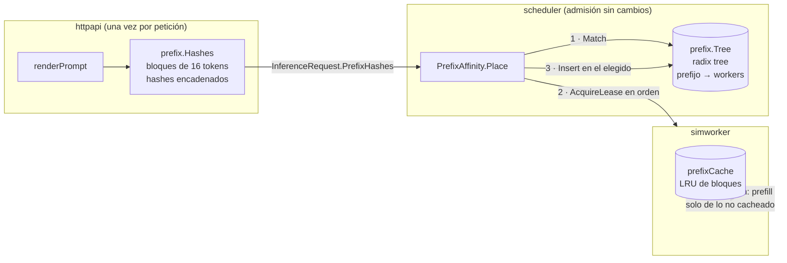

# 9. Fase 3: routing por prefijos (KV-Cache)

Este documento explica la Fase 3: qué problema resuelve el routing por afinidad de prefijo, cómo está implementado, qué decisiones se tomaron (con sus alternativas) y qué se midió. Cómo encaja cada pieza en el resto del servicio está también en los documentos 1–7.

> **Estado (2026-11-17):** implementada. Las decisiones se tomaron al implementar, con la opción recomendada en cada caso; a diferencia de la Fase 2, no hubo una ronda de aprobación previa. Si alguna se revisa, este documento es el sitio donde registrarlo.

## El problema

El *prefill* (procesar el prompt y llenar la KV-Cache) es la parte cara del TTFT. vLLM tiene *automatic prefix caching*: si los primeros bloques del prompt ya están en la KV-Cache **de esa GPU**, se los salta. Muchas cargas reales comparten prefijos largos:

- Un *system prompt* de cientos o miles de tokens común a todas las peticiones de una aplicación.
- Conversaciones multi-turno: cada turno reenvía todo el historial anterior.
- RAG con documentos frecuentes al principio del contexto.

La caché es **local a cada GPU**. Con round-robin, una petición cae en el worker que tiene su prefijo con probabilidad 1/N, y cada worker acaba guardando todos los prefijos, así que la caché efectiva del clúster es la de una sola GPU. El router por prefijos envía cada petición al worker que ya tiene su prefijo, con lo que el clúster suma las cachés de todas las GPU en vez de repetirlas.

vLLM no puede hacer esto por su cuenta: no sabe que existen otras réplicas ([06](06-relacion-con-vllm.md#reparto-de-responsabilidades)).

## Cómo funciona



1. **Hashing (`internal/prefix/hash.go`).** `httpapi` corta el prompt renderizado en bloques de `BlockTokens` = 16 tokens estimados (64 caracteres) y calcula un hash FNV-64a **encadenado** por bloque: `h[i] = hash(h[i-1] ‖ bloque_i)`, con `h[-1]` derivado del modelo. El hash del bloque *i* identifica todo el prefijo hasta ese bloque. Solo se hashean bloques completos. Los hashes viajan en `InferenceRequest.PrefixHashes`.
2. **Radix tree (`internal/prefix/tree.go`).** Un árbol cuyas aristas son secuencias de hashes (comprimidas: un *system prompt* de 100 bloques es un nodo, no 100). Cada nodo guarda qué workers tienen ese prefijo y cuándo lo usaron por última vez. `Match(hashes)` devuelve, por worker, cuántos bloques iniciales tiene.
3. **Colocación (`internal/scheduler/affinity.go`).** `PrefixAffinity` implementa la interfaz `Placement` de la Fase 2. Ordena los workers, prueba `AcquireLease` en ese orden (el primero que concede gana, como en round-robin) y registra el prefijo en el árbol para el worker elegido.
4. **Caché simulada (`internal/simworker/prefixcache.go`).** El worker simulado tiene su propia caché LRU de bloques: la "verdad" que el árbol intenta aproximar. El TTFT pasa a ser `BaseTTFT + PrefillPerToken × tokens no cacheados`.

La admisión (cola por modelo, barrera FIFO, límites, `503`) **no cambia**: era el objetivo de separar admisión y colocación en la Fase 2 ([08 · Decisión 3](08-fase-2-decisiones.md#decisión-3-separar-admisión-y-colocación)).

## Resumen de decisiones

| # | Decisión | Opción elegida | Alternativa principal descartada |
| :--- | :--- | :--- | :--- |
| 1 | Qué se hashea | Todo el prompt, en bloques de 16 tokens con hashes encadenados | Solo el *system prompt* |
| 2 | Dónde se hashea | En `httpapi`, una vez; viaja en el contrato | En la colocación, en cada intento |
| 3 | Estructura | Radix tree comprimido, uno para todos los modelos | Mapa plano bloque → workers |
| 4 | Cómo se aproxima la caché real | LRU por worker con capacidad estimada; expulsión por hojas | TTL fijo por entrada |
| 5 | Algoritmo de afinidad | Afinidad con umbral de carga; desbordamiento al menos cargado | Puntuación ponderada `match − α·carga` |
| 6 | Cuándo se registra un prefijo | Al conceder el lease (optimista) | Al terminar el prefill (confirmado) |
| 7 | Caché en el simulador | LRU de bloques por worker, separada del ledger | Descontar los bloques cacheados del ledger |

---

## Decisión 1: qué se hashea

**Decisión:** el prompt completo, cortado en bloques de 16 tokens estimados, con hashes encadenados y solo bloques completos. Es el modelo de vLLM (*automatic prefix caching* trabaja por bloques de `--block-size`, 16 por defecto, identificados por un hash del bloque y de su prefijo).

| Opción | Ventaja | Problema |
| :--- | :--- | :--- |
| Solo el *system prompt* (hash del primer mensaje) | Trivial | No cubre conversaciones multi-turno ni RAG; depende de que el cliente use el rol `system`. |
| **Bloques encadenados del prompt completo** | Captura cualquier prefijo compartido, de cualquier longitud; igual que el motor | Un hash por bloque (1 por cada 64 caracteres). |
| Hash de longitud variable (por mensaje) | Menos hashes | Dos prompts que comparten medio mensaje no comparten nada. |

Detalles:

- **Encadenado:** dos prompts comparten sus primeros *k* hashes exactamente cuando comparten sus primeros *k* bloques. El mismo texto en otra posición da otro hash, porque la caché de un bloque no sirve sin la de los anteriores.
- **Semilla por modelo:** la KV-Cache de un modelo no sirve para otro. Así basta un árbol para todos los modelos.
- **Solo bloques completos:** vLLM no reutiliza un bloque a medias. Un prompt de menos de 64 caracteres no tiene hashes y se coloca solo por carga.
- **Por caracteres, no por tokens:** sin tokenizer (FI-3), los bloques se cortan cada 64 runas, la misma proporción que `tokens.Estimate`. Los límites de bloque no coinciden con los de vLLM, pero el router no lo necesita: solo necesita que el mismo texto dé la misma identidad. El coste es que la caché simulada asume 16 tokens por bloque.

## Decisión 2: dónde se calculan los hashes

**Decisión:** en `httpapi.toInferenceRequest`, una vez por petición, y viajan en el nuevo campo `InferenceRequest.PrefixHashes`.

El dispatcher puede llamar a `Place` muchas veces para la misma petición mientras espera en la cola (una por despertar). Hashear allí repetiría el trabajo, y además `Place` se ejecuta con el mutex del scheduler tomado. Calcularlos al construir la petición deja `Place` en O(bloques) de búsqueda en el árbol.

El campo es opcional: sin hashes, `PrefixAffinity` coloca por carga y la caché simulada no hace nada. Los tests de las fases 1 y 2 no cambian.

## Decisión 3: radix tree comprimido

**Decisión:** un radix tree sobre secuencias de hashes, con aristas comprimidas, un único árbol para todos los modelos (el modelo va en la semilla del hash) y, en cada nodo, un mapa `worker → último uso`.

| Opción | Ventaja | Problema |
| :--- | :--- | :--- |
| Mapa plano `hash → workers` (como vLLM dentro de una GPU) | Muy simple | La expulsión LRU por worker no sabe qué bloques son "hojas"; hay que recorrer el prefijo bloque a bloque en cada consulta. |
| **Radix tree comprimido** (como SGLang) | Un prefijo largo compartido ocupa un nodo; la expulsión por hojas sale natural; lo pedía el roadmap | Hay que partir aristas al insertar. |

**Invariante:** si un worker está marcado en un nodo, también lo está en todos sus antecesores (tener un prefijo implica tener todos los más cortos). `Insert` marca el camino entero y la expulsión quita siempre las hojas primero, así que se mantiene, y `Match` puede quedarse con la marca más profunda de cada worker. Un test aleatorizado (`TestTreeRandomized`) comprueba la invariante y los contadores tras cada una de 3.000 operaciones.

**Partir aristas:** si una petición diverge a mitad de una arista, el nodo se parte en dos y los workers del nodo original se copian al nuevo nodo superior (tenían la arista entera, luego también su primera parte). Los contadores de bloques no cambian.

**Recencia con reloj lógico:** un contador que sube en cada `Insert`, no la hora. El árbol no depende del reloj y los tests son deterministas.

## Decisión 4: cómo se aproxima la caché real (FI-6, primera parte)

El router no ve lo que vLLM expulsa de su caché. Si el árbol solo creciera, acabaría apuntando a prefijos que ya no están.

**Decisión:** cada worker tiene en el árbol una **capacidad en bloques**, por defecto `TokenBudget / 16` (toda su KV-Cache, que es lo que vLLM puede mantener cacheado cuando está ociosa). Cuando un `Insert` la supera, se expulsan del árbol las **hojas** de ese worker menos usadas, hasta 7/8 de la capacidad (el margen hace que la expulsión no ocurra en cada inserción).

**Por qué funciona:** con una sola réplica del control plane (FI-2), el router ve **todo** el tráfico que llega a cada worker. Su LRU recibe la misma secuencia de usos que la del worker, así que expulsa más o menos lo mismo. La medición lo confirma: el router predijo un 73,8 % de aciertos y la caché real tuvo un 74,5 % ([Mediciones](#mediciones)).

**Dónde diverge** (y por qué no importa demasiado: un error solo cuesta un prefill, nunca corrección):

- vLLM no puede expulsar bloques en uso por peticiones en curso; el árbol sí.
- El árbol expulsa nodos enteros. Un nodo de 100 bloques se va de una vez, aunque bastara con quitar 2.
- La capacidad es una estimación: la caché real de vLLM es la memoria de KV libre, que varía con la carga.
- Si un worker reinicia, su caché se vacía y el árbol no se entera. `PrefixAffinity.RemoveWorker` existe para eso, y lo llamará el registro de workers de la Fase 4.
- Un prompt más largo que la capacidad de un worker no cabe: el árbol lo expulsa entero al insertarlo (y el worker tampoco lo retendría).

**Alternativa descartada: TTL fijo.** Es más simple, pero no relaciona la expulsión con la presión real sobre la caché: un TTL corto pierde prefijos que siguen en la GPU, uno largo mantiene los que ya se expulsaron. La memoria del árbol queda acotada igualmente por la suma de capacidades.

## Decisión 5: algoritmo de afinidad (FI-6, segunda parte)

La afinidad pura envía todo el tráfico de un prefijo popular al mismo worker y lo satura. Hay que combinar afinidad y carga.

**Decisión:** dos grupos, y dentro de cada uno un orden. Los workers se prueban en este orden con `AcquireLease` y gana el primero que concede:

1. **Afines:** `match ≥ MinMatchBlocks` (4 bloques ≈ 64 tokens) y `carga ≤ MaxLoad` (0,8). Primero el prefijo más largo y, a igualdad, el menos cargado.
2. **El resto**, del menos al más cargado. Los empates rotan, como en round-robin.

`carga = (tokens reservados + coste de esta petición) / presupuesto`, leída del `Snapshot()` del ledger.

**El desbordamiento replica los prefijos calientes.** Cuando el worker afín pasa de `MaxLoad`, la petición va al menos cargado, que cachea el prefijo y queda registrado en el árbol. Desde ese momento hay dos workers afines y el empate se resuelve por carga. Un prefijo popular se extiende a tantos workers como su tráfico necesite, sin configurar nada. En la medición con un único *system prompt* para todo el tráfico, bastaron **2 desbordamientos** para replicarlo en los 3 workers, y el reparto quedó en 88/83/64 leases.

| Opción | Ventaja | Problema |
| :--- | :--- | :--- |
| Afinidad pura | Máximo acierto | Satura el worker de un prefijo popular (FI-6). |
| **Afinidad con umbral de carga** | Simple de razonar: "sigue la caché salvo que el worker esté cargado" | El umbral se mide sobre el ledger pesimista (ver [Interacción con FI-1](#interacción-con-fi-1-la-reserva-pesimista)). |
| Puntuación `match − α·carga` | Un único orden continuo | `α` no tiene unidades naturales; difícil de ajustar y de explicar. |
| *Power of two choices* entre los afines | Reparte bien | Descarta el prefijo más largo la mitad de las veces. |

**`MinMatchBlocks`:** un acierto de 1–3 bloques (16–48 tokens) ahorra un prefill despreciable. Sin este mínimo, un saludo común (`user: Hola, ...`) desequilibraría el reparto sin ganar nada.

**Por qué no esperar al worker afín:** si el worker afín está lleno, la petición va a otro que tenga sitio, aunque haya que hacer el prefill entero. Esperar a un worker concreto sería una reserva por worker, que la Fase 2 descartó al separar cola y colocación ([08 · C1](08-fase-2-decisiones.md#conflictos-resueltos)). Un prefill completo cuesta decenas o cientos de ms; esperar en la cola puede costar segundos.

## Decisión 6: el prefijo se registra al conceder el lease

**Decisión:** en cuanto `AcquireLease` concede, `Place` llama a `Tree.Insert(worker, hashes)`. Es **optimista**: el worker todavía no ha hecho el prefill.

La alternativa (registrarlo cuando el worker confirma el prefill) necesitaría una señal nueva en el contrato `Lease`, y el beneficio es pequeño. La ventana en la que el árbol se adelanta dura un TTFT, y lo que se gana es que dos peticiones con el mismo prefijo que llegan casi a la vez vayan al mismo worker. Con vLLM, la segunda reutiliza los bloques de la primera en cuanto están calculados.

Solo se registran las colocaciones con éxito. Los intentos fallidos del dispatcher (petición que no cabe) no tocan el árbol.

## Decisión 7: caché de prefijos en el simulador

Sin una caché simulada, el router no se puede medir: el TTFT sería el mismo vaya donde vaya la petición. Era la tercera mejora pendiente de [04](04-worker-simulado.md#cómo-hacerlo-más-realista-si-hiciera-falta).

**Decisión:** `simworker.Config.PrefixCacheBlocks` activa una LRU de bloques por worker (`-prefix-cache-blocks`, por defecto `token-budget / 16`; 0 la desactiva y es el valor por defecto en los tests de las fases 1 y 2). Al empezar `ExecuteStream`:

1. Cuenta cuántos bloques **iniciales consecutivos** de `PrefixHashes` están en la caché. Un bloque cacheado después de un fallo no sirve, como en vLLM.
2. `TTFT = BaseTTFT + PrefillPerToken × (PromptTokens − bloques_acertados × 16)`.
3. Toca todos los bloques de la petición **del último al primero**, para que los primeros (los compartidos) sean los más recientes y se expulsen los últimos. vLLM hace lo mismo al liberar los bloques de una petición en orden inverso.

**La caché no descuenta capacidad del ledger.** En vLLM la caché vive en la memoria de KV libre y los bloques compartidos se cuentan una sola vez. Aquí la caché es un conjunto aparte y el ledger sigue cobrando el prompt completo a cada petición (FI-1). Mezclar ambos cambiaría la admisión, que no es el alcance de esta fase.

`/debug/workers` expone la verdad del worker: `prefix_cache_blocks`, `prefix_cache_used`, `prefix_blocks_queried` y `prefix_blocks_hit`.

## Interacción con la cola

- `Place` se llama igual que en la Fase 2: en el camino rápido de `Acquire` y desde el dispatcher para cada petición en espera, siempre con el mutex del scheduler tomado. El árbol tiene su propio mutex; el orden de bloqueo es siempre `scheduler.mu` → `PrefixAffinity.mu`/`Tree.mu`, también en `Stats()`.
- La cola sigue siendo **por modelo**, no por worker: una petición en espera entra en el primer worker que libere capacidad suficiente, tenga o no su prefijo (ver Decisión 5).
- La barrera FIFO y los límites no cambian.

## Interacción con FI-1: la reserva pesimista

El ledger cobra `prompt + max_tokens` a cada petición, aunque el prompt sea un prefijo ya cacheado. Con afinidad esto se nota más: 10 peticiones con el mismo *system prompt* de 1.500 tokens en el mismo worker reservan 15.000 tokens de ledger para lo que en vLLM serían ~1.500 de KV-Cache compartida. Consecuencias:

- `MaxLoad` se mide sobre una carga sobrestimada, así que el desbordamiento ocurre antes de lo necesario. En la práctica, eso replica antes los prefijos calientes.
- La capacidad del pool en peticiones por segundo no mejora con la afinidad; solo mejora la latencia (TTFT).

Descontar del coste los bloques que se espera encontrar en caché es una de las opciones ya listadas en FI-1. Se revisará con la ocupación real de vLLM en la Fase 6.

## Configuración

| Flag (`cmd/platform`) | Por defecto | Qué controla |
| :--- | :--- | :--- |
| `-placement` | `prefix` | `prefix` (`PrefixAffinity`) o `round-robin` (la colocación de la Fase 2, para comparar). |
| `-affinity-max-load` | `0.8` | Carga del ledger a partir de la cual un worker deja de recibir peticiones solo por afinidad. |
| `-affinity-min-blocks` | `4` | Prefijo mínimo cacheado que cuenta como afinidad, en bloques de 16 tokens. |
| `-prefix-cache-blocks` | `-1` (= `token-budget/16`) | Caché de prefijos simulada por worker; `0` la desactiva. |

En código, `scheduler.Config.Placement` sigue siendo `&RoundRobin{}` por defecto. El binario elige `NewPrefixAffinity`.

## Métricas

`GET /debug/scheduler` incluye un bloque `placement` (`AffinityStats`):

| Campo | Significado |
| :--- | :--- |
| `placements` / `with_prefix` | Leases concedidos; los que tenían al menos un bloque. |
| `affinity_hits` | Fueron a un worker con ≥ `MinMatchBlocks` de su prefijo. |
| `shorter_match` | De ellos, los que tenían otro worker con un prefijo más largo pero cargado o lleno. |
| `affinity_overflows` | Tenían un worker afín, pero fueron a otro sin acierto útil porque los afines estaban cargados o llenos. Es la señal de un prefijo caliente replicándose. |
| `queried_blocks` / `predicted_hit_blocks` / `predicted_hit_rate` | Acierto de caché que **espera** el router. |
| `tree.nodes`, `tree.blocks_per_worker`, `tree.evicted_blocks` | Tamaño del árbol y expulsiones. |

`predicted_hit_rate` frente a `prefix_blocks_hit / prefix_blocks_queried` de `/debug/workers` mide lo desfasado que está el árbol respecto a las cachés reales. `cmd/loadgen` imprime ambos al terminar.

## Mediciones

Con `-prefill-per-token 100us` (~10.000 tokens/s de prefill, más cerca de un modelo 8B real que los 20 µs por defecto), 3 workers con el presupuesto por defecto (16.384 tokens, caché de 1.024 bloques cada uno), 4 req/s durante 60 s, sin RAG ni cancelaciones, y la misma semilla en ambos modos:

```bash
task run -- -placement prefix -prefill-per-token 100us        # o -placement round-robin
task loadgen -- -rate 4 -duration 60s -prefixes 24 -rag-fraction 0 -cancel-fraction 0
```

| Escenario | Colocación | TTFT p50 | TTFT p99 | Acierto real | Acierto previsto | Reparto de leases |
| :--- | :--- | ---: | ---: | ---: | ---: | :--- |
| 24 *system prompts* de ~1.500 tokens, uniformes | **prefix** | **57 ms** | 210 ms | **74,5 %** | 73,8 % | 82 / 79 / 74 |
| | round-robin | 206 ms | 214 ms | 39,8 % | — | 79 / 78 / 78 |
| 24 prompts, Zipf `-prefix-skew 1.5` (unos pocos calientes) | **prefix** | 56 ms | 207 ms | **85,9 %** | 85,4 % | 72 / 50 / 89 |
| | round-robin | 57 ms | 208 ms | 75,8 % | — | 71 / 70 / 70 |
| 1 único prompt para todo el tráfico | **prefix** | 56 ms | 73 ms | 95,7 % | — | 88 / 83 / 64 |
| | round-robin | 56 ms | 78 ms | 95,7 % | — | 79 / 78 / 78 |

Lectura:

- **Uniforme:** el caso para el que existe el router. Los 24 prompts ocupan ~2.250 bloques, más que la caché de un worker (1.024) pero menos que la de los tres. Con round-robin cada worker intenta guardarlos todos y se expulsan entre sí. Con afinidad se reparten y caben, así que el TTFT p50 baja de 206 ms a 57 ms (el prefill de 1.500 tokens desaparece). El p99 sigue en ~210 ms porque cada prompt hace un prefill completo la primera vez en cada worker, y 22 peticiones desbordaron por carga.
- **Zipf:** los prompts calientes caben en todas las cachés, así que round-robin también acierta en la mediana. La afinidad mejora el acierto global (+10 puntos) a costa de un reparto menos uniforme (50–89), que el umbral de carga mantiene acotado.
- **Un solo prompt (el caso de FI-6):** sin el umbral, los 235 leases habrían ido a un worker. Con él, 2 desbordamientos replicaron el prompt en los 3 workers y desde entonces el empate se resolvió por carga. Acierto y latencia son iguales que con round-robin: la afinidad no empeora el caso que más temía FI-6.
- El acierto previsto por el árbol queda a menos de 1 punto del real en los dos casos con expulsiones. Aproximar la caché con una LRU propia funciona mientras haya una sola réplica.

A 20 req/s (unas 4× la capacidad del pool con reserva pesimista) ambos modos saturan y el TTFT lo domina la cola (~5 s). La afinidad no añade capacidad (ver FI-1 arriba).

## Limitaciones y trabajo futuro

- **Los hashes no son los de vLLM.** vLLM hashea IDs de token tras aplicar la *chat template*; nosotros, texto aplanado (`renderPrompt`). Para el router da igual (solo necesita identidades consistentes), pero el `VLLMAdapter` de la Fase 6 ignorará `PrefixHashes` y la caché real será la de vLLM. Si la plantilla del modelo inserta texto variable al principio (fechas, por ejemplo), dos prompts que aquí comparten prefijo podrían no compartirlo en vLLM. Hay que comprobarlo con la plantilla real.
- **El árbol no se compacta.** Tras una expulsión pueden quedar un padre y un único hijo con los mismos workers, que podrían fusionarse. No afecta a la corrección, solo al número de nodos.
- **Sin eventos del motor.** El árbol no recibe confirmación de lo que hay realmente en cada GPU. Si la versión de vLLM que se fije publica eventos agrupados de KV-Cache, podrán corregir el árbol fuera del camino crítico ([06](06-relacion-con-vllm.md#el-vllmadapter-fase-6a)).
- **Varias réplicas (FI-2):** cada réplica tendría su propio árbol y vería solo parte del tráfico, así que su LRU dejaría de imitar la del worker. El particionado por worker de FI-2 lo resolvería: cada worker pertenece a una sola réplica.
- **`RemoveWorker`** no está conectado a nada todavía: no hay registro de workers hasta la Fase 4.
