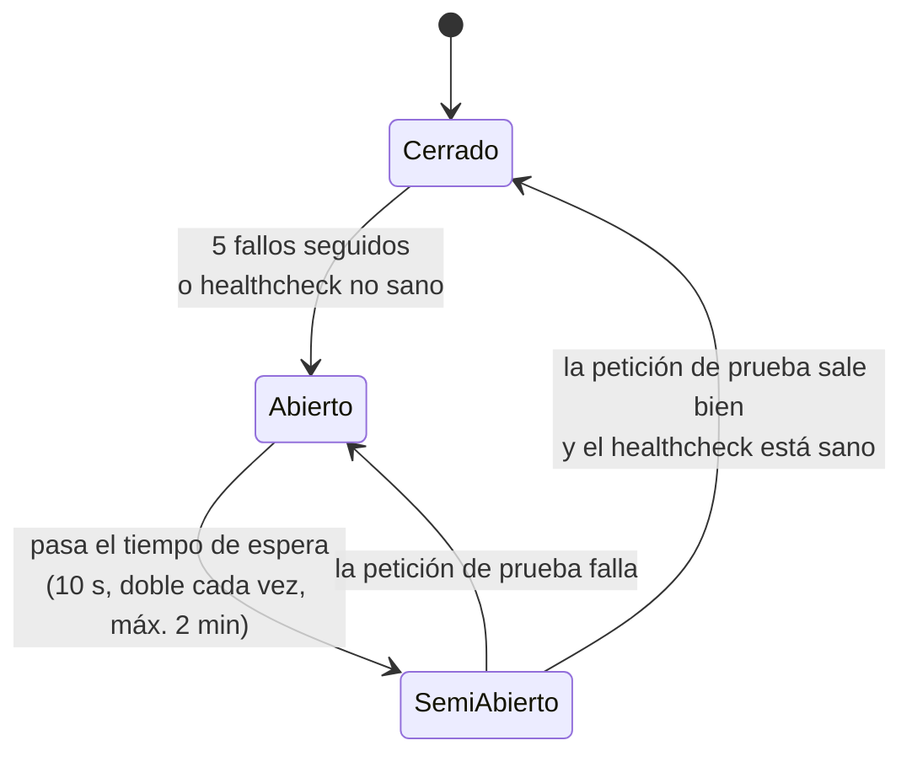

# 10. Fase 4: resiliencia y ciclo de vida — decisiones de diseño

Este documento recoge las decisiones de diseño de la Fase 4 (salud de los workers, *circuit breakers*, reintentos y alta y baja de workers en caliente), con sus alternativas y la opción elegida. Como en la [Fase 2](08-fase-2-decisiones.md), es el registro del *por qué*; cómo quedó el código está en los documentos 1–7 y en [Implementación](#implementación-2026-11-18).

> **Estado (2026-11-18):** las siete decisiones y los cuatro conflictos están **aprobados con la opción recomendada** e **implementados**. Al implementar se corrigió un detalle de la decisión 3 (la mediana de la ITL excluye al propio worker, ver [Implementación](#decisiones-de-implementación-tomadas-por-el-camino)).

## Por qué la Fase 4 necesita estas decisiones

Hasta ahora ningún worker falla: `simworker` siempre responde, nunca se cuelga y nunca se reinicia. Con vLLM (Fase 6) los fallos son el funcionamiento normal, y cada uno pide una respuesta distinta:

| Fallo real con vLLM | Cómo se manifiesta en el control plane | Qué debería pasar |
| :--- | :--- | :--- |
| Proceso caído o pod borrado | Conexión rechazada al empezar `ExecuteStream` | No enviarle más peticiones; reintentar la petición en otro worker. |
| GPU colgada (driver, NCCL) | La conexión se acepta pero no llega ningún token | Cortar la petición tras un plazo, liberar su lease, reintentar y aislar el worker. |
| GPU degradada (*throttling*, vecino ruidoso) | TTFT e ITL altos, pero responde | Seguir usándola, pero solo cuando las demás estén llenas. |
| Reinicio de vLLM | Streams en curso cortados; la caché de prefijos vuelve vacía | Fallar los streams afectados; olvidar sus prefijos en el radix tree. |
| Error de la petición (p. ej. `400` por `--max-model-len`) | `ExecuteStream` devuelve error al empezar | Devolver `400` al cliente. **No** es culpa del worker y no debe aislarlo. |
| Alta o baja de nodos (autoscaler de la Fase 7) | Hoy imposible sin reiniciar: la lista de workers es fija | Dar de alta en caliente; dar de baja **drenando**, sin cortar streams. |

El roadmap original pedía *heartbeats* del worker al registro y *circuit breakers* por latencia. La decisión 2 explica por qué se propone sustituir los heartbeats por *healthchecks* activos, y la decisión 3 por qué la latencia alta no debería aislar un worker.

## Conflictos a resolver

Al combinar las recomendaciones aparecen cuatro conflictos. Se proponen así:

| # | Conflicto | Propuesta | Alternativa descartada |
| :--- | :--- | :--- | :--- |
| C1 | Reintentar en otro worker (decisión 4) es imposible si el `200` ya se envió (FI-9). | **Retrasar las cabeceras hasta el primer chunk** (o hasta el error). Resuelve FI-9 a la vez. | Reintentar solo las peticiones sin streaming: deja fuera casi todo el tráfico. |
| C2 | El breaker aísla un worker; ¿se borran sus prefijos del radix tree (Fase 3)? | **No.** Un worker aislado suele volver con la caché intacta. Solo se borran al darlo de baja o al detectar un reinicio (cambio de `InstanceID`, decisión 2). | Borrarlos al abrir el breaker: un fallo transitorio costaría todos sus aciertos de caché. |
| C3 | Si todos los workers de un modelo están aislados, ¿las peticiones nuevas esperan en la cola? | **No: `503 no_healthy_workers` inmediato con `Retry-After`.** La cola es para esperar capacidad, no recuperación. Las que ya esperaban siguen hasta su timeout. | Encolar: el cliente esperaría 5 s para recibir casi seguro un `503`. |
| C4 | La ITL sube con la carga de forma legítima (*continuous batching*); un detector de latencia podría confundir "cargado" con "degradado". | **La latencia solo despriorizaría, nunca aislaría** (decisión 3), comparando cada worker con la mediana de su modelo. Un falso positivo cuesta poco. | Aislar por latencia: un falso positivo quita capacidad, carga más al resto, sube su ITL y puede aislar en cascada. |

## Resumen

| # | Decisión | Opción recomendada | Depende de |
| :--- | :--- | :--- | :--- |
| 1 | Registro de workers | Alta y baja en caliente en el scheduler; baja con drenaje | — |
| 2 | Detección de caídas | *Healthcheck* activo (pull) con `Health(ctx)` en el contrato, más detección pasiva por tráfico | 1 |
| 3 | Aislamiento | *Circuit breaker* por worker que solo abren errores y cuelgues; la latencia solo desprioriza | 2 |
| 4 | Reintentos | Un reintento en otro worker si falla antes del primer token; cabeceras retrasadas hasta el primer chunk | 3, C1 |
| 5 | Clasificación de errores | Nuevo error `ErrWorkerFailure` en el contrato: el worker distingue sus fallos de los de la petición | — |
| 6 | Fallos simulados | Inyección de fallos en `simworker`, configurable en caliente desde `/debug` | — |
| 7 | Tests y métricas | Máquina de estados con reloj falso, estrés con caos y `loadgen` con un worker que cae | 1–6 |

Fuera de alcance salvo que se decida lo contrario: varias réplicas del control plane (FI-2), descubrimiento de workers desde Kubernetes (Fase 7) y métricas Prometheus (Fase 5).

---

## Decisión 1: registro de workers (alta y baja en caliente)

**Recomendación:** que el scheduler admita `AddWorker(w)` y `RemoveWorker(id)` en caliente. La baja **drena**: el worker deja de recibir peticiones nuevas, sus streams en curso terminan con normalidad y solo entonces desaparece (también del radix tree).

Hoy `scheduler.New` recibe la lista de workers y calcula con ella todo lo estático: las colas por modelo, el presupuesto máximo (para el `400` inmediato), el límite de cada cola y los canales que escucha el dispatcher. Nada de eso puede cambiar después.

| Opción | A favor | En contra |
| :--- | :--- | :--- |
| A. Lista fija + estado de salud | Mínimo cambio | El autoscaler de la Fase 7 y los reinicios con otra dirección necesitarían reiniciar el control plane. |
| **B. Alta y baja en caliente en el scheduler** | Prepara la Fase 7; la baja con drenaje es la base del *scale-down* sin cortar streams | Recalcular lo estático bajo el mutex y reconstruir la escucha del dispatcher. |
| C. Servicio de registro separado | Desacopla | Prematuro con una réplica (FI-2); otro proceso que operar. |

Detalles de la opción B:

- **Estados de un worker en el registro:** `activo` → `drenando` → eliminado. Un worker drenando no se ofrece a la colocación, pero su `CapacityChanged()` se sigue escuchando hasta que sus leases terminan.
- **Lo estático pasa a ser derivado:** al cambiar la lista se recalculan, bajo `scheduler.mu`, los workers por modelo, el presupuesto máximo y el límite de cada cola. Un modelo que se queda sin workers conserva su cola; las peticiones que esperaban vencen con su timeout normal.
- **Dispatcher:** un cambio de la lista lo despierta (por el canal `kick` que ya existe) y reconstruye su lista de canales de `reflect.Select`.
- **¿Quién llama a `AddWorker` y `RemoveWorker`?** En la Fase 4, `cmd/platform` al arrancar y unos *endpoints* de depuración (`POST /debug/workers`, `DELETE /debug/workers/{id}`) para probar a mano y desde `loadgen`. En la Fase 7, el *watch* de los Endpoints de Kubernetes.
- **`404` frente a `503`:** un modelo es "conocido" mientras algún worker registrado lo sirva, esté sano o no. Si no lo sirve nadie, `404`; si lo sirven solo workers aislados, `503 no_healthy_workers` (C3).

## Decisión 2: cómo se detecta que un worker ha caído

**Recomendación:** *healthcheck* **activo**: el control plane consulta cada worker de forma periódica con un nuevo método del contrato, `Health(ctx) (HealthStatus, error)`. Se complementa con detección **pasiva**: los fallos de las peticiones reales alimentan el breaker (decisión 3).

| Opción | Cómo funciona | A favor | En contra |
| :--- | :--- | :--- | :--- |
| A. *Heartbeats* push (worker → registro) | El worker avisa cada X s; si deja de avisar, está caído | Es lo que decía el roadmap; escala bien con muchos workers | **vLLM no envía heartbeats.** Haría falta un *sidecar* por GPU, que solo tiene sentido con la admisión en el worker de FI-2. |
| **B. Healthcheck pull** | El control plane llama a `Health` cada 2 s, con un timeout de 1 s | vLLM ya expone `GET /health`; detecta caídas aunque no haya tráfico | Una petición por worker cada 2 s (despreciable con decenas de workers). |
| C. Solo pasiva (por tráfico) | Los fallos de peticiones reales marcan al worker | Sin tráfico extra | No detecta una caída hasta que una petición real la sufre, ni la recuperación sin tráfico. |

Detalles de la opción B:

- **Histéresis:** 3 *healthchecks* fallidos seguidos → no sano; 2 correctos seguidos → sano otra vez. Evita que un fallo suelto saque al worker.
- **Contrato:** `Health(ctx) (HealthStatus, error)`. `HealthStatus` incluye un `InstanceID`, que identifica el proceso. Si cambia, el worker se ha reiniciado y su caché de prefijos está vacía, así que el scheduler llama a `PrefixAffinity.RemoveWorker` (C2). En `simworker` es un contador de reinicios. En vLLM no hay un identificador de instancia en `/health`; candidatos a comprobar con la versión fijada (como en FI-4): `process_start_time_seconds` de `/metrics`, o el *uptime* del pod.
- **Una goroutine de healthcheck por worker**, con un *jitter* inicial para no consultar todos a la vez.
- **Es una pista, no una puerta atómica.** Un worker que muere entre dos *healthchecks* se descubre por el tráfico (opción C) o en el siguiente *healthcheck*.

El roadmap quedaría "Heartbeats y healthchecks del worker hacia el registry" → "Healthchecks activos desde el registro (vLLM no emite heartbeats)".

## Decisión 3: aislamiento con circuit breaker; la latencia solo desprioriza

**Recomendación:** un *circuit breaker* por worker en el scheduler, con tres estados. Solo lo abren **fallos del worker** (errores y cuelgues); la latencia alta solo marca al worker como **degradado**, que lo manda al final del orden de colocación.



| Estado | Colocación |
| :--- | :--- |
| Cerrado | Normal. |
| Cerrado + degradado | Solo si los no degradados no tienen sitio. |
| Abierto | Excluido. Sus streams en curso **no se cortan**. |
| Semiabierto | Admite **una** petición de prueba a la vez. |

**Qué cuenta como fallo del worker:** `ErrWorkerFailure` (decisión 5) en `AcquireLease` o `ExecuteStream`, y los cuelgues: ningún token en `TTFTTimeout` (por defecto 10 s + 1 ms por token de prompt) o ningún token nuevo en `StallTimeout` (10 s) a mitad de stream. **No** cuentan: la cancelación del cliente, los errores de la petición (`ErrInvalidRequest`, `ErrRequestTooLarge`) ni `ErrAtCapacity`.

**Umbral de apertura:** 5 fallos seguidos, o un healthcheck que pasa a no sano. Más adelante podría pasarse a una tasa (p. ej. > 50 % en una ventana de 20 peticiones), que tolera mejor un worker con mucho tráfico y fallos sueltos.

**Latencia → degradado (soft):** media exponencial de la ITL por worker. Un worker está degradado si su ITL supera 2× la mediana de la de **los demás** workers de su modelo, con un mínimo de muestras. Se compara la ITL y no el TTFT porque el TTFT depende sobre todo del prompt y del acierto de caché, no de la salud del worker.

| Opción para la latencia | A favor | En contra |
| :--- | :--- | :--- |
| Ignorarla | Simple | Un worker con *throttling* sigue recibiendo su parte del tráfico y empeora el p99. |
| Aislar (abrir el breaker), con un tope de workers aislados (como `max_ejection_percent` de Envoy) | Saca al lento del todo | La ITL sube con la carga: un falso positivo quita capacidad y puede aislar en cascada (C4). |
| **Despriorizar** | Un falso positivo apenas cuesta: el worker sigue usándose cuando hace falta | El worker degradado sigue recibiendo tráfico en picos. |

**Dónde vive:** en el scheduler, entre la admisión y la colocación. La colocación recibe solo los workers elegibles: primero los sanos no degradados y, si ninguno tiene sitio, los degradados. La interfaz `Placement` no cambia. El breaker se entera del resultado de cada stream porque el scheduler **envuelve el lease** que devuelve (un decorador de `Lease`). Ese mismo decorador mide el TTFT y la ITL y aplica `TTFTTimeout` y `StallTimeout` para cualquier tipo de worker.

## Decisión 4: reintentos y cabeceras retrasadas (resuelve FI-9)

**Recomendación:** si un worker falla **antes del primer token**, la petición se reintenta **una vez** en otro worker, sin que el cliente lo note. Para que sea posible, el `200` y las cabeceras SSE se envían al recibir el primer chunk, no al obtener el lease (C1). A partir del primer token no se reintenta: el error va en banda, como hoy.

| Opción | A favor | En contra |
| :--- | :--- | :--- |
| A. Sin reintentos | Simple | Cada caída de un worker se convierte en errores para todas las peticiones que estaba empezando. |
| B. Reintentos solo sin streaming | No toca el streaming | Casi todo el tráfico de chat es streaming. |
| **C. Un reintento antes del primer token, cabeceras retrasadas** | Las caídas y los cuelgues al arrancar no llegan al cliente; de paso, un rechazo al empezar se devuelve con su código (`400`, `503`) en vez de en banda (FI-9) | El cliente recibe las cabeceras con el primer token, no antes; el handler se complica un poco. |
| D. Reintentos también a mitad de stream (reanudar) | Lo más resistente | Habría que regenerar y descartar los tokens ya enviados, o reanudar con el texto parcial; la salida podría no coincidir. Desproporcionado. |

Detalles:

- **Es seguro reintentar:** generar no tiene efectos secundarios, y antes del primer token el cliente no ha recibido nada.
- **El reintento excluye el worker que falló** y vuelve a pasar por `Acquire`: si no hay sitio, espera en la cola como cualquier otra petición, dentro del mismo deadline del cliente. No tiene prioridad (más simple; se revisará si `loadgen` muestra que importa).
- **Máximo un reintento por petición.** Con dos workers caídos a la vez, el segundo fallo llega al cliente. Evita que una petición "venenosa" tumbe uno a uno los workers.
- **Retrasar las cabeceras** apenas cambia nada para el cliente: de todas formas no recibe nada útil hasta el primer token. `X-Worker-Id` pasa a ser el worker que de verdad atiende la petición.
- **Sin streaming** el reintento aplica a cualquier fallo antes de terminar, porque no se ha enviado nada. Se propone mantener la misma regla (solo antes del primer token) por simetría.

## Decisión 5: clasificar los errores del worker

**Recomendación:** un nuevo error en el contrato, `inference.ErrWorkerFailure`. Las implementaciones de `Worker` envuelven con él los fallos **propios** (conexión rechazada, `5xx` de vLLM, stream cortado). Todo lo demás se trata como error de la petición o del cliente.

Sin clasificar, el breaker no puede distinguir "este worker está roto" de "esta petición era inválida". Si un `400` de vLLM por `--max-model-len` contara como fallo del worker, una ráfaga de peticiones demasiado largas aislaría workers sanos.

| Opción | A favor | En contra |
| :--- | :--- | :--- |
| Contar cualquier error que no sea cancelación | Sin cambios en el contrato | Peticiones inválidas abren breakers. |
| **`ErrWorkerFailure` explícito** | Quien conoce el protocolo (el adaptador) decide qué es fallo suyo | Cada implementación tiene que envolver bien sus errores; un error sin clasificar no abre el breaker. |

Los cuelgues (decisión 3) no necesitan clasificación: los detecta el decorador del scheduler.

## Decisión 6: fallos simulados en `simworker`

**Recomendación:** inyección de fallos configurable en `simworker.Config` **y en caliente** (`SetFaults`), con un *endpoint* de depuración, `POST /debug/workers/{id}/faults`, para provocarlos a mano o desde `loadgen`. Igual que el realismo de la Fase 2 y la caché simulada de la Fase 3: sin fallos simulados, el breaker no tiene nada que detectar.

| Fallo | Qué hace | Imita |
| :--- | :--- | :--- |
| `ErrorRate` | Esa fracción de `ExecuteStream` falla al empezar con `ErrWorkerFailure` | Conexión rechazada, `5xx` |
| `Down` | Todo `ExecuteStream` y todo `Health` fallan | Proceso caído |
| `Hang` | `ExecuteStream` no emite nada hasta que se cancela | GPU colgada |
| `Slowdown` | Multiplica el TTFT y la ITL | *Throttling*, vecino ruidoso |
| `FailAfterTokens` | Corta el stream con `ErrWorkerFailure` tras N tokens | Reinicio a mitad de stream |
| `Restart()` | Corta los streams en curso, vacía la caché de prefijos y cambia `InstanceID` | Reinicio de vLLM |

Los fallos aleatorios usan la semilla del ID de la petición, como la longitud de salida, para que los tests sean reproducibles.

## Decisión 7: tests y métricas

| Nivel | Valida | Cómo |
| :--- | :--- | :--- |
| Contrato | Máquina de estados del breaker, histéresis del healthcheck, clasificación de errores, reintento antes del primer token, ningún reintento después | Reloj inyectable y workers con fallos inyectados; sin `time.Sleep`. |
| Registro | Alta y baja en caliente, drenaje sin cortar streams, recalcular límites, `404` frente a `503 no_healthy_workers` | Tests del scheduler con workers que entran y salen mientras hay cola. |
| Estrés con caos | Las invariantes de las fases 2 y 3 (presupuesto, sin fugas, un resultado por petición) **con** fallos aleatorios, reinicios y altas y bajas; ninguna petición colocada en un worker con el breaker abierto | `TestStressInvariants` con fallos inyectados y `-race`. |
| Carga | Cuántos errores ve el cliente cuando cae un worker, con y sin reintentos | `loadgen -chaos`: tumba un worker a mitad de la prueba y lo recupera. |

**Métricas** (en `/debug`, sin Prometheus hasta la Fase 5):

- `/debug/workers`: estado de registro (activo/drenando), salud, breaker (cerrado/abierto/semiabierto), degradado, ITL media, fallos y `InstanceID`.
- `/debug/scheduler`: reintentos (intentados y con éxito), aperturas de breaker, rechazos `no_healthy_workers` y cuelgues detectados (`ttft_timeout`, `stall_timeout`).

---

## Plan de implementación (seguido)

En pasos que se pueden revisar por separado, cada uno con sus tests:

1. **Contrato y simulador:** `ErrWorkerFailure`, `Health` y `HealthStatus` (decisiones 2 y 5); inyección de fallos en `simworker` (decisión 6).
2. **Registro dinámico:** `AddWorker`/`RemoveWorker` con drenaje y *endpoints* de depuración (decisión 1).
3. **Salud y breaker:** healthchecks, breaker, decorador de `Lease` con timeouts de cuelgue y degradado por ITL (decisiones 2 y 3).
4. **Reintentos:** cabeceras retrasadas y un reintento antes del primer token (decisión 4). Cierra FI-9.
5. **Caos y documentación:** test de estrés con fallos, `loadgen -chaos`, medición y actualización de los documentos 1–7, del README y de FI-9.

## Valores por defecto propuestos

| Parámetro | Valor | Por qué |
| :--- | :--- | :--- |
| Intervalo / timeout del healthcheck | 2 s / 1 s | Detecta una caída sin tráfico en ~6 s (3 fallos) |
| Histéresis de salud | 3 fallos → no sano; 2 éxitos → sano | Un fallo suelto no saca al worker |
| Apertura del breaker | 5 fallos seguidos | Robusto frente a fallos sueltos |
| Espera en abierto | 10 s, doble cada vez, máximo 2 min | Recupera rápido de lo transitorio sin martillear lo que sigue roto |
| `TTFTTimeout` | 10 s + 1 ms por token de prompt | Con la reserva pesimista vLLM casi no encola, así que un TTFT de decenas de segundos es un cuelgue |
| `StallTimeout` | 10 s sin tokens | Con ITL de decenas de ms, 10 s sin tokens no es lentitud |
| Degradado | ITL > 2× la mediana de los demás workers del modelo, mínimo 20 streams | Solo desprioriza; un falso positivo cuesta poco |
| Reintentos | 1, solo antes del primer token | Seguro y acotado |

Estos valores son para el simulador. Se calibrarán con vLLM en la Fase 6.

---

## Implementación (2026-11-18)

Las siete decisiones están implementadas. Detalle del código en [01](01-arquitectura.md), [02](02-recorrido-de-una-peticion.md), [03](03-leases-y-capacidad.md), [04](04-worker-simulado.md), [05](05-api-http.md) y [07](07-concurrencia-y-tests.md).

| Decisión | Dónde | Cómo quedó |
| :--- | :--- | :--- |
| 1. Registro | `scheduler/registry.go`, `cmd/platform/admin.go` | `Scheduler.AddWorker` / `RemoveWorker` (con drenaje). `New` registra los workers iniciales con `AddWorker`. Los límites por modelo se recalculan en cada cambio y el dispatcher reconstruye su `reflect.Select` cuando cambia la versión del registro. Endpoints `POST /debug/workers` y `DELETE /debug/workers/{id}`. |
| 2. Salud | `inference.Worker.Health`, `registry.go` | Una goroutine por worker consulta `Health` cada `HealthInterval` (2 s, con *jitter* inicial), con timeout de 1 s e histéresis 3/2. Un cambio de `InstanceID` llama a `PrefixAffinity.RemoveWorker`. |
| 3. Breaker y degradado | `registry.go`, `lease.go` | Estado por worker bajo `Scheduler.mu`. `placeLocked` filtra los workers usables y llama a `Placement.Place` dos veces: primero con los no degradados y, si no hay sitio, con los degradados. |
| 4. Reintentos | `scheduler/lease.go`, `httpapi` | El `Lease` que devuelve `Acquire` es un decorador (`managedLease`) que reintenta **dentro de su propio `ExecuteStream`**. `httpapi` solo retrasa las cabeceras al primer chunk y responde con un código real si el stream falla antes. |
| 5. Errores | `inference.ErrWorkerFailure`, `ErrNoHealthyWorkers` | `simworker` envuelve sus fallos con `ErrWorkerFailure`. Los cuelgues los clasifica el decorador. |
| 6. Fallos simulados | `simworker/faults.go`, `admin.go` | `Config.Faults`, `SetFaults`, `Restart`. Endpoints `POST /debug/workers/{id}/faults` y `/restart`. |
| 7. Tests y métricas | `*_test.go`, `/debug/*`, `cmd/loadgen -chaos` | Ver [07](07-concurrencia-y-tests.md). Contadores nuevos en `/debug/scheduler` y `status` por worker en `/debug/workers`. |

### Decisiones de implementación tomadas por el camino

| Tema | Elegido | Por qué |
| :--- | :--- | :--- |
| Mediana para "degradado" | La de **los demás** workers, sin incluir al propio | Con dos workers, una mediana que incluye al lento es la media de ambos, y "x > 2 × (x + y)/2" no se cumple nunca. Lo encontró `TestDegradedWorkerOnlyUsedWhenOthersAreFull`. |
| Muestra de ITL | Una por stream terminado con ≥ 2 tokens: `(último − primero) / (tokens − 1)`, media exponencial con peso 1/8 | Una muestra por token haría que un worker con mucho tráfico dominara la mediana. |
| Dónde vive el reintento | En el decorador de `Lease`, no en `httpapi` | La API no cambia: sigue llamando a `ExecuteStream` una vez. Cualquier consumidor del scheduler obtiene el reintento. `WorkerID()` devuelve el worker final. |
| Timeouts de cuelgue | En el decorador, con un canal intermedio entre worker y consumidor | Funcionan con cualquier implementación de `Worker`. El temporizador solo corre mientras se espera al worker: un cliente lento no cuenta como cuelgue. |
| Un worker que se cae sin tráfico | Lo marca el healthcheck: no sano → breaker abierto | Así la vuelta a la normalidad es la misma que tras fallos por tráfico (espera, prueba, cierre). |
| Un `Hang` simulado | Pasa los healthchecks | Un motor colgado puede seguir respondiendo `/health`. Así se prueba que la detección pasiva (timeout de TTFT) funciona sola. |
| `AcquireLease` con el worker `Down` | Sigue concediendo | Con vLLM el ledger vive en el control plane: un worker caído solo se descubre al llamarlo. |
| Endpoints de administración | En `cmd/platform`, no en `httpapi` | Crean y rompen workers **simulados**; con vLLM los workers vendrán del despliegue (Fase 7). La API pública no cambia. |
| Rechazo `no_healthy_workers` | `503` con `type: server_error` | Es un fallo del servidor, no sobrecarga (`server_overloaded` se reserva para la cola). |

### Mediciones con `loadgen -chaos`

Tres workers con los valores por defecto del binario, `-ttft-timeout 2s`, 4 req/s durante 45 s (10 % de peticiones RAG, sin cancelaciones). `sim-worker-1` se rompe entre los segundos 15 y 30:

```bash
task run -- -ttft-timeout 2s                     # añadir -max-retries -1 para comparar sin reintentos
task loadgen -- -rate 4 -duration 45s -cancel-fraction 0 -chaos down   # o -chaos hang
```

| Fallo | Reintentos | `200` | `503 worker_unavailable` | Fallos del worker | Reintentos (con éxito) | TTFT p99 |
| :--- | :--- | ---: | ---: | ---: | ---: | ---: |
| Caído (`down`) | 1 (por defecto) | **181 (100 %)** | 0 | 9 | 9 (9) | 132 ms |
| | ninguno | 177 (97,8 %) | 4 | 4 | 0 | 157 ms |
| Colgado (`hang`) | 1 (por defecto) | **181 (100 %)** | 0 | 10 (todos por TTFT) | 10 (10) | 2,18 s |
| | ninguno | 171 (94,5 %) | 10 | 10 | 0 | 132 ms |

Lectura:

- **Con reintentos el cliente no ve ninguno de los fallos.** Cada petición que cayó en el worker roto antes del primer token se completó en otro.
- **Caído:** los healthchecks lo detectan en ~6 s (3 fallos cada 2 s) y abren el breaker; los fallos de antes (4–9) son los que absorben los reintentos.
- **Colgado:** pasa los healthchecks, así que solo lo detecta el timeout de TTFT. Tras 5 cuelgues seguidos se abre el breaker; cada prueba en semiabierto vuelve a colgarse y lo reabre con el doble de espera. El coste está en la cola de latencia: las peticiones reintentadas esperaron el timeout entero (p99 de 2,18 s con `-ttft-timeout 2s`; con el valor por defecto de 10 s, el p99 sería de ~10 s).
- En los cuatro casos el worker se recuperó solo al quitar el fallo: breaker cerrado y sano al terminar.

### Limitaciones y trabajo futuro

- **Árbol de prefijos optimista con fallos:** la colocación registra el prefijo al conceder el lease (Fase 3, decisión 6). Si el stream falla, el árbol cree que el worker tiene un prefijo que nunca procesó. Solo cuesta un fallo de caché, y un reinicio detectado lo limpia.
- **`TTFTTimeout` de 10 s** es conservador. Con vLLM real conviene calibrarlo con el TTFT p99 observado (Fase 6): es lo que paga cada petición que cae en un worker colgado.
- **Breaker por fallos seguidos.** Un worker con mucho tráfico y fallos intermitentes (p. ej. 30 %) rara vez acumula 5 seguidos. Si `loadgen` o vLLM lo muestran, pasar a una tasa en ventana.
- **Los reintentos no tienen prioridad en la cola.** Si el pool está lleno, el reintento espera como una petición nueva.
- **Las altas y bajas solo llegan por `/debug`.** El *watch* de Kubernetes es la Fase 7.
- **Varias réplicas (FI-2):** cada réplica tendría su propio breaker y sus propios healthchecks. Es aceptable (la salud es una pista), pero multiplica las consultas a `/health`.
