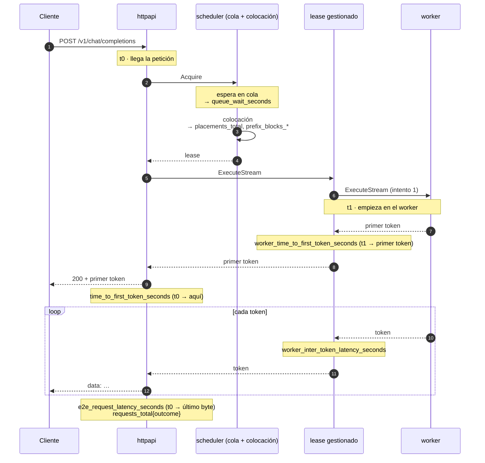
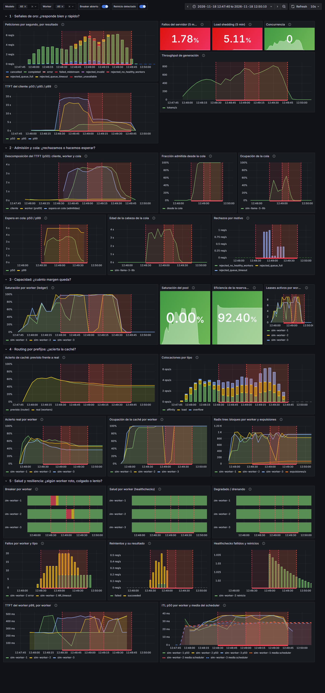

# 12. Observabilidad

Esta guía explica **qué mide la plataforma, por qué esas métricas y no otras, cómo leer los dashboards y cómo diagnosticar problemas** con ellos y con los logs. Las decisiones de diseño detrás (librería, arquitectura, alcance) están en [11 · Fase 5: decisiones](11-fase-5-decisiones.md).

> **Estado (2026-11-18): implementado.** Las métricas, los logs, el stack y el dashboard de esta guía existen y se validaron contra el stack local con `loadgen` (prefijos compartidos, un worker caído, uno colgado y un reinicio): cada consulta del dashboard se ejecutó contra Prometheus y el dashboard se revisó visualmente. Código: `internal/metrics`, `deploy/observability`. Decisiones: [11](11-fase-5-decisiones.md).

## Índice

1. [Qué preguntas responde](#qué-preguntas-responde)
2. [Arrancar el stack](#arrancar-el-stack)
3. [Dónde se mide: el recorrido de una petición](#dónde-se-mide-el-recorrido-de-una-petición)
4. [Convenciones](#convenciones)
5. [Catálogo de métricas](#catálogo-de-métricas)
6. [El dashboard, panel a panel](#el-dashboard-panel-a-panel)
7. [Ejemplo de lectura: un worker colgado](#ejemplo-de-lectura-un-worker-colgado)
8. [Guía de diagnóstico](#guía-de-diagnóstico)
9. [Logs](#logs)
10. [SLI, SLO y alertas propuestas](#sli-slo-y-alertas-propuestas)
11. [Relación con las métricas de vLLM (Fase 6)](#relación-con-las-métricas-de-vllm-fase-6)
12. [Limitaciones](#limitaciones)

---

## Qué preguntas responde

Una plataforma de inferencia tiene cinco preguntas operativas. Cada métrica del catálogo existe para responder a una de ellas; si una métrica no responde a ninguna, no se añade.

| # | Pregunta | Quién la hace | Área del catálogo |
| :--- | :--- | :--- | :--- |
| 1 | ¿Los clientes reciben respuestas correctas y rápidas? | Cualquiera, primero | Peticiones |
| 2 | Si no, ¿es porque falta capacidad? ¿Estamos rechazando o haciendo esperar? | Quien dimensiona el pool | Admisión y cola, Capacidad |
| 3 | ¿Cuánto margen queda antes de saturar? | El autoscaler (Fase 7) | Capacidad |
| 4 | ¿Está funcionando el routing por prefijos? | Quien ajusta la Fase 3 | Routing por prefijos |
| 5 | ¿Hay algún worker roto, colgado, lento o reiniciándose? | Quien opera los workers | Salud y resiliencia |

El orden importa. El dashboard está ordenado igual: se mira de arriba abajo y cada fila explica la anterior.

## Arrancar el stack

```bash
task stack:up                     # construye la imagen y arranca plataforma + Prometheus + Grafana (necesita Docker)
task loadgen -- -rate 4 -duration 2m -prefixes 24 -rag-fraction 0      # tráfico con prefijos compartidos
task loadgen -- -rate 5 -duration 100s -prefixes 24 -chaos hang        # o con un worker que se cuelga a mitad
task stack:up:fake-vllm           # variante (Fase 6a): la plataforma habla por HTTP con 3 vLLM falsos (:8001-8003)
task stack:up:vllm-cpu            # variante (Fase 6b-CPU): vLLM real en CPU (~6 min de calentamiento); :2 para dos instancias
task loadgen -- -rate 5 -duration 90s -prefixes 24 -chaos hang -chaos-worker http://localhost:8001   # caos sobre un vLLM falso
task stack:logs                   # logs JSON de la plataforma
task stack:down                   # para y borra el stack (no guarda datos)
```

Ficheros (`deploy/observability/`): `docker-compose.yml`, `prometheus/prometheus.yml` (*scrape* cada 5 s, retención 2 días), `prometheus/alerts.yml` (las [alertas de ejemplo](#sli-slo-y-alertas-propuestas)), `grafana/provisioning/` (fuente de datos y proveedor de dashboards) y `grafana/dashboards/llm-platform-overview.json` (el dashboard). La plataforma corre en el contenedor con `-prefill-per-token 100us`, para que el efecto de la caché de prefijos se vea en el TTFT.

| Servicio | URL | Para qué |
| :--- | :--- | :--- |
| Plataforma | `http://localhost:8080` | API, `/metrics`, `/debug/*` |
| Prometheus | `http://localhost:9090` | Consultas PromQL sueltas, estado del *scrape* (`/targets`) |
| Grafana | `http://localhost:3000` | Dashboard **LLM Platform · Overview**, página de inicio (acceso anónimo de solo lectura; `admin`/`admin` para editar) |
| Alertas | `http://localhost:9090/alerts` | Estado de las reglas de ejemplo (sin Alertmanager: no avisan a nadie) |

**El dashboard es código.** Grafana lo carga del JSON del repositorio y no admite guardar cambios desde la UI (`allowUiUpdates: false`). Para cambiarlo: editar en la UI como `admin`, exportar el JSON (*Share → Export*) y sustituir el fichero.

Prometheus hace *scrape* cada 5 s, así que un panel tarda entre 5 y 15 s en reflejar un cambio. Si un panel sale vacío, lo primero es comprobar en `http://localhost:9090/targets` que el *target* `platform` está `UP`.

## Dónde se mide: el recorrido de una petición



La clave es que **hay dos TTFT**, y su diferencia es información:

```text
TTFT del cliente  =  espera en cola  +  (intentos fallidos + reintento)  +  TTFT del worker  +  ~overhead de la API
```

| Si sube… | …y el TTFT del worker no sube | …y el TTFT del worker también sube |
| :--- | :--- | :--- |
| TTFT del cliente | Falta capacidad (cola) o hay reintentos: mirar la fila de admisión y la de salud. | El prefill es más caro: prompts más largos, menos aciertos de caché o un worker lento. |

## Convenciones

| Convención | Regla | Ejemplo |
| :--- | :--- | :--- |
| Prefijo | Todo lleva `llmplatform_` | `llmplatform_requests_total` |
| Unidades | Unidades base en el nombre: segundos, tokens, bloques | `_seconds`, `_tokens_total`, `_blocks` |
| Contadores | Terminan en `_total`; se leen con `rate()` o `increase()`, nunca en bruto | `rate(llmplatform_requests_total[1m])` |
| Gauges | Valor actual; se leen tal cual | `llmplatform_queue_requests` |
| Histogramas | Series `_bucket`, `_sum`, `_count`; percentiles con `histogram_quantile` | ver abajo |
| Etiquetas | Solo conjuntos acotados: `model`, `worker`, `outcome`, `reason`, `kind`, `state`, `result`, `path` | — |
| Prohibido como etiqueta | IDs de petición, prefijos, prompts, mensajes de error | — |
| Modelos desconocidos | Una petición a un modelo que nadie sirve se etiqueta `model="unknown"` | Si no, un cliente podría crear series a voluntad con nombres inventados. |

**Presupuesto de series** con M workers y N modelos: unos 10 histogramas × ~15 *buckets*, la mitad por modelo y la mitad por worker, más ~30 gauges y contadores por worker. Con 10 workers y 2 modelos son unas 1.500 series, una cantidad trivial para Prometheus.

**Percentiles a partir de histogramas:**

```promql
histogram_quantile(0.99, sum by (le) (rate(llmplatform_time_to_first_token_seconds_bucket[5m])))
```

`histogram_quantile` interpola linealmente dentro del *bucket*: un p99 de "0,9 s" solo significa "entre 0,75 y 1 s". Por eso los *buckets* están más juntos donde se esperan los valores normales.

## Catálogo de métricas

Para cada métrica: qué es, por qué está y cómo se interpreta. **Tipo:** C = contador, G = gauge, H = histograma. **Origen:** E = evento (instrumentado en el código), S = estado leído en cada *scrape* (de `Stats()`/`Snapshots()`, los mismos datos que `/debug`).

### 1. Peticiones — lo que ve el cliente

| Métrica | Tipo | Etiquetas | Qué mide | Por qué |
| :--- | :--- | :--- | :--- | :--- |
| `llmplatform_requests_total` | C·E | `model`, `outcome` | Peticiones terminadas, por resultado | La señal de tráfico y de errores en una sola métrica: cada petición acaba en exactamente un `outcome`. |
| `llmplatform_requests_in_flight` | G·E | `model` | Peticiones que se están respondiendo ahora (tras la admisión) | La concurrencia real. Con la ITL dependiente de la carga, explica por qué sube la latencia. |
| `llmplatform_time_to_first_token_seconds` | H·E | `model` | Desde que llega la petición hasta enviar el primer token | **La latencia que percibe el usuario** en un chat: lo que tarda en "empezar a escribir". |
| `llmplatform_e2e_request_latency_seconds` | H·E | `model` | Desde que llega hasta el último byte (solo `completed`) | Dominada por la longitud de la salida; sirve para capacidad, no para experiencia. |
| `llmplatform_prompt_tokens_total` | C·E | `model` | Tokens de prompt (estimados, FI-3) de las peticiones admitidas | Throughput de entrada; el prefill es proporcional. |
| `llmplatform_generation_tokens_total` | C·E | `model` | Tokens generados y enviados | **El throughput útil** de la plataforma. |
| `llmplatform_reserved_tokens_total` | C·E | `model` | Tokens reservados en el ledger por las peticiones admitidas (`prompt + max_tokens`) | Comparado con los dos anteriores, mide cuánto desperdicia la reserva pesimista (FI-1). |

**Valores de `outcome`** (cada petición termina en uno solo):

| `outcome` | HTTP | Significado | ¿Cuenta como fallo del servidor? |
| :--- | :--- | :--- | :--- |
| `completed` | 200 | Terminó con éxito | No |
| `cancelled` | — | El cliente se fue (en cola o a mitad de stream) | No |
| `rejected_invalid` | 400/404 | Petición inválida, demasiado grande o modelo desconocido | No (error del cliente) |
| `rejected_queue_full` | 503 | Cola llena: *load shedding* | No: protección de carga (ver [SLO](#sli-slo-y-alertas-propuestas)) |
| `rejected_queue_timeout` | 503 | No hubo capacidad a tiempo | No: protección de carga |
| `rejected_no_healthy_workers` | 503 | Ningún worker del modelo está sano | **Sí** |
| `worker_unavailable` | 503 | El worker falló antes del primer token, también tras el reintento | **Sí** |
| `failed_midstream` | 200 + error en banda | El worker falló después del primer token | **Sí** |
| `error` | 500 | Error inesperado | **Sí** |

### 2. Admisión y cola

| Métrica | Tipo | Etiquetas | Qué mide | Por qué |
| :--- | :--- | :--- | :--- | :--- |
| `llmplatform_admissions_total` | C·E | `model`, `path` = `immediate` \| `queued` | Leases concedidos, por camino. **Incluye el lease de cada reintento** (una petición reintentada cuenta dos) | La fracción que pasa por la cola es el primer síntoma de que el pool se acerca al límite, antes de rechazar. |
| `llmplatform_queue_wait_seconds` | H·E | `model`, `outcome` = `admitted` \| `timeout` \| `cancelled` | Tiempo en cola de quien sale de ella | Separa "espera y entra" de "espera y se rinde". |
| `llmplatform_queue_requests` | G·S | `model` | Peticiones esperando ahora | Profundidad de la cola. |
| `llmplatform_queue_tokens` | G·S | `model` | Tokens esperando ahora | El límite de la cola es por tokens (C2 de la Fase 2). |
| `llmplatform_queue_token_limit` | G·S | `model` | Límite de tokens en cola del modelo | Para dibujar la ocupación de la cola: `queue_tokens / queue_token_limit`. |
| `llmplatform_queue_head_age_seconds` | G·S | `model` | Edad de la petición en cabeza | Si se acerca a `HeadMaxAge` (2,5 s), la barrera FIFO está a punto de activarse. |
| `llmplatform_queue_barrier_wakeups_total` | C·S | — | Despertares del dispatcher frenados por la barrera FIFO | Peticiones grandes esperando mientras las pequeñas pasan: indica mezcla de tamaños bajo presión. |
| `llmplatform_model_workers` | G·S | `model` | Workers activos que sirven el modelo | Contexto: el límite de la cola y la capacidad dependen de él. |

Los rechazos no tienen métrica propia: son `llmplatform_requests_total{outcome=~"rejected_.*"}`. Así hay una sola fuente de verdad.

### 3. Capacidad

| Métrica | Tipo | Etiquetas | Qué mide | Por qué |
| :--- | :--- | :--- | :--- | :--- |
| `llmplatform_worker_token_budget` | G·S | `worker` | Presupuesto del worker (KV-Cache simulada) | El denominador de la saturación. |
| `llmplatform_worker_tokens_reserved` | G·S | `worker` | Tokens reservados ahora en su ledger | **Ratio de saturación** = `reserved / budget`. Es la ocupación del ledger pesimista, no de la GPU (FI-1). |
| `llmplatform_worker_leases_active` | G·S | `worker` | Leases activos | Concurrencia por worker; la ITL crece con ella. |

### 4. Routing por prefijos (Fase 3)

| Métrica | Tipo | Etiquetas | Qué mide | Por qué |
| :--- | :--- | :--- | :--- | :--- |
| `llmplatform_placements_total` | C·S | `kind` = `affinity` \| `overflow` \| `load` | Colocaciones: por afinidad, desbordadas por carga, o solo por carga (sin prefijo útil en ningún worker) | Cuánto se usa la afinidad y cuánto se desborda. Muchos `overflow` = prefijos calientes o pool justo. |
| `llmplatform_prefix_blocks_queried_total` | C·S | — | Bloques de prefijo de las peticiones colocadas | Denominador del acierto. |
| `llmplatform_prefix_blocks_predicted_hit_total` | C·S | — | Bloques que el router **cree** que estaban en caché del worker elegido | Acierto **previsto** = `predicted / queried`. |
| `llmplatform_worker_prefix_cache_queried_blocks_total` | C·S | `worker` | Bloques consultados en la caché del worker | Denominador del acierto real. |
| `llmplatform_worker_prefix_cache_hit_blocks_total` | C·S | `worker` | Bloques que **de verdad** estaban en caché | Acierto **real**. Su diferencia con el previsto mide lo desfasado que está el árbol (FI-6). |
| `llmplatform_worker_prefix_cache_used_blocks` | G·S | `worker` | Bloques ocupados en su caché | Si siempre está llena, hay expulsiones constantes. |
| `llmplatform_worker_prefix_cache_capacity_blocks` | G·S | `worker` | Capacidad de su caché | Para dibujar la ocupación. |
| `llmplatform_prefix_tree_nodes` | G·S | — | Nodos del radix tree | Memoria del router. |
| `llmplatform_prefix_tree_blocks` | G·S | `worker` | Bloques que el árbol atribuye a cada worker | Comparado con `used_blocks`, otra vista del desfase. |
| `llmplatform_prefix_tree_evicted_blocks_total` | C·S | — | Bloques expulsados del árbol | Presión sobre la caché estimada. |

`placements_total` y `prefix_blocks_*` no llevan `model` porque `PrefixAffinity` lleva contadores globales. Las métricas `worker_prefix_cache_*` salen del worker simulado; con vLLM vendrán de su propio `/metrics` (ver [Relación con vLLM](#relación-con-las-métricas-de-vllm-fase-6)).

### 5. Salud y resiliencia (Fase 4)

| Métrica | Tipo | Etiquetas | Qué mide | Por qué |
| :--- | :--- | :--- | :--- | :--- |
| `llmplatform_worker_time_to_first_token_seconds` | H·E | `worker` | Desde que empieza `ExecuteStream` en el worker hasta su primer token | **Prefill puro**, sin cola ni reintentos. Comparado entre workers muestra cuál va lento; comparado con el TTFT del cliente muestra cuánto pesa la cola. |
| `llmplatform_worker_inter_token_latency_seconds` | H·E | `worker` | Tiempo entre tokens consecutivos (una observación por token) | La velocidad de decode. Un worker con ITL alta es candidato a "degradado". |
| `llmplatform_worker_failures_total` | C·E | `worker`, `kind` = `error` \| `ttft_timeout` \| `stall_timeout` | Fallos atribuidos al worker | Distingue un worker que falla (`error`) de uno colgado (`*_timeout`). |
| `llmplatform_retries_total` | C·E | `model`, `result` = `succeeded` \| `failed` | Reintentos en otro worker y su resultado | Cuántos fallos se le han ocultado al cliente. Muchos reintentos con éxito = la resiliencia funciona, pero hay un worker roto. |
| `llmplatform_breaker_transitions_total` | C·E | `worker`, `to` = `open` \| `half_open` \| `closed` | Cambios de estado del breaker | Detecta aperturas y oscilaciones (*flapping*). |
| `llmplatform_health_checks_total` | C·E | `worker`, `result` = `ok` \| `failed` | Healthchecks realizados | Separa "no responde a `/health`" de "falla con tráfico". |
| `llmplatform_worker_restarts_detected_total` | C·E | `worker` | Reinicios detectados (cambio de `InstanceID`) | Un reinicio vacía la caché: explica caídas del acierto real. |
| `llmplatform_worker_healthy` | G·S | `worker` | 1 si el healthcheck lo considera sano | Estado actual. |
| `llmplatform_worker_breaker_state` | G·S | `worker`, `state` = `closed` \| `open` \| `half_open` | 1 en el estado actual, 0 en los demás | Patrón *enum* de Prometheus: alimenta el panel de línea de tiempo. |
| `llmplatform_worker_degraded` | G·S | `worker` | 1 si su ITL supera 2× la mediana de los demás | Si está a 1, solo recibe tráfico cuando los demás están llenos. |
| `llmplatform_worker_draining` | G·S | `worker` | 1 mientras se drena tras una baja | Explica por qué un worker deja de recibir peticiones. |
| `llmplatform_worker_itl_ewma_seconds` | G·S | `worker` | La ITL media que usa el scheduler para decidir "degradado" | Permite ver el criterio exacto de la decisión, no una aproximación. |

### 5b. Motor (vLLM, Fase 6a)

Solo existen para workers con un motor real (el adaptador de vLLM); con workers simulados no hay series.

| Métrica | Tipo | Etiquetas | Qué mide | Por qué |
| :--- | :--- | :--- | :--- | :--- |
| `llmplatform_worker_engine_kv_cache_usage` | G·S | `worker` | Ocupación real de la KV-Cache (0–1) según el motor | Comparada con `worker_tokens_reserved / worker_token_budget`, mide el coste de la reserva pesimista (**FI-1**). |
| `llmplatform_worker_engine_requests_running` | G·S | `worker` | Peticiones que el motor está ejecutando | Debería seguir a `worker_leases_active`. |
| `llmplatform_worker_engine_requests_waiting` | G·S | `worker` | Peticiones en la cola **propia** del motor | Con la admisión del control plane debería ser ~0; si crece, admitimos más de lo que el motor procesa. |
| `llmplatform_prompt_token_estimate_ratio` | H·E | `model` | Tokens de prompt estimados / reales (los del motor) | El error de `tokens.Estimate` contra el tokenizer real (**FI-3**): 1 = exacto. |

Con un motor real, `prompt_tokens_total` y `generation_tokens_total` llevan sus cifras exactas (FI-8), y las métricas `worker_prefix_cache_*` salen de sus contadores (en tokens, convertidos a bloques).

**Contadores que existen desde el principio.** Los contadores de eventos con etiquetas conocidas (`requests_total` por `outcome`, `worker_failures_total`, `breaker_transitions_total`, `health_checks_total`, `worker_restarts_detected_total`, `retries_total`, `admissions_total`…) se crean a 0 para cada worker y modelo en el primer *scrape*. Sin eso, una serie nacería con valor 1 en su primer evento e `increase()` no lo vería: la primera apertura del breaker de un worker no aparecería en ningún panel ni anotación. Por eso las leyendas listan combinaciones que nunca ocurrieron; los paneles de fallos filtran con `> 0`.

### 6. Proceso

| Métrica | Origen | Para qué |
| :--- | :--- | :--- |
| `llmplatform_build_info{version, go_version}` | Constante = 1 | Saber qué versión está corriendo al comparar pruebas. |
| `go_goroutines`, `go_memstats_*`, `process_cpu_seconds_total`, `process_resident_memory_bytes` | `client_golang` | Fugas de goroutines (una por stream y por healthcheck) y consumo del control plane. |

### *Buckets* de los histogramas

Alineados con los de vLLM en el rango útil, para poder comparar percentiles en la Fase 6 (comprobar con la versión de vLLM que se fije, como en FI-4):

| Histograma | *Buckets* (segundos) |
| :--- | :--- |
| TTFT (cliente y worker) | 0,01 · 0,02 · 0,04 · 0,06 · 0,08 · 0,1 · 0,25 · 0,5 · 0,75 · 1 · 2,5 · 5 · 7,5 · 10 · 20 · 40 |
| ITL (worker) | 0,005 · 0,01 · 0,025 · 0,05 · 0,075 · 0,1 · 0,15 · 0,2 · 0,3 · 0,4 · 0,5 · 0,75 · 1 · 2,5 |
| Latencia total | 0,25 · 0,5 · 1 · 2,5 · 5 · 10 · 15 · 20 · 30 · 40 · 50 · 60 · 120 |
| Espera en cola | 0,005 · 0,01 · 0,025 · 0,05 · 0,1 · 0,25 · 0,5 · 1 · 2,5 · 5 · 10 |

## El dashboard, panel a panel

**LLM Platform · Overview** tiene cinco filas, una por pregunta, y dos variables: `$model` y `$worker` (multiselección, "All" por defecto). Los rangos de `rate()` usan `$__rate_interval`, que Grafana ajusta al intervalo de *scrape*.

Las **anotaciones** (líneas verticales en todos los paneles) marcan las aperturas del breaker y los reinicios detectados, para relacionar cualquier pico con un evento de la Fase 4:

```promql
sum by (worker) (increase(llmplatform_breaker_transitions_total{to="open"}[1m])) > 0
sum by (worker) (increase(llmplatform_worker_restarts_detected_total[1m])) > 0
```

### Fila 1 · Señales de oro (pregunta 1)

| Panel | Consulta | Cómo leerlo |
| :--- | :--- | :--- |
| **Peticiones por segundo, por resultado** (barras apiladas) | `sum by (outcome) (rate(llmplatform_requests_total{model=~"$model"}[$__rate_interval]))` | La altura total es el tráfico. En una prueba sana es casi todo verde (`completed`). Ámbar = protección de carga (`rejected_queue_*`). Rojo = fallos del servidor. |
| **Tasa de fallos del servidor** (stat, %) | `sum(rate(llmplatform_requests_total{outcome=~"rejected_no_healthy_workers\|worker_unavailable\|failed_midstream\|error"}[5m])) / sum(rate(llmplatform_requests_total{outcome!~"rejected_invalid\|cancelled"}[5m]))` | Debe ser 0. Con reintentos activos, un worker caído casi no la mueve (Fase 4). Si sube, hay un fallo que la resiliencia no absorbe. |
| **Tasa de *load shedding*** (stat, %) | Igual con `outcome=~"rejected_queue_.*"` | Rechazos para proteger la latencia. No es un fallo, pero un valor sostenido significa que falta capacidad. |
| **TTFT del cliente: p50 / p95 / p99** (series) | `histogram_quantile(0.99, sum by (le) (rate(llmplatform_time_to_first_token_seconds_bucket{model=~"$model"}[$__rate_interval])))` | Lo más importante para un chat. El p50 lo marcan el TTFT base y el prefill; el p99, la cola y los reintentos. |
| **Throughput de generación** (tokens/s) | `sum(rate(llmplatform_generation_tokens_total{model=~"$model"}[$__rate_interval]))` | El trabajo útil. Si el tráfico sube y esto no, el pool está saturado. |
| **Concurrencia** | `sum(llmplatform_requests_in_flight{model=~"$model"})` | Streams abiertos. Sube con la carga y con salidas largas. |

### Fila 2 · Admisión y cola (pregunta 2)

| Panel | Consulta | Cómo leerlo |
| :--- | :--- | :--- |
| **Descomposición del TTFT (p50)**: cliente, worker y cola | Los tres `histogram_quantile(0.5, …)` de `time_to_first_token_seconds`, `worker_time_to_first_token_seconds` y `queue_wait_seconds{outcome="admitted"}` | **El panel clave para diagnosticar latencia.** Si la línea del cliente se separa de la del worker, el tiempo se va en la cola o en reintentos. Si suben juntas, el problema está en el worker (prefill). |
| **Fracción admitida desde la cola** | `sum(rate(llmplatform_admissions_total{path="queued"}[$__rate_interval])) / sum(rate(llmplatform_admissions_total[$__rate_interval]))` | Sube antes que los rechazos: es la alerta temprana de capacidad. 0 % = sobra capacidad; > 50 % = la mayoría espera. |
| **Ocupación de la cola** (%, por modelo) | `llmplatform_queue_tokens / llmplatform_queue_token_limit` | Al llegar al 100 % empiezan los `rejected_queue_full`. |
| **Espera en cola p50 / p99** | `histogram_quantile(…, sum by (le) (rate(llmplatform_queue_wait_seconds_bucket{outcome="admitted"}[$__rate_interval])))` | El p99 tiene un techo: el timeout de cola (5 s). Si se pega a él, aparecen `rejected_queue_timeout`. |
| **Edad de la cabeza de la cola** | `llmplatform_queue_head_age_seconds` | Por encima de 2,5 s se activa la barrera FIFO. |
| **Rechazos por motivo** | `sum by (outcome) (rate(llmplatform_requests_total{outcome=~"rejected_.*"}[$__rate_interval]))` | `queue_full` = picos más rápidos de lo que la cola absorbe; `queue_timeout` = carga sostenida por encima de la capacidad; `no_healthy_workers` = caída, no carga. |

### Fila 3 · Capacidad (pregunta 3)

| Panel | Consulta | Cómo leerlo |
| :--- | :--- | :--- |
| **Saturación por worker** (%, una línea por worker) | `llmplatform_worker_tokens_reserved{worker=~"$worker"} / llmplatform_worker_token_budget` | Ocupación del ledger. Workers parejos = buen reparto. Uno siempre más alto = prefijo caliente o worker preferido por afinidad. **Cuidado:** el 100 % es del ledger pesimista; la GPU real puede estar mucho más vacía (FI-1). |
| **Saturación del pool** | `sum(llmplatform_worker_tokens_reserved) / sum(llmplatform_worker_token_budget)` | La señal que usaría el autoscaler (Fase 7), corregida por la eficiencia de la reserva. |
| **Eficiencia de la reserva** | `(sum(rate(llmplatform_prompt_tokens_total[5m])) + sum(rate(llmplatform_generation_tokens_total[5m]))) / sum(rate(llmplatform_reserved_tokens_total[5m]))` | Qué fracción de lo reservado se usa de verdad. Con `max_tokens` grandes y salidas cortas puede bajar del 30 %: es el coste de FI-1, medido. |
| **Leases activos por worker** | `llmplatform_worker_leases_active{worker=~"$worker"}` | Concurrencia por worker; explica sus diferencias de ITL. |

### Fila 4 · Routing por prefijos (pregunta 4)

| Panel | Consulta | Cómo leerlo |
| :--- | :--- | :--- |
| **Acierto de caché: previsto frente a real** | Previsto: `rate(llmplatform_prefix_blocks_predicted_hit_total[5m]) / rate(llmplatform_prefix_blocks_queried_total[5m])`. Real: `sum(rate(llmplatform_worker_prefix_cache_hit_blocks_total[5m])) / sum(rate(llmplatform_worker_prefix_cache_queried_blocks_total[5m]))` | Dos líneas que deberían ir juntas (en la Fase 3 quedaron a menos de 1 punto). Si el previsto supera al real, el árbol cree que hay prefijos que la GPU ya expulsó (FI-6): reinicios, capacidad mal estimada o fallos tras la colocación. |
| **Colocaciones por tipo** (barras apiladas) | `sum by (kind) (rate(llmplatform_placements_total[$__rate_interval]))` | `affinity` alto = la afinidad funciona. `overflow` alto = prefijos calientes replicándose o workers cargados. Todo `load` = el tráfico no comparte prefijos (o no hay prompts largos). |
| **Acierto real por worker** | `rate(…hit_blocks_total{worker=~"$worker"}[5m]) / rate(…queried_blocks_total[5m])` | Un worker con acierto 0 tras un reinicio es normal: tarda unas peticiones en recalentarse. |
| **Ocupación de la caché por worker** | `llmplatform_worker_prefix_cache_used_blocks / llmplatform_worker_prefix_cache_capacity_blocks` | Siempre al 100 % y con acierto bajo = el conjunto de prefijos activos no cabe: más workers o caché más grande. |
| **Árbol: bloques por worker y expulsiones** | `llmplatform_prefix_tree_blocks`, `rate(llmplatform_prefix_tree_evicted_blocks_total[5m])` | Memoria y presión del router. |

### Fila 5 · Salud y resiliencia (pregunta 5)

| Panel | Consulta | Cómo leerlo |
| :--- | :--- | :--- |
| **Breaker por worker** (línea de tiempo) | `sum by (worker) (llmplatform_worker_breaker_state{state="half_open"}) + 2 * sum by (worker) (llmplatform_worker_breaker_state{state="open"})` → 0 / 1 / 2 | Verde = cerrado. Amarillo = semiabierto (probando). Rojo = abierto. Rojo y amarillo alternándose es *flapping*: el worker se recupera a medias. Una apertura de 10 s es una franja fina en un rango largo: acercar el zoom o seguir las anotaciones. (Hay que agregar `by (worker)` antes de sumar: las dos series difieren en `state` y PromQL no las emparejaría.) |
| **Salud por worker** (línea de tiempo) | `llmplatform_worker_healthy` | Verde = sano; rojo = no sano según los healthchecks. |
| **Degradado / drenando** (línea de tiempo) | `llmplatform_worker_degraded + 2 * llmplatform_worker_draining` | Naranja = degradado; gris = drenando tras una baja. |
| **Fallos por worker y tipo** | `sum by (worker, kind) (increase(llmplatform_worker_failures_total[1m])) > 0` | `error` = el worker responde con fallos; `ttft_timeout` = colgado sin empezar; `stall_timeout` = colgado a mitad de stream. |
| **Reintentos y su resultado** | `sum by (result) (rate(llmplatform_retries_total[$__rate_interval]))` | `succeeded` = fallos ocultados al cliente (bien, pero hay un worker roto). `failed` = ni el reintento lo salvó: aparece como `worker_unavailable` en la fila 1. |
| **TTFT del worker p99, por worker** | `histogram_quantile(0.99, sum by (le, worker) (rate(llmplatform_worker_time_to_first_token_seconds_bucket[$__rate_interval])))` | Un worker muy por encima del resto va lento (o le tocan los prompts largos: comprobar con la afinidad). |
| **ITL p50 por worker** y **media del scheduler** | `histogram_quantile(0.5, sum by (le, worker) (rate(llmplatform_worker_inter_token_latency_seconds_bucket[$__rate_interval])))` y `llmplatform_worker_itl_ewma_seconds` | Todos suben juntos con la carga (*continuous batching*: normal). Uno solo por encima del doble de los demás = degradado. |
| **Healthchecks fallidos y reinicios** | `sum by (worker) (increase(llmplatform_health_checks_total{result="failed"}[1m])) > 0` y lo mismo con `worker_restarts_detected_total[5m]` | Fallos de `/health` sin fallos de tráfico = el worker no responde, pero no le llega tráfico porque ya está aislado. Un reinicio explica una caída del acierto de caché. |

Cada panel lleva esta misma explicación en su icono ⓘ.

## Ejemplo de lectura: un worker colgado

Captura real del dashboard durante una prueba de 100 s a 5 req/s con 24 *system prompts*. `sim-worker-1` se cuelga entre las 12:48:06 y las 12:48:36 (`-chaos hang`, con el `-ttft-timeout` por defecto de 10 s) y `sim-worker-2` se reinicia a las 12:49:10. Las franjas rojas verticales son las anotaciones de apertura del breaker y de reinicio.



Leyendo de arriba abajo, como recomienda la guía:

1. **Señales de oro.** El TTFT del cliente salta de ~0,2 s a un p99 de ~20 s y aparecen barras ámbar (`rejected_queue_timeout`) y alguna roja (`worker_unavailable`). *Fallos del servidor* marca un 1,78 % y *load shedding* un 5,11 %: hay un problema real.
2. **Admisión y cola.** La descomposición del TTFT responde *dónde*: la línea del cliente (p50 ≈ 3,5 s) va pegada a la de la **espera en cola** (≈ 3,4 s), mientras el TTFT del worker sigue en ~0,14 s. No es prefill lento: las peticiones **esperan**. La cola se llena, la fracción admitida desde la cola llega al 100 % y la cabeza envejece hasta ~4 s (la barrera FIFO actúa).
3. **Capacidad.** ¿Por qué esperan con tres workers? La saturación por worker está al 100 %: cada petición que cae en el worker colgado **retiene su reserva hasta el timeout de 10 s**, y entre las que se cuelgan y las que esperan su reintento el pool se queda sin presupuesto.
4. **Salud.** *Fallos por worker y tipo* lo confirma: `ttft_timeout` en `sim-worker-1` (colgado sin empezar, no `error`). El breaker se abre (rojo), prueba (amarillo) y se cierra. Los reintentos `succeeded` explican que la mayoría de peticiones afectadas terminaran bien. A las 12:49:10, el reinicio de `sim-worker-2` aparece como fallos `error` (streams cortados), una apertura de su breaker y un *reinicio detectado*.
5. **Diagnóstico y acción.** El coste de un cuelgue lo marca `-ttft-timeout`: con 10 s, cada petición atrapada bloquea capacidad 10 s. En la misma prueba con `-ttft-timeout 2s` (Fase 4) el cliente no vio ningún error. La acción es calibrar ese timeout con el TTFT p99 real de vLLM (Fase 6), no añadir workers.

## Guía de diagnóstico

Cada fila es un síntoma: dónde mirar, cómo distinguir las causas y qué hacer.

| Síntoma | Mirar | Si ves… | Causa probable | Qué hacer |
| :--- | :--- | :--- | :--- | :--- |
| **TTFT y rechazos de cola suben de golpe con fallos `ttft_timeout`** | Filas 2, 3 y 5 | Espera en cola alta, saturación al 100 %, `ttft_timeout` en un worker | Un worker colgado retiene capacidad hasta el timeout de TTFT (ver el [ejemplo](#ejemplo-de-lectura-un-worker-colgado)) | Bajar `-ttft-timeout`; retirar el worker si sigue colgado. |
| **El TTFT p99 sube** | Fila 2 · Descomposición del TTFT | Cliente sube, worker no; espera en cola sube | Falta capacidad: las peticiones esperan | Comprobar saturación (fila 3); más workers o menos `max_tokens` (FI-1). |
| | | Cliente sube, worker no; cola plana; reintentos > 0 | Reintentos: las peticiones pagan el fallo de un worker antes de ir a otro | Fila 5: qué worker falla. Si son `ttft_timeout`, el p99 ≈ `-ttft-timeout`: valorar bajarlo. |
| | | Cliente y worker suben juntos | Prefill más caro | Fila 4: ¿cayó el acierto de caché? ¿Hay un worker degradado o reiniciado? |
| **Aparecen `503`** | Fila 1 · Peticiones por resultado | `rejected_queue_full` / `rejected_queue_timeout` | Sobrecarga: la plataforma se protege | Es el comportamiento diseñado. Si es sostenido, falta capacidad. |
| | | `rejected_no_healthy_workers` | Todos los workers de un modelo caídos o aislados | Fila 5: estado y healthchecks. Es una caída, no carga. |
| | | `worker_unavailable` | Un worker falla y no había alternativa o el reintento también falló | Fila 5: fallos por worker; ¿solo queda un worker sano? |
| **Saturación al 100 % pero poco throughput** | Fila 3 · Eficiencia de la reserva | Eficiencia < 40 % | Reserva pesimista: `max_tokens` mucho mayores que las salidas reales (FI-1) | Pedir `max_tokens` realistas a los clientes; es el argumento para resolver FI-1 en la Fase 6. |
| **Cae el acierto de caché real** | Fila 4 | El previsto también cae | Cambió el tráfico (prefijos nuevos) o hay más prefijos de los que caben | Ocupación de la caché al 100 % → más capacidad. |
| | | El previsto se mantiene y el real cae | El árbol está desfasado | ¿Reinicios detectados? ¿Fallos de workers (el árbol registra al conceder el lease)? |
| **Reparto de leases desigual** | Fila 3 · Saturación por worker, fila 4 · Colocaciones | Un worker alto y muchos `affinity` | Un prefijo caliente concentrado en él | Normal hasta `-affinity-max-load` (0,8). Si pasa de ahí sin `overflow`, revisar el umbral. |
| | | Un worker bajo y `degraded = 1` | Está degradado y solo recibe el sobrante | Fila 5: ¿su ITL es de verdad 2× la del resto? |
| **Un worker en *flapping*** | Fila 5 · Estado | Abierto y semiabierto alternándose | Las pruebas fallan una y otra vez; la espera se dobla hasta 2 min | Normal mientras siga roto: el breaker lo contiene. Si se recupera a medias (pasa la prueba y vuelve a fallar), investigar el worker. |
| **Muchos reintentos con éxito** | Fila 5 · Reintentos | `succeeded` sostenido y fila 1 en verde | Un worker roto que la resiliencia oculta | El cliente no lo nota, pero se está perdiendo capacidad y latencia: arreglar o retirar el worker (`DELETE /debug/workers/{id}`). |
| **Goroutines que no paran de crecer** | `go_goroutines` | Sube sin volver al bajar el tráfico | Fuga: streams o healthchecks que no terminan | Es lo que comprueban los tests de estrés; reproducirlo con `loadgen` y abrir un bug. |

## Logs

Logs en JSON (`log/slog`) por la salida estándar. `docker compose logs -f platform` los muestra en el stack local.

### Log por petición

Uno por petición, al terminar:

```json
{"time":"2026-11-18T10:15:02.114Z","level":"INFO","msg":"request completed","request_id":"chatcmpl-9f…","model":"sim-llama-3-8b","worker_id":"sim-worker-2","outcome":"completed","http_status":200,"prompt_tokens":1512,"max_new_tokens":256,"stream":true,"completion_tokens":187,"queue_wait_ms":0,"retries":1,"ttft_ms":118,"worker_ttft_ms":61,"duration_ms":3912}
```

| Campo | Significado |
| :--- | :--- |
| `request_id` | El `X-Request-Id` del cliente si lo envió (hasta 64 caracteres `[A-Za-z0-9._-]`); si no, uno generado. Se devuelve en la cabecera `X-Request-Id`. |
| `worker_id` | El worker que **terminó** sirviendo la petición (tras un reintento, el segundo). |
| `outcome`, `http_status` | Los mismos valores que la métrica `requests_total`. |
| `queue_wait_ms`, `retries`, `ttft_ms`, `worker_ttft_ms` | La descomposición del TTFT de esta petición concreta. |

| `msg` | Nivel |
| :--- | :--- |
| `request completed` | `INFO` |
| `request cancelled by client` | `INFO` |
| `request rejected` (`400`/`404`) | `INFO` |
| `request shed` (`rejected_queue_*`) | `WARN` |
| `request failed` (`5xx` que no son de carga, errores a mitad de stream) | `ERROR` |

### Eventos del ciclo de vida (scheduler)

| `msg` | Nivel | Campos | Cuándo |
| :--- | :--- | :--- | :--- |
| `worker added` | `INFO` | `worker_id`, `models`, `token_budget` | Alta (al arrancar o por `/debug/workers`) |
| `worker draining` / `worker removed` | `INFO` | `worker_id`, `in_flight` | Baja: empieza y termina el drenaje |
| `worker unhealthy` / `worker healthy` | `WARN` / `INFO` | `worker_id`, `consecutive_failures`, `error` | El healthcheck cambia de veredicto |
| `worker restart detected` | `WARN` | `worker_id`, `old_instance`, `new_instance` | Cambio de `InstanceID` |
| `breaker opened` | `WARN` | `worker_id`, `reason` (`failures` \| `unhealthy` \| `probe_failed`), `cooldown` | El breaker se abre |
| `breaker half-open` / `breaker closed` | `INFO` | `worker_id` | Empieza la prueba / se recupera |
| `worker hung` | `WARN` | `worker_id`, `request_id`, `kind` (`ttft_timeout` \| `stall_timeout`), `tokens_sent` | Cuelgue detectado |
| `request retried` | `WARN` | `request_id`, `failed_worker`, `error` | Reintento en otro worker |

### Cómo cruzar logs y métricas

- **De un pico a sus peticiones:** el panel dice *cuándo* y *qué* `outcome` (o qué worker); en los logs se filtra por ese intervalo y por `outcome` o `worker_id`.
- **De una petición a su historia:** con el `request_id` (que el cliente tiene en `X-Request-Id`) se encuentran su log, sus eventos `request retried` y `worker hung`, y el `worker_id` final.
- **De una anotación a su causa:** una apertura del breaker en el dashboard corresponde a un `breaker opened` con su `reason` y, antes, a los `worker hung` o `request failed` que la provocaron.

## SLI, SLO y alertas propuestas

Propuesta para fijar criterio; los objetivos son orientativos y se calibrarán con vLLM. Las reglas de abajo están en `deploy/observability/prometheus/alerts.yml`: Prometheus las evalúa y muestra su estado en `http://localhost:9090/alerts`, pero no hay Alertmanager, así que no avisan a nadie (ver [11 · Decisión 8](11-fase-5-decisiones.md#decisión-8-alcance)). En la prueba del ejemplo de arriba, `ServerErrorsHigh` y `SustainedLoadShedding` pasaron a `pending`, como debían.

| SLI | Definición | Objetivo propuesto |
| :--- | :--- | :--- |
| **Disponibilidad** | Peticiones válidas que no terminan en fallo del servidor: `1 − fallos / (total − rejected_invalid − cancelled)`. Los fallos son los `outcome` marcados como tales en el [catálogo](#1-peticiones--lo-que-ve-el-cliente). | 99,5 % |
| **Latencia de inicio** | Fracción de peticiones completadas con TTFT del cliente ≤ 2,5 s (un límite de *bucket*) | 99 % |
| **Protección de carga** | Fracción de peticiones válidas rechazadas por cola | < 1 % sostenido (si no, falta capacidad) |

**Por qué los `503` de cola no cuentan contra la disponibilidad:** son una decisión deliberada de la plataforma para no degradar a todos (Fase 2). Contarlos como fallos empujaría a colas infinitas, justo lo que el diseño evita. Se vigilan con su propio SLI.

Reglas de alerta (extracto de `alerts.yml`, validado con `promtool check rules`):

```yaml
groups:
  - name: llmplatform
    rules:
      - alert: ServerErrorsHigh                 # se gasta el presupuesto de disponibilidad
        expr: |
          (sum(rate(llmplatform_requests_total{outcome=~"rejected_no_healthy_workers|worker_unavailable|failed_midstream|error"}[5m])) or vector(0))
            / sum(rate(llmplatform_requests_total{outcome!~"rejected_invalid|cancelled"}[5m])) > 0.005
        for: 5m
      - alert: NoHealthyWorkers                 # un modelo entero caído
        expr: sum by (model) (rate(llmplatform_requests_total{outcome="rejected_no_healthy_workers"}[1m])) > 0
        for: 1m
      - alert: WorkerBreakerOpen                # un worker aislado demasiado tiempo
        expr: llmplatform_worker_breaker_state{state="open"} == 1
        for: 10m
      - alert: SustainedLoadShedding            # falta capacidad
        expr: |
          (sum(rate(llmplatform_requests_total{outcome=~"rejected_queue_.*"}[10m])) or vector(0))
            / sum(rate(llmplatform_requests_total{outcome!~"rejected_invalid|cancelled"}[10m])) > 0.01
        for: 15m
      - alert: PrefixTreeOutOfSync              # el router se equivoca sobre las cachés (FI-6)
        expr: |
          (rate(llmplatform_prefix_blocks_predicted_hit_total[15m]) / rate(llmplatform_prefix_blocks_queried_total[15m]))
          - (sum(rate(llmplatform_worker_prefix_cache_hit_blocks_total[15m])) / sum(rate(llmplatform_worker_prefix_cache_queried_blocks_total[15m])))
          > 0.15
        for: 15m
```

## Relación con las métricas de vLLM (Fase 6)

Con vLLM, Prometheus hará *scrape* también del `/metrics` de cada servidor vLLM. Las métricas del control plane y las del motor se complementan: las nuestras ven el clúster y lo que percibe el cliente; las de vLLM ven el interior de cada GPU. Los nombres de vLLM cambian entre versiones (FI-4) y hay que comprobarlos con la versión fijada.

| Plataforma (`llmplatform_…`) | vLLM (`vllm:…`) | Diferencia |
| :--- | :--- | :--- |
| `time_to_first_token_seconds` | `time_to_first_token_seconds` | El nuestro incluye nuestra cola, los reintentos y la red; el de vLLM, su cola interna y el prefill. |
| `worker_time_to_first_token_seconds` | `time_to_first_token_seconds` | Deberían parecerse; la diferencia es la red hasta la GPU. |
| `worker_inter_token_latency_seconds` | `inter_token_latency_seconds` (antes `time_per_output_token_seconds`) | Deberían coincidir salvo agrupación de tokens (FI-8). |
| `queue_wait_seconds` | `request_queue_time_seconds` | Colas distintas: si la nuestra admite bien, la de vLLM debería estar casi vacía. |
| `worker_tokens_reserved / worker_token_budget` | `kv_cache_usage_perc` | **La comparación de FI-1:** ocupación reservada frente a ocupación real de KV-Cache. |
| `worker_leases_active` | `num_requests_running` (+ `num_requests_waiting`) | `waiting` > 0 de forma sostenida significa que admitimos más de lo que vLLM procesa. |
| `worker_prefix_cache_hit_blocks_total / …queried…` | `prefix_cache_hits` / `prefix_cache_queries` (en tokens) | Acierto real de la caché; vLLM cuenta tokens, nosotros bloques de 16. |
| — | `num_preemptions` | Expulsiones por falta de memoria: con la reserva pesimista deberían ser ~0; si se relaja (FI-1), es la métrica que vigilar. |

Desde la Fase 6a, el dashboard tiene una fila **6 · Motor (vLLM)** con la comparación clave (*KV-Cache real frente a reserva del ledger*), la cola propia del motor y el error de estimación de tokens. Con el stack `task stack:up:fake-vllm`, Prometheus lee también el `/metrics` de los motores (`job="vllm"`), como hará con vLLM real: las métricas `vllm:*` se pueden consultar directamente. **Con el vLLM falso las magnitudes son inventadas** ([13](13-fase-6a-decisiones.md#lo-que-el-falso-no-puede-decir-pendiente-de-la-6b)): la fila sirve para comprobar el camino de los datos, no para sacar conclusiones.

## Limitaciones

- **Los valores son simulados.** TTFT, ITL y acierto de caché vienen de `simworker`: las formas y las relaciones entre métricas son las reales, pero las magnitudes se calibrarán con vLLM.
- **La saturación es la del ledger**, no la de la GPU (FI-1). La fila 3 muestra la eficiencia de la reserva para no olvidarlo.
- **Los percentiles son aproximados** (interpolación dentro del *bucket*). Para comparar dos configuraciones con precisión, `loadgen` sigue dando percentiles exactos del lado del cliente.
- **Resolución de 5 s.** Un pico más corto que el intervalo de *scrape* se ve atenuado en `rate()`.
- **Contadores que se reinician** al reiniciar el proceso: `rate()` e `increase()` lo gestionan, pero los totales acumulados en `/debug` empiezan de cero.
- **Una réplica** (FI-2): con varias, cada una expone sus propias métricas y hay que agregarlas con `sum`; los histogramas y los contadores se agregan bien precisamente por eso (decisión 4).
- **`/metrics` en el puerto público** (FI-10): aceptable en local, a separar antes de desplegar.
