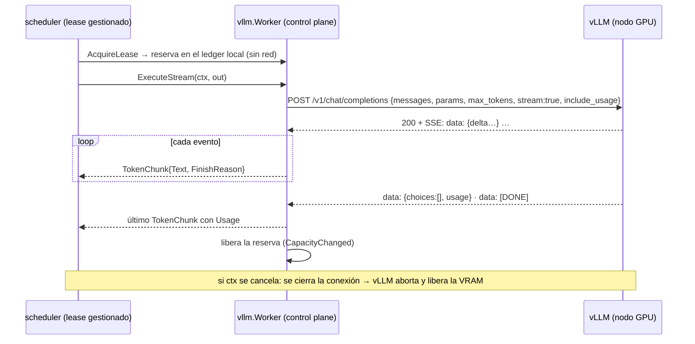

# 13. Fase 6a: adaptador vLLM sin GPU — decisiones de diseño

Este documento recoge las decisiones de diseño de la Fase 6a: el `VLLMAdapter` y los cambios de contrato que necesita, probados contra un vLLM falso, sin GPU. Como en las fases 2, 4 y 5, es el registro del *por qué*, con alternativas y la opción elegida.

> **Estado (2026-11-20):** las once decisiones y los tres conflictos están **aprobados con la opción recomendada** e **implementados**, con una corrección en la decisión 1 (`response_format` se reenvía; ver [Implementación](#implementación-2026-11-20)).

## Qué es la 6a y qué no

La Fase 6 del roadmap mezcla dos cosas de naturaleza muy distinta: **código** (el adaptador y el contrato) y **operación con coste** (GPUs, modelo real, benchmark). Se propone partirla:

| | 6a (este documento) | 6b (después) |
| :--- | :--- | :--- |
| Qué | `VLLMAdapter`, cambios de contrato (FI-7, FI-8, FI-9 pendiente), descubrimiento de workers, vLLM falso, empaquetado Docker | Clúster efímero de GPUs, modelo real, fijar versión de vLLM (FI-4), benchmark con llmperf, calibrar timeouts y FI-1 |
| Coste | Cero: todo local | Horas de GPU |
| Riesgo que elimina | Que el primer contacto con una GPU de pago sea depurar un *parser* SSE | — |
| Salida | La plataforma habla con cualquier servidor con la API de vLLM; probado contra un falso fiel | Números reales |

Al terminar la 6a, la 6b debería ser "apuntar `-vllm` a las GPUs y medir".

## Lo que hay hoy y lo que falta

| Hoy | Problema para vLLM |
| :--- | :--- |
| `chatMessage.Content` es un `string`. | Un `content` en partes (formato multimodal de OpenAI) da `400` por JSON inválido, con un mensaje poco claro. |
| Solo se leen `model`, `messages`, `max_tokens`, `max_completion_tokens`, `stream` y `stream_options`. | `temperature`, `top_p`, `stop`, `seed`… **se descartan en silencio**: el cliente cree que los ha aplicado (FI-7). |
| `InferenceRequest` solo lleva el prompt aplanado (`role: content\n`). | vLLM necesita los `messages` estructurados para aplicar la *chat template* del modelo (FI-7). |
| `usage` se calcula con los tokens de prompt **estimados** y contando chunks. | Con vLLM, un chunk puede no ser un token (FI-8) y la estimación puede errar ~2× (FI-3). |
| El ledger, el TTL del lease y `CapacityChanged()` viven dentro de `simworker`. | El adaptador necesita exactamente la misma lógica. |
| El presupuesto de cada worker es un flag (`-token-budget`). | Con vLLM depende de la GPU, del modelo y de `--gpu-memory-utilization`: hay que leerlo, no adivinarlo. |
| Los workers se crean al arrancar (y por `/debug`). | Un vLLM tarda minutos en cargar el modelo: hay que registrarlo cuando esté listo. |

## Conflictos a resolver

| # | Conflicto | Propuesta | Alternativa descartada |
| :--- | :--- | :--- | :--- |
| C1 | Reenviar los parámetros del cliente a vLLM (decisión 1) choca con los que la plataforma controla: `max_tokens` es la reserva del ledger, `stream` lo decide el handler, `n > 1` multiplicaría la salida sin reservarla. | El control plane **fija** `model`, `max_tokens`, `stream` y `stream_options`; **rechaza con `400`** lo que no sabría reservar o devolver (`n > 1`, `best_of`, `logprobs`, `tools`, `content` en partes); el resto se reenvía tal cual. | Reenviar todo: el ledger dejaría de ser verdad y el cliente recibiría respuestas sin lo que pidió. |
| C2 | El presupuesto se descubre por HTTP (decisión 5), pero `Scheduler.AddWorker` lo lee de `Snapshot()` al registrar. | **Primero descubrir, después registrar:** un *conector* por URL reintenta el descubrimiento y solo llama a `AddWorker` cuando tiene presupuesto y modelos. | Registrar con un presupuesto provisional: el scheduler calcularía límites de cola y `400` con un dato falso. |
| C3 | `max_model_len` de vLLM puede ser menor que el presupuesto de KV-Cache. Una petición que cabe en el ledger pero supera `max_model_len` haría que `AcquireLease` devolviera `ErrRequestTooLarge`, la colocación probaría otro worker y la petición acabaría esperando en la cola hasta un `503` que nunca se resolverá. | Nuevo campo `WorkerSnapshot.MaxRequestTokens`; el scheduler usa `min(presupuesto, MaxRequestTokens)` en su comprobación de `400` inmediato. | Dejar que vLLM lo rechace: llegaría como `400` en el primer intento, pero tras pasar por la cola y ocupar una reserva. |

## Resumen

| # | Decisión | Opción recomendada | Depende de |
| :--- | :--- | :--- | :--- |
| 1 | Petición en el contrato (FI-7) | Mensajes tipados + parámetros reenviados tal cual, con lista de campos controlados y rechazados | C1 |
| 2 | Tokens reales (FI-8, FI-3) | `usage` de vLLM en el último chunk; la API lo usa si existe; métrica del error de estimación | — |
| 3 | Ledger compartido | Extraer el ledger, el lease y la señal de capacidad de `simworker` a `internal/ledger` | — |
| 4 | Adaptador | `internal/vllm`: cliente HTTP por worker, parser SSE propio, cancelación cerrando la conexión | 1–3 |
| 5 | Descubrimiento | `/v1/models` (modelos, `max_model_len`) y `/metrics` (`vllm:cache_config_info` → presupuesto); conector que registra cuando todo está listo | C2, C3 |
| 6 | Errores | Tabla explícita HTTP/red → errores del contrato; el `400` de vLLM nunca es `ErrWorkerFailure` | — |
| 7 | Salud y métricas del motor | `/health` + `/metrics` en cada healthcheck: `InstanceID`, acierto real de la caché, ocupación real de KV-Cache | 5 |
| 8 | Configuración | `-vllm url1,url2,…` (mezclable con `-workers`), `-vllm-api-key` | 5 |
| 9 | Pruebas | `internal/vllm/fakevllm` (tests) y `cmd/fakevllm` (stack); prueba opcional con vLLM real en CPU | 4 |
| 10 | Empaquetado | Imagen de `fakevllm`; perfil del compose con 3 vLLM falsos detrás de la plataforma | 9 |
| 11 | Alcance | Fuera: *tool calls*, multimodal, `n > 1`, logprobs, *speculative decoding* explícito, FI-1 (6b) | — |

---

## Decisión 1: la petición en el contrato (FI-7)

**Recomendación:** `InferenceRequest` lleva los **mensajes tipados** y un mapa con los **parámetros a reenviar sin interpretar**, con dos listas cerradas: los campos que controla la plataforma y los que rechaza.

| Opción | A favor | En contra |
| :--- | :--- | :--- |
| A. Campos tipados para cada parámetro (`Temperature`, `TopP`, `Stop`…) | Validación fuerte | Cada parámetro nuevo de vLLM (decodificación guiada, `min_p`, `repetition_penalty`…) exige cambiar el contrato, la API y el adaptador. |
| B. Reenviar el cuerpo original entero (`json.RawMessage`) | Cero mantenimiento | El control plane perdería el control de `max_tokens`, `stream` y `n` (C1). |
| **C. Mensajes tipados + parámetros reenviados con listas cerradas** | El control plane controla lo que necesita para reservar y responder; lo demás llega a vLLM sin código nuevo | Un parámetro que vLLM no conozca llega a vLLM y lo rechaza él (`400`, bien clasificado por la decisión 6). |

Detalles:

```go
type Message struct {
    Role    string
    Content string // texto; content en partes → 400 (fuera de alcance)
    Name    string // opcional, OpenAI lo admite
}

type InferenceRequest struct {
    // … campos actuales (ID, Model, Prompt, PromptTokens, MaxNewTokens, PrefixHashes)
    Messages []Message                  // Fase 6a: para la chat template del motor
    Params   map[string]json.RawMessage // Fase 6a: parámetros de muestreo, reenviados tal cual
}
```

| Campos | Tratamiento | Por qué |
| :--- | :--- | :--- |
| `model`, `messages`, `max_tokens`, `max_completion_tokens`, `stream`, `stream_options` | **Controlados**: la plataforma los interpreta y los fija en la petición a vLLM | Son la reserva del ledger, la forma de la respuesta y el `usage` (decisión 2). |
| `n` (≠ 1), `best_of`, `logprobs` (`true`), `top_logprobs`, `prompt_logprobs`, `tools`, `tool_choice`, `functions`, `function_call` | **Rechazados con `400`** y un mensaje claro | `n > 1` multiplica la salida sin reservarla; el resto produce salida que `TokenChunk` no transporta, así que el cliente no recibiría lo que pidió. Los rechazados se listan en un único sitio para revisarlos al ampliar el alcance. |
| Todo lo demás (`temperature`, `top_p`, `stop`, `seed`, `presence_penalty`, `frequency_penalty`, extras de vLLM como `top_k` o `min_p`…) | **Reenviados** sin interpretar | Afectan a qué se genera, no a cuánto ni a cómo se devuelve. |

`Prompt` (el texto aplanado) se mantiene: lo usan la estimación de tokens y los hashes de prefijo, y el simulador. `simworker` ignora `Messages` y `Params` (sus salidas son falsas de todas formas).

## Decisión 2: tokens reales (FI-8 y FI-3)

**Recomendación:** el adaptador pide a vLLM el `usage` al final del stream (`stream_options: {"include_usage": true}`) y lo devuelve en el **último `TokenChunk`**. La API lo usa si existe y, si no (simulador), calcula como hoy.

```go
type Usage struct{ PromptTokens, CompletionTokens int }

type TokenChunk struct {
    Index        int    // índice del chunk (ya no se asume que sea un token: FI-8)
    Text         string
    FinishReason FinishReason
    Usage        *Usage // solo en el último chunk, si el worker lo conoce
}
```

| Uso del `usage` real | Efecto |
| :--- | :--- |
| `usage` de la respuesta al cliente | Cifras exactas en lugar de estimación + conteo de chunks. |
| `llmplatform_generation_tokens_total`, `prompt_tokens_total` | Tokens reales en el dashboard y en el benchmark. |
| **Nueva métrica** `llmplatform_prompt_token_estimate_ratio` (histograma de estimados / reales) | Mide el error de `tokens.Estimate` con el tokenizer real. Es el dato que FI-3 necesita para decidir si hace falta un tokenizer. |

La reserva (`TokenCost`) sigue usando la estimación: el `usage` real llega al final, cuando la reserva ya está hecha (FI-1 y FI-3 se revisan en la 6b con estas cifras).

## Decisión 3: ledger compartido

**Recomendación:** extraer de `simworker` a un paquete nuevo, `internal/ledger`, lo que no es simulación: el presupuesto con su mutex, `AcquireLease`/`Release` atómicos, el TTL del lease, la máquina de estados (adquirido → ejecutando → liberado) y `CapacityChanged()`. `simworker` y el adaptador lo usan igual; cada uno solo implementa "ejecutar el stream".

| Opción | A favor | En contra |
| :--- | :--- | :--- |
| Copiar la lógica en el adaptador | Rápido | Dos copias de la parte más delicada (concurrencia, liberar exactamente una vez, TTL), que ya tiene sus tests y su historia de carreras corregidas. |
| **Extraer `internal/ledger`** | Una sola implementación probada; los tests de contrato del lease se ejecutan una vez | Un refactor de `simworker` antes de empezar. |

Los tests de contrato del lease (`internal/simworker`) pasan a `internal/ledger` y se añade una batería común que se ejecuta contra ambas implementaciones de `Worker`.

## Decisión 4: el adaptador

**Recomendación:** paquete `internal/vllm` que implementa `inference.Worker` sobre `internal/ledger`.



| Aspecto | Propuesta | Por qué |
| :--- | :--- | :--- |
| Cliente HTTP | Uno por worker, con `Transport` propio: timeout de conexión 2 s, sin timeout global (los streams duran minutos), *keep-alive*, `MaxIdleConnsPerHost` alto | Los cuelgues ya los detecta el scheduler (Fase 4); un timeout global cortaría streams largos. |
| Parser SSE | Propio (`bufio` con buffer de 1 MB): líneas `data:`, comentarios `:` de *keep-alive*, `[DONE]` y eventos `{"error": …}` | El formato es pequeño y estable; una dependencia no compensa. Se prueba con casos límite (líneas partidas, chunks vacíos, `usage` sin `choices`). |
| Chunks | `delta.content` → `Text`; los deltas sin contenido (el primero con `role`, los vacíos) no generan `TokenChunk`; `finish_reason` `stop`/`length`/otros → `FinishReason` | El cliente no debe recibir chunks vacíos que cuenten como tokens. |
| Cancelación | El `ctx` de `ExecuteStream` va en la petición HTTP: cancelar cierra la conexión | vLLM aborta las peticiones cuya conexión se cierra y libera sus bloques; es el camino `ctx.Done()` de la Fase 1, ahora con VRAM real. |
| Cabeceras | `Authorization: Bearer` si hay `-vllm-api-key`; `X-Request-Id` con el ID de la petición | Correlación de logs entre plataforma y vLLM. |

## Decisión 5: descubrimiento y registro

**Recomendación:** un **conector** por URL (goroutine) que, hasta lograrlo, reintenta con *backoff* (1 s → 30 s):

1. `GET /v1/models` → modelos servidos (`id`) y `max_model_len`.
2. `GET /metrics` → `vllm:cache_config_info`, cuyas etiquetas incluyen `num_gpu_blocks` y `block_size`. Presupuesto = `num_gpu_blocks × block_size` tokens: toda la KV-Cache de la GPU.
3. `Scheduler.AddWorker(w)` con ese presupuesto, sus modelos y `MaxRequestTokens = max_model_len` (C3).

| Opción para el presupuesto | A favor | En contra |
| :--- | :--- | :--- |
| Flag `-token-budget` por worker | Simple | Hay que leer los logs de cada vLLM y copiar un número que cambia con la GPU, el modelo y `--gpu-memory-utilization`. |
| **Leerlo de `/metrics`** (con el flag como respaldo si la métrica no existe) | Correcto por construcción, sin configuración | Depende del nombre de la métrica en la versión de vLLM (FI-4): se fija en un solo sitio del adaptador y se verifica con el vLLM falso y en la 6b. |

Un vLLM que aún está cargando el modelo no responde: el conector espera sin bloquear el arranque. El log `worker added` (Fase 5) indica cuándo entra cada uno. Si al redescubrir (tras un reinicio) cambian el presupuesto o los modelos, el worker se da de baja y se vuelve a dar de alta.

## Decisión 6: traducción de errores

**Recomendación:** una tabla explícita en el adaptador. La regla: **solo lo que es culpa del worker es `ErrWorkerFailure`** (Fase 4, decisión 5).

| Lo que pasa | Error del contrato | Efecto en la plataforma |
| :--- | :--- | :--- |
| Conexión rechazada, reiniciada, DNS, timeout de conexión | `ErrWorkerFailure` | Cuenta para el breaker; reintento antes del primer token. |
| HTTP `5xx` | `ErrWorkerFailure` | Igual. |
| HTTP `400` cuyo mensaje indica longitud de contexto (`maximum context length`) | `ErrRequestTooLarge` | `400 context_length_exceeded` al cliente; no toca el breaker (cierra lo pendiente de FI-9). |
| Otro `400` / `422` (parámetro inválido) | `ErrInvalidRequest` | `400` al cliente con el mensaje de vLLM. |
| HTTP `404` (modelo no servido) | `ErrWorkerFailure` | El worker no sirve lo que anunció: configuración rota; el breaker lo aísla y se reintenta en otro. |
| HTTP `401` / `403` | `ErrWorkerFailure` | API key mal configurada: es un fallo del worker, no del cliente. |
| Stream cortado sin `[DONE]` | `ErrWorkerFailure` | Si ya hubo tokens, error en banda (sin reintento). |
| Evento `data: {"error": …}` a mitad de stream | `ErrWorkerFailure` | Ídem. |

El texto de `maximum context length` es una heurística sobre el mensaje de vLLM; se centraliza en una función con tests y se verifica en la 6b. Con C3, además, casi ninguna petición demasiado larga debería llegar a vLLM.

## Decisión 7: salud y métricas del motor

**Recomendación:** `Health(ctx)` hace `GET /health` (sano si `200`) y, en la misma consulta, lee `/metrics` para tres cosas que hoy solo da el simulador:

| Dato | Métrica de vLLM | Para qué |
| :--- | :--- | :--- |
| `InstanceID` (reinicios, Fase 4) | `process_start_time_seconds`; si no existe, detectar el **reinicio de un contador** (`vllm:request_success_total` que baja) | Olvidar los prefijos del worker al reiniciarse. `process_start_time_seconds` puede faltar si vLLM exporta métricas en modo multiproceso: por eso el respaldo. |
| Acierto real de la caché de prefijos (Fase 3) | `vllm:prefix_cache_queries`, `vllm:prefix_cache_hits` (en tokens) | Rellenar `PrefixBlocksQueried/Hit` del `Snapshot` (tokens ÷ `block_size`): la fila 4 del dashboard sigue funcionando con datos reales. |
| Ocupación real de la KV-Cache | `vllm:kv_cache_usage_perc` | Nuevo `WorkerSnapshot.EngineKVUsage`, y en el dashboard una fila "Motor" que la compara con la saturación del ledger: **la comparación de FI-1**. |

| Opción | A favor | En contra |
| :--- | :--- | :--- |
| Solo `/health` | Mínimo | Sin detección de reinicios ni datos del motor. |
| **`/health` + `/metrics` en cada healthcheck (cada 2 s)** | Un único sondeo periódico, fuera del camino crítico (regla de la Fase 2: estado agregado, nunca eventos por bloque) | `/metrics` de vLLM pesa decenas de KB: ~0,5 consultas/s por worker, asumible. |
| Que Prometheus lea vLLM y el router no | Sin código | El router no podría reaccionar (reinicios) ni el `Snapshot` reflejar la realidad. Prometheus **también** leerá vLLM directamente en la 6b, para el dashboard. |

Los nombres de las métricas de vLLM se declaran en un único sitio y se verifican contra la versión fijada en la 6b (FI-4).

## Decisión 8: configuración

**Recomendación:**

| Flag | Por defecto | Efecto |
| :--- | :--- | :--- |
| `-vllm` | vacío | URLs de servidores vLLM separadas por comas. Cada una tiene un conector (decisión 5). |
| `-vllm-api-key` | `$VLLM_API_KEY` | `Authorization: Bearer` hacia vLLM. |
| `-vllm-token-budget` | `0` (descubrir) | Respaldo si `vllm:cache_config_info` no existe. |
| `-workers` | `3` | Workers simulados, como hoy. **Se pueden mezclar** con `-vllm` (`-workers 0` para solo vLLM). |

El ID de cada worker vLLM es `vllm-<host:puerto>`. Mezclar simulados y reales en un pool sirve en la 6b para comparar, pero el benchmark se hará con un pool homogéneo.

## Decisión 9: cómo se prueba

**Recomendación:** un vLLM falso escrito en Go, en dos formas:

- **`internal/vllm/fakevllm`**: un `httptest.Server` que implementa `/v1/chat/completions` (SSE con el formato de vLLM, `usage`, `finish_reason`), `/v1/models` (con `max_model_len`), `/health` y `/metrics` (`cache_config_info`, `kv_cache_usage_perc`, `prefix_cache_*`, `process_start_time_seconds`). Tiene fallos configurables: `5xx`, `400` por longitud, cortar el stream, colgarse, eventos de error, reinicio (cambia `process_start_time_seconds` y pone los contadores a cero) y carga lenta del modelo.
- **`cmd/fakevllm`**: el mismo servidor como binario, para el stack local y para probar el camino de red completo.

| Nivel | Valida |
| :--- | :--- |
| Unidad | Parser SSE (casos límite), tabla de errores, validación de parámetros, descubrimiento, cálculo del presupuesto. |
| Contrato | La batería de tests del lease (decisión 3) contra el adaptador + `fakevllm`. |
| Integración | Scheduler + API + adaptador + `fakevllm`: cancelación cierra la conexión (el falso lo comprueba), reintento antes del primer token, `400` de longitud sin tocar el breaker, reinicio detectado, `usage` real en la respuesta. |
| Estrés | El test de estrés con caos de la Fase 4, también con workers vLLM falsos. |
| Opcional, manual | Una prueba de humo contra **vLLM real en CPU** con un modelo diminuto: valida el formato real (SSE, errores, métricas) antes de pagar GPU. Es lenta y pesada (la imagen de vLLM para CPU ocupa varios GB), así que no entra en `task check`. Se decide al empezar la 6b. |

**El riesgo de un falso:** que imite lo que creemos que hace vLLM, no lo que hace. Se mitiga escribiéndolo a partir de ejemplos reales de respuestas de vLLM, documentando de qué versión salen, y con la prueba de humo opcional.

## Decisión 10: empaquetado

**Recomendación:** completar el punto del roadmap "Empaquetado en Docker de los componentes de Go":

- Imagen de `cmd/fakevllm` (misma receta que la de la plataforma).
- Un perfil `fake-vllm` en `deploy/observability/docker-compose.yml`: tres contenedores `fakevllm` y la plataforma arrancada con `-workers 0 -vllm http://fakevllm-1:8000,…`. Prometheus lee también el `/metrics` de los falsos, como hará con vLLM en la 6b.
- `task stack:up` sigue como hoy (simulador); `task stack:up:fake-vllm` arranca la variante.

## Decisión 11: alcance

| Tema | Propuesta | Por qué |
| :--- | :--- | :--- |
| *Tool calls* | Fuera (`400` explícito) | `TokenChunk` solo transporta texto. (`response_format` sí se reenvía: la decodificación guiada produce texto normal.) |
| Multimodal (`content` en partes) | Fuera (`400` explícito, mensaje claro) | Ídem; además cambia la estimación de tokens. |
| `n > 1`, `best_of`, logprobs | Fuera (`400`) | C1. |
| FI-1 (reserva pesimista) | 6b | Se necesita la ocupación real (decisión 7) bajo carga real para decidir. |
| Fijar versión de vLLM (FI-4) | 6b | Depende del modelo y de la GPU. |
| Tokenizer real (FI-3) | 6b | Con la métrica de la decisión 2 se sabrá si hace falta. |
| `/v1/completions` (no chat) | Fuera | La API de la plataforma solo expone chat. |

## Plan de implementación (seguido)

1. **Ledger compartido:** extraer `internal/ledger` y migrar `simworker` sin cambiar su comportamiento (los tests actuales deben pasar sin tocarlos, salvo los movidos).
2. **Contrato y API:** `Messages`, `Params` y validación (decisión 1, C1); `Usage` en `TokenChunk` y su uso en la API y en las métricas (decisión 2); `MaxRequestTokens` (C3).
3. **vLLM falso:** `internal/vllm/fakevllm` a partir de respuestas reales documentadas.
4. **Adaptador:** cliente, parser SSE, errores, descubrimiento y conector, salud con `/metrics`; tests de unidad, contrato e integración.
5. **Binario y stack:** flags, `cmd/fakevllm`, imagen, perfil del compose, fila "Motor" del dashboard; validación con `loadgen` (incluido `-chaos` sobre un falso).
6. **Documentación:** documentos 1–7, 12, README (roadmap 6a/6b, FI-3, FI-7, FI-8, FI-9).

## Lo que la 6b necesitará decidir

Para no perderlo: proveedor de GPU (AWS, RunPod u otro) y presupuesto; modelo (el roadmap dice Llama-3-8B; uno más pequeño reduce coste); versión de vLLM (FI-4); diseño del benchmark (llmperf, mezcla de tráfico, prefijos compartidos o no); y si se hace antes la prueba de humo en CPU.

---

## Implementación (2026-11-20)

| Decisión | Dónde | Cómo quedó |
| :--- | :--- | :--- |
| 1. Petición completa | `inference` (`Message`, `InferenceRequest.Messages`/`Params`), `httpapi/params.go` | Listas de campos controlados y rechazados en un solo fichero. `content` en partes o nulo → `400` con mensaje claro. Los `null` equivalen a ausentes (`"tools": null` se acepta). |
| 2. Tokens reales | `inference.Usage`, `TokenChunk.Usage`, `httpapi`, `metrics` | La API usa el `usage` del motor si llega (respuesta, log y métricas) y si no, como antes. Nueva métrica `llmplatform_prompt_token_estimate_ratio`. |
| 3. Ledger compartido | `internal/ledger`, `internal/workertest` | `simworker` reescrito sobre el ledger **sin tocar sus tests**, que siguen pasando. Batería de contrato común (`workertest.Run`) ejecutada contra el simulador y contra el adaptador; `workertest.Stub` para tests que necesitan un worker con `usage` o `max_model_len`. |
| 4. Adaptador | `internal/vllm/worker.go` | Cliente HTTP por worker, parser SSE propio, cancelación cerrando la conexión. |
| 5. Descubrimiento | `internal/vllm/discover.go`, `connector.go` | `Discover` (`/v1/models` + `vllm:cache_config_info`); `Connector` con *backoff* 1 s → 30 s y redescubrimiento cada 30 s. `WorkerSnapshot.MaxRequestTokens`, que el scheduler usa para el `400` inmediato (C3). |
| 6. Errores | `internal/vllm/errors.go` | La tabla de la decisión, con el cuerpo de error de vLLM en sus dos formas. |
| 7. Salud y motor | `discover.go` (`Health`, `updateEngine`), `inference.EngineStats` | `/health` + `/metrics` en cada healthcheck; `InstanceID` por `process_start_time_seconds` o por un contador que baja; acierto de caché y ocupación real en el `Snapshot`. Métricas `llmplatform_worker_engine_*` y fila 6 del dashboard. |
| 8. Configuración | `cmd/platform` | `-vllm`, `-vllm-api-key` (`$VLLM_API_KEY`), `-vllm-token-budget`. |
| 9. Pruebas | `internal/vllm/fakevllm`, `cmd/fakevllm`, tests de `internal/vllm` | Ver [07](07-concurrencia-y-tests.md). La prueba con vLLM real en CPU queda para el arranque de la 6b. |
| 10. Empaquetado | `platform/Dockerfile` (`ARG CMD`), `docker-compose.fake-vllm.yml`, `prometheus-fake-vllm.yml` | Una imagen por comando; `task stack:up:fake-vllm` levanta la plataforma con `-workers 0 -vllm …` y tres vLLM falsos en `:8001–8003`, que Prometheus también lee (`job="vllm"`). |
| 11. Alcance | — | Como se decidió, con la corrección de `response_format`. |

### Decisiones de implementación tomadas por el camino

| Tema | Elegido | Por qué |
| :--- | :--- | :--- |
| **`response_format` (corrige la decisión 1)** | Se **reenvía**, no se rechaza | El documento lo rechazaba por "producir salida que `TokenChunk` no transporta", y eso es falso: la decodificación guiada de vLLM produce texto normal en `delta.content`. Rechazarlo habría quitado una función útil sin motivo. |
| Fin del stream | Los chunks de texto se envían en cuanto llegan; al final, un chunk **sin texto** con `finish_reason` y `usage` | Retener cada chunk para pegarle el `finish_reason` retrasaría todos los tokens, también el primero (TTFT). Los servidores OpenAI también terminan así. |
| Deltas vacíos | No generan `TokenChunk` | El primer delta de vLLM (solo `role`) y los vacíos no deben contar como tokens ni como "primer token". |
| Parser de `/metrics` | Propio (`promtext.go`, con tests) | `prometheus/common/expfmt` ya es dependencia indirecta, pero su API de *parsing* cambia entre versiones por la validación de nombres. |
| Nombres de métricas de vLLM | Listas en un solo sitio, de la actual a las antiguas (con y sin `_total`) | FI-4: cambian entre versiones. |
| Caché de prefijos de vLLM en el `Snapshot` | Contadores en tokens ÷ `block_size` → bloques; ocupación = `kv_cache_usage × num_gpu_blocks` | La fila 4 del dashboard sigue funcionando sin cambios con datos del motor. |
| ID del worker | `vllm-<host:puerto>`, tomado de la configuración | Disponible incluso antes de crear el ledger (lo usan los errores). |
| Imágenes del compose | Sin nombre fijo para los vLLM falsos | Tres servicios construyendo la misma etiqueta a la vez chocaban al exportarla; la caché de capas hace que cueste lo mismo. |
| `loadgen -chaos` sobre un vLLM falso | Si `-chaos-worker` es una URL, usa su `/fake/faults` | Mismo flujo de caos para el simulador y para el camino HTTP. |

### Validación

- Tests: batería de contrato contra el adaptador (red real a un `httptest.Server`), unidad (parser SSE, errores, cuerpo de la petición, `/metrics`), integración (parámetros reenviados, `usage`, errores, cancelación que **aborta en el motor**, reinicios con y sin `process_start_time_seconds`, conector que espera a que cargue el modelo, extremo a extremo con reintento) y **estrés con caos sobre la red**: 400 peticiones contra 3 vLLM falsos que fallan, se cuelgan, cortan el stream, emiten errores, se reinician y dejan de estar sanos, sin fugas ni sobrecargas del ledger. `-race -count=5` en Go 1.23.
- Stack `task stack:up:fake-vllm`: los tres falsos se registraron solos al terminar de "cargar" (~15 s), con presupuesto descubierto (1024 × 16 = 16 384 tokens) y `max_model_len` 8192; Prometheus lee el `/metrics` de la plataforma y el de los motores; `loadgen` con 24 prompts compartidos y un falso colgado 30 s; cada consulta del dashboard, incluida la fila 6, devolvió datos.

### Lo que el falso no puede decir (pendiente de la 6b)

- **Los formatos son supuestos.** El SSE, los cuerpos de error, `/v1/models` y los nombres de métricas se escribieron a partir del comportamiento documentado de vLLM, no de capturas de una versión concreta. Lo primero de la 6b es fijar la versión y contrastarlos (o hacer la prueba de humo en CPU).
- **Las magnitudes del motor son inventadas.** En el falso, la ocupación de KV-Cache es `peticiones × 256 tokens`, su tokenizer es `3 + caracteres / 4` por mensaje y su caché de prefijos solo mira el primer mensaje. El stack mostró el ledger al 99,5 % frente a una KV-Cache "real" del 14 % y una estimación de tokens al 95 %: **el camino de los datos funciona, los números no significan nada** hasta medir vLLM.
- **La detección de longitud excesiva** se basa en el texto del mensaje de vLLM (`maximum context length`…); con C3 casi ninguna petición demasiado larga debería llegar al motor.
